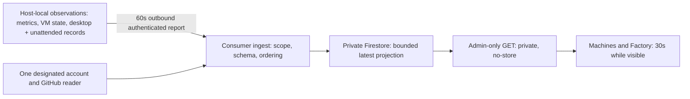

# Read-only infrastructure reporting — initial design

The approved outcome is an internal infrastructure dashboard, first for the company's two
projects, with stable machine identities and explicit many-to-many project associations.
This first bounded assignment establishes claims, verifies observation sources/access and
prepares implementation design. It does not authorize broad implementation before the
supervising controller obtains independent design critique. No implementation or deployment
has occurred. Private fleet facts and provider identities remain in the task checkout's ignored
`local/handoffs/2026-11-06-infrastructure-design.md`, not this public repository.

## Mandate and boundaries

The operator authorized reusable Morpheus reporting and the company-owned internal dashboard,
deployment and reversible iteration. Ordinary existing CI/cloud capacity and small reporting
costs only; no new paid service, native/paid model fallback, destructive action or access
widening. The native root remains controller-only. Preserve claims, independent review,
protected branches and passing CI; no TestFlight action or unrelated delivery intervention.
This worker may not delegate recursively. The controller owns supervision and fresh critique.

Claimed in the supplied isolated checkout using `morpheus pm claim`; no additional worktree.
The remote claim and its normal merged-item reconciliation are already pushed. The roadmap
remains in progress; this design is not task acceptance and no review record claims clearance.

## Proposed flow



Local operational configuration continues to own placement and capacity. The reporting store
owns no job control and is not a scheduler. Telemetry errors cannot block a worker, CI job,
lease or release. No inbound host ports, logs, transcripts, prompts or secret values.

## Reusable file ownership and dependencies

- `plugins/factory/src/fleet-observation.mjs` and `plugins/factory/tests/fleet-observation.test.mjs`:
  new pure record projection; read `runs/*/{run,process}.json`, top-level `task-*.json`, and
  `unattended/*/{admission,process,result}.json`. Do not call Manager inspection/status or
  unattended workerResult. Allowlisted fields only; liveness checks must not repair or signal.
  Configure every additional unattended state root explicitly, deduplicate canonical roots.
- `plugins/factory/src/config.mjs` plus focused config tests: reuse accountUsage semantics,
  expose the selected gateway-instance/account ID and reset bounds without breaking existing
  routing. Existing first-account-per-provider selection is acceptable only after explicit
  enrollment proves the exact account/group mapping. No generic multi-account scheduler.
- `plugins/factory/src/host/reporting/`: reporter, payload schema, fixed source adapters and
  explicit install/rollback scripts and short README. Own lockfile/package boundary; do not
  pull host-reporting dependencies into ordinary Morpheus installs. Share the plugin's fleet
  projection through one resolved module path, not copied code. Installer must prove that path
  resolves in the actual installed package. Installed reporter is reviewed immutable code,
  not a moving task checkout.
- Existing `host/worker/host_config.py`: preserve its owner/mode/outside-Git validation.
  Reporting registration is a private sidecar using stable IDs, project refs, source paths and
  credential references; do not migrate existing host placement configuration to Firestore.
- Consumer repo: owns ingestion, registration, storage, API/page auth, UI, navigation,
  deployment, visual evidence and real-host operating records. Its implementation can start
  against reviewed synthetic payload fixtures while reusable source work is completed.
- Host-setup repo: no implementation needed yet. Existing dispatcher config/state are read-only
  inputs. A null slot can mean idle OR starting; render that limitation honestly. Do not change
  admission/dispatcher behavior to make a dashboard easier. Any later additive observation
  export would get its own claim in the already supplied isolated checkout and tests.

## Observation semantics

Stable operator-assigned opaque host IDs survive hostname changes; no hardware serial or MAC
address is needed. Explicit project and source associations are registration, never accepted
from report bodies. A configured route is not an active worker. A worker task has a stable
host/channel/task identity and an invocation ID; a resumed invocation changes only the latter.
Project associations come from the task workspace map and an explicit registration mapping,
not inferred directory basenames. Multi-repository tasks remain one worker.

Keep one `infraWorkers` document per enrolled host/runtime channel, holding a bounded active
instance array (not a document per historical run). `infraHosts` holds machine registration and
per-source latest observations. `infraAccounts` holds each real gateway account once; workers
reference account IDs. Zero active instances requires a complete, successful census; unreadable,
truncated or mismatched process evidence produces unknown/partial, never idle. A latest terminal
result may be linked without copying its free-form summary. Restart/recovery records are evidence,
never an instruction to repair the worker.

Every source has `sampledAt` (attempt time), `sourceObservedAt` (data time, nullable),
`serverReceivedAt` (server-generated), status and nullable value. Quota retains provider/gateway
timestamps; dispatcher state retains its own updatedAt. Successful host-liveness measurement has
the current observation time. A failed source does not freshen older data. UI freshness is
computed at read time, stale after 180 seconds; stale/failed data is not healthy or zero.

Ingest compares per-source sampledAt transactionally, not quota's possibly repeated or old
sourceObservedAt. Reject duplicates/older attempts without changing serverReceivedAt; reject
implausible future samples, malformed dates and oversized values. A reporter restart uses the
same stable identity and fresh samples, with no new distributed epoch/session ledger. An actual
backward clock jump remains a visible source-clock error until time catches up.

## Build versus borrow

Propose `systeminformation` 5.33.19 for host CPU/memory/filesystem measurements: npm metadata
checked 2026-11-06, modified 2026-10-30, 875,133 unpacked bytes, no runtime dependencies reported.
Node os/statfs already provide CPU totals, memory total/free, uptime and available disk and were
probed successfully. However, macOS active/reclaimable memory and comparable CPU sampling would
otherwise need platform parsing that the maintained library supplies. Use only needed calls;
no process inventory, network probes or serial-number collection. Existing VM/Factory/GitHub
adapters remain small domain projections with native filesystem/fetch/child-process primitives.
Prometheus/Netdata/OTel were considered in the supplied baseline; their extra services/storage
do not remove the custom adapters this bounded outcome needs. Promote the final choice into
decisions.md after critique settles it; no package dependency was added in this design stage.

Memory field definitions: [systeminformation memory reference](https://systeminformation.io/memory.html).

## Validation performed and limits

Required context records were read in credited small ranges and context receipts succeeded.
Complexity installation check passed its canary. Exact-worktree graph installation was attempted;
Morpheus's index was created but the automatic claim commit advanced HEAD before final check.
Darwin's exact-checkout installation completed successfully. The current MCP transport closed;
used the installed graph CLI rather than repeatedly retrying the transport.

Tier 2, Morpheus main graph generation 2026-11-06T22:46:39Z: search with two complete pages
(49 results); readGatewayQuota inbound/outbound trace; accountUsage exact snippet. Coverage on
config/store/service/gateway-worker/processes/host_config reported metadata_match with no recorded
issues. The task checkout's exact relevant source was also read because it is the implementation
target. This is best-effort coverage, not proof of completeness. Darwin exact-checkout generation
2026-11-06T23:17:13Z: auth/admin/API/proxy/build-checker paths metadata_match; firestore.rules
not_tracked was read directly. Host-setup's expected primary graph was absent: read exact
dispatcher source directly. No exhaustive architecture or absence claims are made from that graph.

The key hazards were confirmed in exact source: Manager.status can stop orphans and rewrite
run/process records; workerResult can rewrite result.json; readGatewayQuota selects the first
account of each provider and drops identity/reset detail; accountUsage can return a percentage
from an old provider snapshot. Pure observation must not reuse these mutating status entrypoints.

Read-only probes verified real active desktop process identities, unattended record enumeration,
gateway account IDs/usage, all three host inventories, existing deployment/Firestore/IAM and
bounded GitHub job reads. Detailed results and access gaps are in the private design artifact.
These are investigation probes, not implementation tests. No application suites, CI, UI builds,
complexity measurement of changed functions or deployment validation are claimed.

Dependency installation: `pnpm install --frozen-lockfile --ignore-scripts` in the task plugin
checkout succeeded, reusing 296 cached packages; no tracked dependency files changed.
After writing the design records, `morpheus pm validate` passed (455 roadmap items) and
`git diff --check` passed. Only roadmap/worklog records are staged; no source function changed.

## Next bounded brief

Controller: obtain a fresh independent critique of authentication scoping, document bounds,
source freshness/order/restart behavior, account identity and packaging. Then implement the
reusable projection/reporter and consumer API/UI with exclusive file ownership above. Before
any rollout, run meaningful focused suites for auth denial, host/account scope, order/replay,
limits, failed sources, stale timestamps, worker idle/running/exit and restart. Verify installed
package imports and launchd rollback. Follow each repo's typecheck/build/compile/index and
complexity requirements, capture final UI states, finish independent source review and green
protected CI, then deploy/read back and observe real host/worker transitions and source failure.
No release acceptance is reduced by finishing this first design turn.

## Implementation handoff — 2026-11-06

The controller accepted the design and authorized implementation through unreviewed draft PRs,
then supplied four original-acceptance gaps before source review. The optional host package now
owns reporting/: strict v1 wire schema, filesystem-only desktop/unattended census, passive exact
gateway-account reader, bounded GitHub reader, hardware/VM/persistent-runner adapters, one-shot
HTTPS reporter and explicit unloaded-only installer/rollback. It does not change operational
admission/quota policy, install a service, enroll a host, deploy, or start a model invocation.
The ordinary CLI and plugin runtime dependencies remain unchanged.

Design critique dispositions (implementation assertions, not independent source clearance):

- D1: read records directly; no Manager/status/reconcile imports or cleanup calls. Filesystem
  immutability tests cover desktop and unattended; cleanup-unverified stays unresolved.
- D2: per-host consumer credential binding plus protected source/document/project/account writer
  registration; reporters receive no Firestore credentials. Consumer HTTP tests cover spoofing.
- D3: launchd serializes one-shot sends; consumer transactions compare collection time,
  retain upstream time, ignore equal/older attempts without freshening, cap future skew and recover
  on a fresh restart sample without an epoch ledger.
- D4: consumer page and API independently require admin; GET checks session revocation and returns
  private/no-store even on errors. Three collections remain outside employee-readable HQ.
- D5: exact stored account-by-ID only; no active provider refresh or model probe. Passive Anthropic
  counters are fractions (0.82 means82%); Codex counters are percentages. Live read-only acquisition
  verified that distinction and stale timestamps. Tests pin units/identity/reset bounds.
- D6: configured capacity, measured VMs, dispatcher allocations and GitHub runner state remain
  separate; attribution joins exact repo/runner IDs from dispatcher/local enrolled metadata,
  never name substrings. Null/provisioning and organization-census gaps remain unknown.
- D7: strict field/byte/count/string allowlists, fixed errors and approved exact GitHub links.
  Independent source failures retain healthy sources; oversized valid sources become an explicit
  source error rather than dropping the machine heartbeat. Consumer preserves last good outcome.

ROOT01–04: added observed hardware model/chip/logical cores/OS, VM CPU/RAM and simulator lanes,
eligible roles/labels, enrolled persistent runner metadata, job name/current reported step, and
Factory host/task/model/effort/observed elapsed. Missing start times are unknown (file mtime is
not a launch time). Per-host counts never inherit global repository totals. Failed/incomplete
sources cannot display zero runners/busy/allocations; consumer regressions cover these cases.
The consumer root layout already owns main; its dashboard adds no nested main landmark.

Build/borrow: pinned systeminformation5.33.19 (zero dependencies,875133 unpacked bytes; registry
metadata checked during design) and the already-used Zod4.1.12 (zero dependencies) inside the
optional host package only. No framework, controller, history store or new paid service.
The v1 protocol is canonical here and vendored byte-for-byte in the consumer; the explicit
reporting/check-contract.mjs comparison passes with SHA256
9150c0a41b0863392f9efd5a85dc1f4967ce9aebd1746326890c5b80aac6b8f8.

Validation: node --test reporting/tests/*.test.mjs (12 passed), focused
pnpm exec vitest run tests/factory-distribution.test.ts (4 passed), host package
pnpm typecheck, pnpm build, pnpm check, and root pnpm typecheck, pnpm compile,
pnpm lint, pnpm morpheus pm index. Root full suite was not run: no shared-core change;
CI retains its full integration role. Installer tests exercise dry-run, isolated copied-package
import, unloaded-only replacement, previous-plist preservation/rollback and outside-Git config.

Complexity: inspected the complete new families with pinned Lizard and canonical refactoring
prompt. Early record-reader/GitHub mixed-responsibility functions were separated into domain
helpers. Source cognitive warnings are advisory (observeFactory28; wire parseReport16).
The consumer scanner reports HostRunners through its entire TSX module (26–135, real function
ends40), merging later components into CCN47. This is an observed parser-extent limitation,
not a new gate or policy exception. No suppressions/exclusions; inspect actual JSX functions.
No claim of complete JSX complexity measurement. Raw reports and source-blob diagnostic retained.

Graph: exact task Morpheus generation2026-11-06T23:51:31Z, reporting evidence paths metadata_match
without recorded gaps. Consumer graph lacked new paths; material source was read directly
and the not_tracked limitation retained. Coverage signal is not completeness proof.

Private live-source findings/enrollment preparation and exact host identities remain ignored.
Fresh independent source reviews, green protected CI and the controller's reviewed rollout remain
outstanding. This stage does not establish deployed acceptance or permission to merge.

Packaging checkpoint: the interrupted native session retained complete credited reads of the
prior decisions fingerprint in local/sessions/reads.jsonl, but its context receipt was missing.
After reading the appended decision, restored the receipt using the documented assertion
fallback; no review or authorization requirement was bypassed. Consumer index refreshed at
2026-11-07T00:00:03Z: all new implementation paths metadata_match/no recorded issue; rules remain
not_tracked and were read/tested directly. Best-effort graph signal only.

Draft PR https://github.com/cpheinrich/morpheus/pull/637 contains implementation commit
4465c3c8fb9beecda1dd324de8100b617ae4c847. Final local check pr reports only the deliberately
absent agent-reviewed label; independent review has not occurred. Auto-merge is off. Paired
consumer draft https://github.com/darwin-health/darwin/pull/144. Review packets are generated
after this final records commit; the controller owns fresh reviewers and supervised rollout.

CI caught the public-fixture privacy guard rejecting an invented UUID and credential-shaped URL
test string. Replaced with its supported repeated-group synthetic UUID (still valid v4) and
reserved example.test hostname; no guard exception or production behavior changed. Focused
test_public_fixtures.py (3 tests) and reporter suite (12 tests) pass after the correction.
Darwin CI green at1c0a275 (5/5). Refreshed reporter review packet follows this correction commit.

## Independent review turn1 — BLOCKED; author response for turn2

Record key MORPHEUS-R1 maps exactly to reviewer finding R1; the record schema requires at least three characters. The original description/identifier is retained verbatim.

SOURCE REVIEW BLOCKED for 8d8d84e462b86be06bb60379c50ba5bb90644503 (high risk). One substantive finding remains. No files changed, external actions, claims, deployments, or provider probes performed.

Measured by root: 212000ms, elapsedMinutes 3.533333333333333. Exact clock evidence and original substantive findings retained below. The initial verdict remains blocked. The same reviewer is to assess fixes under a15-minute follow-up ceiling.

R1: Validate invocation/directory/process/result identity before terminal exclusion; contradictory live/unknown process evidence remains visible or partial. Proven historical exits and valid never-launched admissions skip process probing. Regression coverage includes desktop and unattended, foreign proof/malformed records, unknown states, preserved historical exits and no observation writes. Recorded model/effort selection is labelled in the paired consumer. Follow-up verification pending.

Focused correction evidence: reporter15, public privacy3 and direct distribution4; root typecheck/lint/compile. No wire change or operational recovery writes.

Complexity remains advisory: reporter observeFactory27/wire16 cognitive; consumer hostIdentities21/POST16/wire16 cognitive plus the previously documented TSX scanner extent warning (raw HostRunners CCN46). No threshold/exclusion/enrollment change.

Initial source review turn1 BLOCKED; substantive findings retained and author fixes await the same reviewer turn2. No clearance or merge readiness claimed.

```morpheus-review
{
  "version": 2,
  "base": "9d411f4d72db40203495cb84712984e37aa8718a",
  "reviewed": "8d8d84e462b86be06bb60379c50ba5bb90644503",
  "covered": "8d8d84e462b86be06bb60379c50ba5bb90644503",
  "authorSession": "01a1b323-e075-7c32-98b9-2ce4d216f0a9",
  "reviewerSession": "01a1b353-71c1-75a3-8d49-6f1e99d273a6",
  "risk": "high",
  "elapsedMinutes": 3.533333333333333,
  "timing": {
    "source": "clock",
    "durationMs": 212000,
    "evidence": "Root clock around Factory reviewer run 723e269c-0864-424b-b036-5892275dc205: start 2026-11-07 00:05:52 UTC, terminal result acquired by 2026-11-07 00:09:24 UTC."
  },
  "outcome": "blocked",
  "summary": "Initial source review turn1 BLOCKED; substantive findings retained and author fixes await the same reviewer turn2. No clearance or merge readiness claimed.",
  "findings": [
    {
      "id": "MORPHEUS-R1",
      "severity": "substantive",
      "description": "R1 \u2014 substantive: plugins/factory/src/host/reporting/factory.mjs:25\u201328,52\u201360 discards records before validating identity or contradictory process evidence. A terminal run with a live, identity-matched guardian produces complete:true,instances:[]; malformed run.json plus an unrelated exited/cleanupVerified process does likewise. This permits false idle reporting. Validate directory/run/admission/process identities before terminal exclusion; preserve ambiguous records as unknown or mark the census partial. Never let terminal:true override evidence of a running process. Add focused regression cases.",
      "paths": [
        "plugins/factory/src/host/reporting/factory.mjs",
        "plugins/factory/src/host/reporting/tests/reporting.test.mjs"
      ],
      "disposition": "fixed",
      "response": "Validate invocation/directory/process/result identity before terminal exclusion; contradictory live/unknown process evidence remains visible or partial. Proven historical exits and valid never-launched admissions skip process probing. Regression coverage includes desktop and unattended, foreign proof/malformed records, unknown states, preserved historical exits and no observation writes. Recorded model/effort selection is labelled in the paired consumer. Author implementation only; reviewer verification pending."
    }
  ]
}
```
