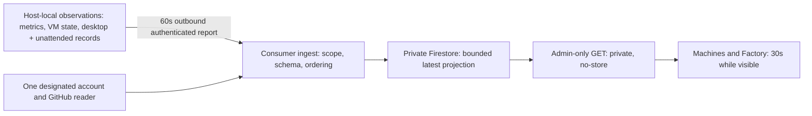

# Read-only infrastructure reporting — initial design

The approved outcome is an internal infrastructure dashboard, first for the company's two
projects, with stable machine identities and explicit many-to-many project associations.
This first bounded assignment establishes claims, verifies observation sources/access and
prepares implementation design. It does not authorize broad implementation before the
supervising controller obtains independent design critique. No implementation or deployment
has occurred. Private fleet facts and provider identities remain in the task checkout's ignored
`local/handoffs/2026-11-06-infrastructure-design.md`, not this public repository.

## Mandate and boundaries

The operator authorized reusable Morpheus reporting and the company-owned internal dashboard,
deployment and reversible iteration. Ordinary existing CI/cloud capacity and small reporting
costs only; no new paid service, native/paid model fallback, destructive action or access
widening. The native root remains controller-only. Preserve claims, independent review,
protected branches and passing CI; no TestFlight action or unrelated delivery intervention.
This worker may not delegate recursively. The controller owns supervision and fresh critique.

Claimed in the supplied isolated checkout using `morpheus pm claim`; no additional worktree.
The remote claim and its normal merged-item reconciliation are already pushed. The roadmap
remains in progress; this design is not task acceptance and no review record claims clearance.

## Proposed flow

Local operational configuration continues to own placement and capacity. The reporting store
owns no job control and is not a scheduler. Telemetry errors cannot block a worker, CI job,
lease or release. No inbound host ports, logs, transcripts, prompts or secret values.

## Reusable file ownership and dependencies

- `plugins/factory/src/fleet-observation.mjs` and `plugins/factory/tests/fleet-observation.test.mjs`:
  new pure record projection; read `runs/*/{run,process}.json`, top-level `task-*.json`, and
  `unattended/*/{admission,process,result}.json`. Do not call Manager inspection/status or
  unattended workerResult. Allowlisted fields only; liveness checks must not repair or signal.
  Configure every additional unattended state root explicitly, deduplicate canonical roots.
- `plugins/factory/src/config.mjs` plus focused config tests: reuse accountUsage semantics,
  expose the selected gateway-instance/account ID and reset bounds without breaking existing
  routing. Existing first-account-per-provider selection is acceptable only after explicit
  enrollment proves the exact account/group mapping. No generic multi-account scheduler.
- `plugins/factory/src/host/reporting/`: reporter, payload schema, fixed source adapters and
  explicit install/rollback scripts and short README. Own lockfile/package boundary; do not
  pull host-reporting dependencies into ordinary Morpheus installs. Share the plugin's fleet
  projection through one resolved module path, not copied code. Installer must prove that path
  resolves in the actual installed package. Installed reporter is reviewed immutable code,
  not a moving task checkout.
- Existing `host/worker/host_config.py`: preserve its owner/mode/outside-Git validation.
  Reporting registration is a private sidecar using stable IDs, project refs, source paths and
  credential references; do not migrate existing host placement configuration to Firestore.
- Consumer repo: owns ingestion, registration, storage, API/page auth, UI, navigation,
  deployment, visual evidence and real-host operating records. Its implementation can start
  against reviewed synthetic payload fixtures while reusable source work is completed.
- Host-setup repo: no implementation needed yet. Existing dispatcher config/state are read-only
  inputs. A null slot can mean idle OR starting; render that limitation honestly. Do not change
  admission/dispatcher behavior to make a dashboard easier. Any later additive observation
  export would get its own claim in the already supplied isolated checkout and tests.

## Observation semantics

Stable operator-assigned opaque host IDs survive hostname changes; no hardware serial or MAC
address is needed. Explicit project and source associations are registration, never accepted
from report bodies. A configured route is not an active worker. A worker task has a stable
host/channel/task identity and an invocation ID; a resumed invocation changes only the latter.
Project associations come from the task workspace map and an explicit registration mapping,
not inferred directory basenames. Multi-repository tasks remain one worker.

Keep one `infraWorkers` document per enrolled host/runtime channel, holding a bounded active
instance array (not a document per historical run). `infraHosts` holds machine registration and
per-source latest observations. `infraAccounts` holds each real gateway account once; workers
reference account IDs. Zero active instances requires a complete, successful census; unreadable,
truncated or mismatched process evidence produces unknown/partial, never idle. A latest terminal
result may be linked without copying its free-form summary. Restart/recovery records are evidence,
never an instruction to repair the worker.

Every source has `sampledAt` (attempt time), `sourceObservedAt` (data time, nullable),
`serverReceivedAt` (server-generated), status and nullable value. Quota retains provider/gateway
timestamps; dispatcher state retains its own updatedAt. Successful host-liveness measurement has
the current observation time. A failed source does not freshen older data. UI freshness is
computed at read time, stale after 180 seconds; stale/failed data is not healthy or zero.

Ingest compares per-source sampledAt transactionally, not quota's possibly repeated or old
sourceObservedAt. Reject duplicates/older attempts without changing serverReceivedAt; reject
implausible future samples, malformed dates and oversized values. A reporter restart uses the
same stable identity and fresh samples, with no new distributed epoch/session ledger. An actual
backward clock jump remains a visible source-clock error until time catches up.

## Build versus borrow

Propose `systeminformation` 5.33.19 for host CPU/memory/filesystem measurements: npm metadata
checked 2026-11-06, modified 2026-10-30, 875,133 unpacked bytes, no runtime dependencies reported.
Node os/statfs already provide CPU totals, memory total/free, uptime and available disk and were
probed successfully. However, macOS active/reclaimable memory and comparable CPU sampling would
otherwise need platform parsing that the maintained library supplies. Use only needed calls;
no process inventory, network probes or serial-number collection. Existing VM/Factory/GitHub
adapters remain small domain projections with native filesystem/fetch/child-process primitives.
Prometheus/Netdata/OTel were considered in the supplied baseline; their extra services/storage
do not remove the custom adapters this bounded outcome needs. Promote the final choice into
decisions.md after critique settles it; no package dependency was added in this design stage.

Memory field definitions: [systeminformation memory reference](https://systeminformation.io/memory.html).

## Validation performed and limits

Required context records were read in credited small ranges and context receipts succeeded.
Complexity installation check passed its canary. Exact-worktree graph installation was attempted;
Morpheus's index was created but the automatic claim commit advanced HEAD before final check.
Darwin's exact-checkout installation completed successfully. The current MCP transport closed;
used the installed graph CLI rather than repeatedly retrying the transport.

Tier 2, Morpheus main graph generation 2026-11-06T22:46:39Z: search with two complete pages
(49 results); readGatewayQuota inbound/outbound trace; accountUsage exact snippet. Coverage on
config/store/service/gateway-worker/processes/host_config reported metadata_match with no recorded
issues. The task checkout's exact relevant source was also read because it is the implementation
target. This is best-effort coverage, not proof of completeness. Darwin exact-checkout generation
2026-11-06T23:17:13Z: auth/admin/API/proxy/build-checker paths metadata_match; firestore.rules
not_tracked was read directly. Host-setup's expected primary graph was absent: read exact
dispatcher source directly. No exhaustive architecture or absence claims are made from that graph.

The key hazards were confirmed in exact source: Manager.status can stop orphans and rewrite
run/process records; workerResult can rewrite result.json; readGatewayQuota selects the first
account of each provider and drops identity/reset detail; accountUsage can return a percentage
from an old provider snapshot. Pure observation must not reuse these mutating status entrypoints.

Read-only probes verified real active desktop process identities, unattended record enumeration,
gateway account IDs/usage, all three host inventories, existing deployment/Firestore/IAM and
bounded GitHub job reads. Detailed results and access gaps are in the private design artifact.
These are investigation probes, not implementation tests. No application suites, CI, UI builds,
complexity measurement of changed functions or deployment validation are claimed.

Dependency installation: `pnpm install --frozen-lockfile --ignore-scripts` in the task plugin
checkout succeeded, reusing 296 cached packages; no tracked dependency files changed.
After writing the design records, `morpheus pm validate` passed (455 roadmap items) and
`git diff --check` passed. Only roadmap/worklog records are staged; no source function changed.

## Next bounded brief

Controller: obtain a fresh independent critique of authentication scoping, document bounds,
source freshness/order/restart behavior, account identity and packaging. Then implement the
reusable projection/reporter and consumer API/UI with exclusive file ownership above. Before
any rollout, run meaningful focused suites for auth denial, host/account scope, order/replay,
limits, failed sources, stale timestamps, worker idle/running/exit and restart. Verify installed
package imports and launchd rollback. Follow each repo's typecheck/build/compile/index and
complexity requirements, capture final UI states, finish independent source review and green
protected CI, then deploy/read back and observe real host/worker transitions and source failure.
No release acceptance is reduced by finishing this first design turn.
