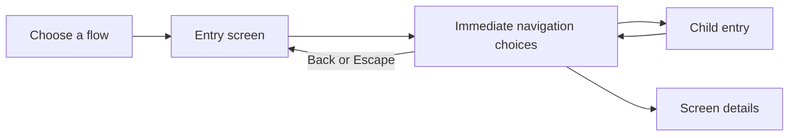

# Study navigation flows

The study schema now supports a validated optional flow hierarchy. The viewer starts with one entry, reveals only the current step's immediate transitions, and opens child entries as their own flow. Direct subflow selection covers conditional and resumed entries. Back and Escape restore the previous graph and screen. The graph distinguishes observed arrows from release-source documentation. Plain wheel scroll remains available to the page. Cmd or Ctrl plus scroll zooms the diagram.

React Flow and Dagre supply the existing canvas, layout and controls. The graph calculates its viewport from the actual canvas dimensions after the browser check identified clipping on narrow screens. Legacy studies retain the all-screen graph. Selection, hash navigation, and the accessible screen list were verified in Chromium. Public visual evidence uses a synthetic app fixture.

Private Fleet implementation patches were independently verified against the exact base before integration. The initial Claude session lost supervision and completed owned cleanup without artifacts. The subsequent Codex UI and schema runs had separate file ownership and both returned validated patches. The controller handled integration and visual QA.

The first independent review found the scoped graph highlight ignored screen-list and history changes. The highlight now follows the selected screen while Back retains its traversal history. Follow-up improvements add actual fit padding, explicit keyboard activation for subflows and a single zoom hint that hides on touch-only devices. The focused suite covers both list/history synchronization and keyboard subflow selection, for 65 passing tests.
