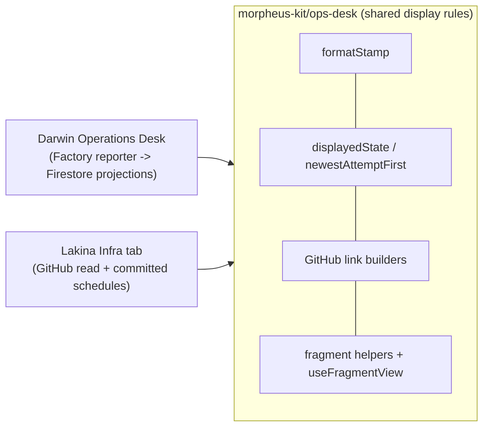

# Share infrastructure desk display rules

Chris asked for Lakina's HQ Infra tab on Darwin's Operations Desk behaviour, with the common code
lifted into Morpheus and both desks proven afterwards. Lakina is the second consumer, so the
display contract both desks must render identically moves to `morpheus-kit/ops-desk`:
`formatStamp` (`Nov 12, 9:19pm PST`, browser zone), `isTerminalState`/`displayedState` (dated
terminal outcomes kept, stale live states unknown), `newestAttemptFirst`, GitHub run/attempt/job/
commit/PR link builders that accept only validated identifiers, and fragment parse/build helpers.
`morpheus-kit/ops-desk/react` adds `useFragmentView`, the history hook behind shareable tabs and
drilldowns. Sources, readers, wire protocols, authorization, copy and pipeline topology stay in
each project.

Darwin adopts the module with no behaviour change (DW-26-11-13-23.42.47): 132 focused tests and
its 36-check synthetic Chromium harness pass, with identical `checks.json` before and after.
Lakina builds its Infra tab on it (LK-26-11-13-23.29.19).

Considered date-fns-tz and dayjs for the time format; `Intl.DateTimeFormat` already supplies the
DST-aware short zone name. No dependency.

## Test plan

- `pnpm exec vitest run tests/ops-desk.test.ts tests/ops-desk-react.test.tsx` — 15 passed.
- `pnpm typecheck`, `pnpm compile` (dist committed), `morpheus complexity check` — clean.
- Consumers against branch commit `18e181e3`: Darwin focused web suites (132 passed) and
  `qa/operations-desk/capture.mjs` (36 checks); Lakina infra suites and `qa/infra-desk/capture.mjs`.
