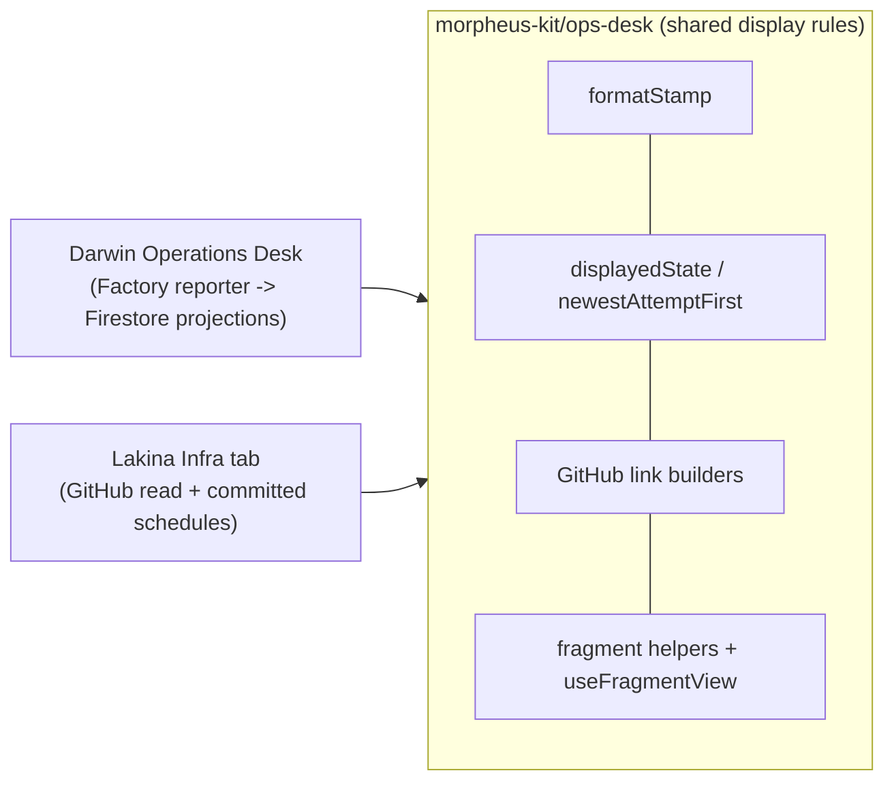

# Share infrastructure desk display rules

Chris asked for Lakina's HQ Infra tab on Darwin's Operations Desk behaviour, with the common code
lifted into Morpheus and both desks proven afterwards. Lakina is the second consumer, so the
display contract both desks must render identically moves to `morpheus-kit/ops-desk`:
`formatStamp` (`Nov 12, 9:19pm PST`, browser zone), `isTerminalState`/`displayedState` (dated
terminal outcomes kept, stale live states unknown), `newestAttemptFirst`, GitHub run/attempt/job/
commit/PR link builders that accept only validated identifiers, and fragment parse/build helpers.
`morpheus-kit/ops-desk/react` adds `useFragmentView`, the history hook behind shareable tabs and
drilldowns. Sources, readers, wire protocols, authorization, copy and pipeline topology stay in
each project.



Darwin adopts the module with no behaviour change on valid data; a malformed SHA, attempt or repository now gets no link instead of a broken one (DW-26-11-13-23.42.47): 132 focused tests and
its 36-check synthetic Chromium harness pass, with identical `checks.json` before and after.
Lakina builds its Infra tab on it (LK-26-11-13-23.29.19).

Considered date-fns-tz and dayjs for the time format; `Intl.DateTimeFormat` already supplies the
DST-aware short zone name. No dependency.

## Test plan

- `pnpm exec vitest run tests/ops-desk.test.ts tests/ops-desk-react.test.tsx` — 16 passed after review fixes.
- `pnpm typecheck`, `pnpm compile` (dist committed), `morpheus complexity check` — clean.
- Consumers against branch commit `18e181e3`: Darwin focused web suites (132 passed) and
  `qa/operations-desk/capture.mjs` (36 checks); Lakina infra suites and `qa/infra-desk/capture.mjs`.

## Independent review

Independent review cleared the shared module with three minor notes and no substantive finding. The reviewer compared it line by line with Darwin's consumer, confirmed the committed dist matches a fresh build and reran the 15 focused tests. The author fixed the dot-segment repository gap and the hand-typed query truncation with tests, and reworded the Darwin claim to no behaviour change on valid data.

```morpheus-review
{
  "version": 2,
  "base": "5f6d5d3d0af1a5fbbd8dfc0429ab8ee5b8f8382f",
  "reviewed": "e513dcd7a1fbf7d58964d16398119191306bd746",
  "covered": "2e48c13cce96ec2e46e626f98da25ab5fe22fab2",
  "authorSession": "fe60c610-5b28-46e4-a840-93f5be8135d5",
  "reviewerSession": "agent:a06fdc1b69cbc7e3b",
  "risk": "normal",
  "elapsedMinutes": 2.010483333333333,
  "timing": {
    "source": "runner",
    "durationMs": 120629,
    "evidence": "Claude Code Agent tool result for reviewer subagent a06fdc1b69cbc7e3b: duration_ms=120629 (one invocation)."
  },
  "outcome": "complete",
  "summary": "Independent review cleared the shared module with three minor notes and no substantive finding. The reviewer compared it line by line with Darwin's consumer, confirmed the committed dist matches a fresh build and reran the 15 focused tests. The author fixed the dot-segment repository gap and the hand-typed query truncation with tests, and reworded the Darwin claim to no behaviour change on valid data.",
  "contextRead": [
    "hq/product/roadmap/MO-26-11-13-23.38.17-share-ops-desk-helpers.md",
    ".agent/worklog/MO-26-11-13-23.38.17.md",
    ".agent/decisions.md",
    "architecture.md",
    "src/ops-desk/README.md",
    ".agent/worklog/2026-08-09-ship-prebuilt-git-artifacts.md",
    "hq/product/roadmap/MO-26-07-28-003-consume-kit-git-dependency.md"
  ],
  "findings": [
    {
      "id": "MIN-001",
      "severity": "minor",
      "description": "The repository pattern accepted `.` and `..` segments, so `owner/..` produced a github.com link the browser resolves to the wrong page.",
      "paths": [
        "src/ops-desk/index.ts",
        "dist/ops-desk/index.js",
        "dist/ops-desk/index.js.map",
        "tests/ops-desk.test.ts"
      ],
      "disposition": "fixed",
      "response": "Both segments now refuse `.` and `..` (dotted names such as `.github` still pass); the bad-repository test covers `owner/..`, `../x`, `./x`, `owner/.` for run and commit links. dist regenerated."
    },
    {
      "id": "MIN-002",
      "severity": "minor",
      "description": "The Darwin no-behaviour-change claim was overstated: malformed SHAs and attempts now get no link, and an unparseable start time sorts as 0 rather than NaN.",
      "paths": [
        ".agent/worklog/MO-26-11-13-23.38.17.md"
      ],
      "disposition": "fixed",
      "response": "Worklog and PR body now say no behaviour change on valid data, with malformed identifiers getting no link."
    },
    {
      "id": "MIN-003",
      "severity": "minor",
      "description": "parseFragment split with a limit, dropping everything after a second hand-typed `?` in the query.",
      "paths": [
        "src/ops-desk/index.ts",
        "dist/ops-desk/index.js",
        "dist/ops-desk/index.js.map",
        "tests/ops-desk.test.ts"
      ],
      "disposition": "fixed",
      "response": "The query is everything after the first `?`; a test pins `#work?detail=a?b`."
    }
  ]
}
```
