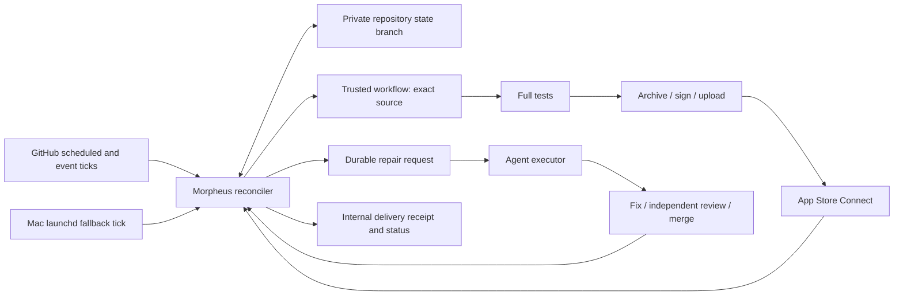

# Morpheus CD pipeline V2

Status: WIP design, 2026-10-18. Owner: Morpheus. First consumer: Evo.
Roadmap: MO-26-10-18-06.52.29. Implementation and operational acceptance follow
this design; approving this document does not assert that delivery works.

## Contract

Christopher authorizes rebuilding and operating CD, including repository changes,
merges, signing credentials, deployment, independent agents and fault testing.
The acceptance target is eight consecutive real internal TestFlight deliveries,
including recovered failures, across staging and production. External beta
review is not part of CD success.

| Requirement | Observable result |
| --- | --- |
| Staging every six hours when iOS inputs change | At each UTC six-hour boundary, select eligible main and eventually deliver it; record a no-change decision otherwise. |
| Production daily from source at least 24 hours old | Select the newest eligible first-parent main revision at the daily boundary. Record when the source reached main, not its author date. Publish daily even without new app changes. |
| Recovery owns completion | An intent stays outstanding through test failures, repair, review, merge, upload and Apple processing until internal availability is verified. |
| Missed schedule recovers | Reconciliation discovers overdue work from durable state. A new merge cannot reset the age of an older undelivered relevant change. |
| Generic platform, thin consumer | Morpheus owns policy, state transitions, providers and agents. Evo declares inputs, apps, schemes, hooks, environment and credential references. |
| Evidence, not green icons | A validated exact-build receipt proves app, source, build number, processing and internal distribution. |
| Budget | Preserve at least 10% of subscription quota. Together.ai expenditure is capped at $250 for this task, with reservations before requests. Report actual usage and limitations. |

Staging slots are 00:00/06:00/12:00/18:00 UTC; production defaults to 09:00 UTC
unless existing project operations require a different explicit configuration.
Six hours is a selection cadence, not permission to lose unserved changes.
A selected intent has immutable original source and slot. A repair may add
descendant app commits, recorded as a source lineage. A newer scheduled source
may coalesce unstarted staging work, but never erase its debt or a failed
validation attempt. Production app repairs must age again; changing trusted
controller code can preserve aged app source if its dependency/configuration
digest is unchanged. Manual validation ignores cadence, never source age.

A successful build is VALID in App Store Connect and available to the configured
internal group, with the relevant beta testing state permitting installation.
External tester group assignment and Beta App Review are separate optional
operations. They cannot revoke an internal delivery.

## Why the current system stalls

The incident is not explained by missing credentials. GitHub repository admin,
App Store Connect reads, signing material, both app records and both runner slots
were verified during preflight. A capability test is evidence at that time, not
a permanent promise of credential validity.

Evidence so far, with a complete sanitized RCA appendix to follow:

* A repair PR merged, while its originating recovery incident remained stopped.
  The controller recognized PR readiness as progress but had no reliable owner
  driving the merged source back through deployment.
* An automated assistant issued an operator stop using a human GitHub identity.
  Later status messages repeated obsolete PR state. The stored stop was not
  evidence of a hard technical blocker.
* A newer iOS merge reset the watchdog freshness calculation and closed an
  overdue-delivery issue without a newer delivered build. Continuous changes
  can therefore conceal an indefinitely stalled pipeline.
* Admission depends on GitHub incident state. One run was refused because its
  incident had already closed; generic PR issue closure and delivery ownership
  disagree over when work is done.
* The scheduler and recovery services reported healthy heartbeats while useful
  delivery was halted. Restarting a live process cannot fix missing ownership.
* Real earlier failures included UI assertions, missing backend indexes,
  storage exhaustion, signing/runtime changes and Apple processing rejection.
  These require different recovery actions; none justify a global permanent
  incident gate or declaring success after upload alone.
* Four-hour staging policy, manual production and an alert-only watchdog differ
  from the requested six-hour staging and daily aged production contract.

Retain proven low-level work: full-test integrity evidence, isolated VM runners,
unsigned archive then explicit profile/identity export, entitlement/IPA checks,
and upload acceptance persisted before distribution. Replace orchestration and
success accounting, not those safeguards.

## Architecture

Use one deterministic reconciler, a durable GitHub ledger, and replaceable
executors. Agents repair exceptions; they do not decide whether a delivered
receipt exists. GitHub issues and chat are projections of state, never locks.

No new database server, queue service or always-on cloud application is required.
GitHub is already required for source and execution. The private consumer repo
stores state, keeping operational data out of public Morpheus. A local cache is
disposable. A 15-minute GitHub-hosted Linux tick and a five-minute launchd tick
run the same reconcile command. Push, workflow completion and manual dispatch
also wake it. Cron is a hint: elapsed time and persisted outstanding work are
authoritative. Neither tick owns a separate retry policy.

The Mac executes the existing two VM slots. Work waits in the ledger, not a
GitHub concurrency pending slot. A bounded runner admission timeout routes
eligible work to the existing GitHub-hosted macOS execution path. If GitHub
itself is unavailable, preserve intent and reconcile on restoration; do not
invent a successful deployment. Local and off-host execution must use the same
identities, receipt validation and global build reservations.

The primary agent executor uses the existing local subscription runtime.
An off-host adapter can use a configured API runtime and GitHub App credentials
when the Mac is absent. This capability must be demonstrated, not assumed.
Individual agent sessions have time/token limits and checkpoints; their expiry
yields durable work for a resumed or independent agent. GitHub Manager may help
review/merge, but delivery cannot depend on its eventually noticing a PR.

### Durable store and concurrency

A dedicated branch (for example `morpheus-cd-state`) contains versioned JSON
state and an append-only event history. Store adapters read a head, compute a
transition, create a commit with that exact parent, and update the ref without
force. A concurrent update rejects the loser; it reloads and re-evaluates.
No side effect is allowed inside a retried pure transition.

The state contains configuration digest, migration epoch, last evaluated slots,
per-channel delivered source cursors, delivery intents, attempts, leases,
effect intentions, build-number reservations, agent work and explicit pauses.
Events preserve previous decisions, evidence references and timestamps. Large
logs/artifacts remain in Actions; their content hashes and identities are in
state. Schema migrations preserve unresolved work and receipts.

A lease includes owner, expiry and monotonically increasing fence. Before each
irreversible operation the executor must atomically claim that operation in the
ledger. Expired owners cannot authorize new work. Upload is not transactional
with GitHub: expiration while Apple is receiving bytes creates uncertainty,
not permission for another uploader. The operation remains reserved until
provider reconciliation resolves it. No claim of general exactly-once external
execution is made.

### Delivery state

States are `pending → testing → uploading → processing → delivered`, with
`repairing`, `waiting` and `paused` as explicit resumable states. A state
always carries its next action, retry time or blocker evidence. “PR ready,”
“agent exited,” “issue closed” and “workflow green” are not terminal states.

A delivery records:

* immutable ID, channel, selected slot, original source, oldest outstanding
  relevant change and selected main-entry timestamp;
* current repaired source and lineage, app-input digest, trusted control
  revision, configuration revision, test evidence and review provenance;
* every attempt and effect ID, executor, lease/fence, workflow/run/attempt,
  reserved app/version/build identity and acceptance artifact;
* processing/group readbacks and final receipt, or the precise evidence needed
  to resume an unresolved operation;
* repair PRs, independent strategies attempted, usage, next check and escalation.

At a missed staging boundary, choose a current relevant source and attach all
unserved relevant changes. After a failure, newer changes may supersede the
candidate only by an explicit recorded lineage transition that preserves the
oldest debt. Old-source successful builds cannot move the cursor past changes
they do not include. Production selects by first appearance on main, verified
from merge/history evidence. Missing age evidence is ineligible, not guessed.

### Execution and side effects

The trusted workflow/control revision and checked-out app source are distinct.
The app source must be reachable from the configured main history; manual
historical tests use explicit allowed source revisions. The workflow records
the source SHA and relevant-input digest before tests and checks them before
archive. Test evidence includes complete runtime inventory and actual results.
A passing unit-only run cannot satisfy full CD.

Before workflow dispatch, persist a unique effect ID. Put it in dispatch inputs,
run name and all artifacts. On lost response, enumerate matching runs before
retrying; a duplicate run must acquire the same operation claim and exit
without repeated upload. Every Actions artifact is downloaded and validated;
an artifact name alone proves nothing.

Reserve build numbers globally per app/version in the GitHub ledger, reconcile
with the provider maximum at allocation, and never reuse a reservation after an
uncertain upload. The upload adapter returns accepted, rejected or uncertain,
binding source, delivery, effect, app, version, build, IPA hash and run attempt.
Persist acceptance as soon as Apple accepts. If the job dies before persisting,
query that exact build identity; resume processing/distribution when found.
Do not archive/upload again merely because distribution or external review
failed. A bounded observation deadline produces a documented recovery decision,
not an unbounded silent wait or a blind retry.

Internal completion reads the exact app/version/build, processing status,
internal group ownership/type/membership and beta testing state. Wrong-source,
wrong-app, stale artifact or sibling-build receipts fail validation. Receipt
validation is shared across staging and production. Store the final receipt
before advancing the delivered cursor or closing a delivery issue.

### Automated remediation

Classify from direct evidence, with an unknown category that still owns work:

| Failure | First recovery | Escalation within automation |
| --- | --- | --- |
| Runner offline, disk/cache full, stale runtime | Restore/clean only owned disposable resources; retry same intent | Other VM/hosted runner; independent infrastructure agent |
| Test/app defect | Reproduce, create focused fix, full tests | Fresh independent diagnosis; repair lineage and review |
| Backend prerequisite/index | Apply declared migration or repair preflight idempotently | Inspect actual provider result; fix adapter instead of repeated unchanged command |
| Signing/auth | Resolve named credential and actual scopes; repair environment/profile | Independent credential diagnosis; only actual missing authority is a blocker |
| CI/PR review/check stall | Reconcile live head/checks; finish independent review and exact-head merge | Different agent/executor, then resume original delivery |
| Apple processing/distribution | Exact-build readback, retry safe group operations | Provider-specific repair; keep accepted binary identity |
| Controller/worker crash | Expired lease and persisted effect reconciliation | Off-host tick/executor using same ledger |

Agents receive scoped credentials through trusted adapters, an immutable task,
evidence links, previous approaches and a writable isolated checkout. They may
repair code, tests when the tests are wrong, workflows and runtime configuration
within the user's authority. They may not weaken assertions, silently skip full
tests, fabricate receipts or count a PR as delivery. Independent review checks
the exact proposed head; a changed head revokes eligibility. Merge is followed
by reconciliation, verification and deployment within the same delivery.

Two genuinely independent diagnoses/strategies are the minimum before a
technical issue is escalated as requiring human action. A fixed “two repairs”
counter is not itself a blocker. Repeated identical failures change strategy.
A blocker record names the missing capability, evidence, attempts, what will
unblock it and a periodic recheck. Quota/cost exhaustion is a visible resumable
budget pause, not success. New capacity resumes work automatically.

An explicit operator pause has actor provenance, scope, reason and resume
condition. An agent must not impersonate a human stop because it is confused.
This task authorizes clearing legacy accidental stops during cutover.
Future genuine human pauses are honored. Issue comments alone cannot grant
arbitrary command execution or prove human provenance.

## Borrowing and alternatives

Research is in progress; primary-source references will accompany the final
decision. GitHub Actions remains the executor and event source. GitHub's
documented scheduled-event delays/drops mean Actions cron alone is insufficient.
Temporal provides durable execution but adds a service and does not eliminate
idempotency for external effects. GitHub Agentic Workflows offers useful repair
worker patterns, but its queue retry limits and Linux/Docker execution do not
replace the delivery contract or native Apple build adapters. A generic
“self-healing CI” bot stopping at a fix PR leaves precisely the observed gap.

Use maintained provider clients or existing repository wrappers for GitHub and
Apple signing/auth. The reducer and delivery-specific policy are small domain
logic; do not build a general workflow language, cron parser or agent platform.
Prefer the existing six-hour arithmetic and UTC daily selection to a scheduler
dependency. Record measured dependencies and selected alternatives before merge.

## Cutover and rollback

1. Snapshot legacy state/configuration/LaunchAgents and current Apple receipts.
   Preserve private evidence in the consumer; redact shared/public reports.
2. Deploy V2 in observation mode, comparing selected sources, age, debt and exact
   receipts without dispatching. Validate live CAS contention on an isolated
   probe branch and provider identities.
3. Install trusted workflows/adapters and demonstrate full tests and internal
   receipt checks. Seed cursors only from verified historical receipts.
4. Fence the cutover epoch, stop legacy dispatch/recovery writers, drain or
   explicitly reconcile in-flight uploads, then enable V2 mutations. Verify the
   two schedules and both tick sources. Do not run competing schedulers.
5. Rollback disables V2 execution, keeps its ledger and accepted uploads, then
   restores a deliberately selected legacy execution path with the same receipt
   reconciliation. Never roll the delivery cursor backward or lose uncertainty.

## Validation and acceptance

Design prototypes must challenge the risky boundaries before implementation:
concurrent CAS writers; crash before/after intent persistence; main age versus
author time; missed slots/new merges; receipt substitution; ambiguous upload;
lease expiry while an effect is still active; quota reservation and retry.

Implementation tests use real adapters at their boundaries and a pure reducer
for combinatorial failure sequences. Model tests are not delivery evidence.
CI verifies schema/transition invariants and uses recorded sanitized responses.
Fault injection is explicit, scoped to validation intents and automatically
expires; it must not alter ordinary app behavior or mask a real failure.

The acceptance campaign records **eight consecutive distinct delivered intents,
four staging and four production**, with original/final source, revisions,
full-test evidence, attempts, injected/real failures, Apple build IDs and exact
internal receipts. No-change slots, duplicate retries, old receipts, green PRs
or upload-only results do not count. No failed/abandoned campaign intent can be
removed to manufacture a streak. A repair can legitimately complete its
original intent. Acceptance uses the final implementation; material changes
require repeating the affected fault scenario and documenting which earlier
deliveries remain valid evidence.

| Scenario | Required observation |
| --- | --- |
| Historical previously failing source | Automated app/test repair, independent review, merge and delivery |
| Controller restart after dispatch | Finds existing run and continues, no duplicate irreversible effect |
| Lost/ambiguous upload response | Finds exact accepted build and finishes internal distribution |
| Apple/group transient failure | Retry distribution without rebuilding accepted binary |
| Runner/worker interruption | Other executor resumes owned intent within documented timeout |
| Failed CI or review stall | Agent owns repair through checks and exact-head merge |
| New merge while backlog exists | Oldest debt remains overdue; delivery includes or records it |
| Production age boundary | 23:59:59 ineligible, 24:00:00 eligible; app fixes restart age |
| Missing/dropped scheduler tick | Other tick discovers and dispatches due work |
| No relevant staging change | Explicit no-change decision; not counted as a delivery |
| Receipt identity mismatch | Rejected without advancing cursor or closing issue |
| Off-host recovery | Demonstrated control and repair fallback, not just an alert |

Two VM slots may run independent source tests in parallel. Signing and Apple
identities remain serialized by global reservation/operation ownership where
required. Production validation uses genuinely aged sources, not backdated
commits. Monitor disk capacity, quota, API rate limits and task spend throughout.

After acceptance, document remaining limitations honestly, leave the schedules
active, and write the reusable Agentic CTO skill in Morpheus. Its contract takes
a brief specification, concrete success criteria and budget; it requires
requirements-first design, independent review, empirical prototypes, delegated
implementation, outcome-based validation, durable ownership and honest closure.

