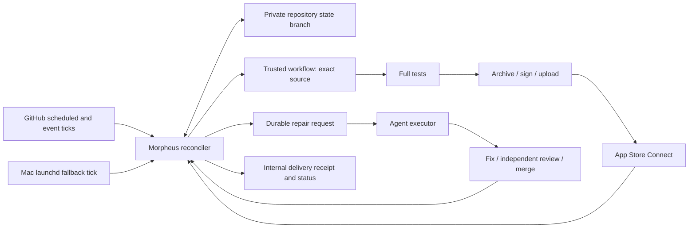

# Morpheus CD pipeline V2

> **Superseded 2026-10-30.** iOS delivery is being rebuilt as one stateless run per slot
> (architecture.md §18.2, "Stateless iOS delivery"; `.agent/decisions.md`, 2026-10-30). This
> document describes V2 while it still delivers, until Evo's cutover; MO-26-10-30-16.06.29 deletes
> it with `src/cd/`.

Status: design under independent review, 2026-10-18. Owner: Morpheus. First consumer: Evo.
Roadmap: MO-26-10-18-06.52.29. Implementation and operational acceptance follow
this design; approving this document does not assert that delivery works.

## Contract

Christopher authorizes rebuilding and operating CD, including repository changes,
merges, signing credentials, deployment, independent agents and fault testing.
The acceptance target is eight consecutive real internal TestFlight deliveries,
including recovered failures, across staging and production. External beta
review is not part of CD success.

| Requirement | Observable result |
| --- | --- |
| Staging every six hours when iOS inputs change | At each UTC six-hour boundary, select eligible main and deliver before the next boundary; record a no-change decision otherwise. |
| Production daily from source at least 24 hours old | Select the newest eligible first-parent main revision at the daily boundary. Record when the source reached main, not its author date. Publish daily even without new app changes. |
| Recovery owns completion | An intent stays outstanding through test failures, repair, review, merge, upload and Apple processing until internal availability is verified. |
| Missed schedule recovers | Reconciliation discovers overdue work from durable state. A new merge cannot reset the age of an older undelivered relevant change. |
| Generic platform, thin consumer | Morpheus owns policy, state transitions, providers and agents. Evo declares inputs, apps, schemes, hooks, environment and credential references. |
| Evidence, not green icons | A validated exact-build receipt proves app, source, build number, processing and internal distribution. |
| Budget | Preserve at least 10% of subscription quota. Together.ai expenditure is capped at $250 for this task, with reservations before requests. Report actual usage and limitations. |

Staging slots are 00:00/06:00/12:00/18:00 UTC; production uses one explicitly
configured UTC daily boundary (Evo starts at 18:00 UTC).
Scheduled work must dispatch within 15 minutes of its boundary and become internally
available before the following six-hour staging boundary (production within six
hours of its daily boundary). These are outcome deadlines, measured from the
original obligation; selecting a source does not satisfy them. An overdue intent
remains overdue while recovery works. Phase deadlines trigger reconciliation,
alternate execution or repair rather than resetting its clock. Six hours never
permits losing unserved changes.
A selected intent has immutable original source and slot. A repair may add
descendant app commits, recorded as a source lineage. A newer scheduled source
may coalesce unstarted staging work, but never erase its debt or a failed
validation attempt. Production app repairs must age again; changing trusted
controller code can preserve aged app source if its dependency/configuration
digest is unchanged. Manual validation ignores cadence, never source age.

A successful build is VALID in App Store Connect and available to the configured
internal group, with the relevant beta testing state permitting installation.
External tester group assignment and Beta App Review are separate optional
operations. They cannot revoke an internal delivery.

## Design motivation and private evidence

The operational RCA, including repository logs and private conversation provenance,
is retained in Evo's private engineering records. It is not published in this
public repository. The independent reviewer can inspect that evidence in the
private task workspace; the public design states reusable requirements and
validation, without incident narratives or private operational details.

A delivery controller must distinguish source selection, test qualification,
upload acceptance, provider processing and actual internal availability. A PR,
issue state, agent response or process heartbeat cannot substitute for the final
receipt. Outstanding work must remain durable across each of those boundaries.

Retain low-level safeguards: full-test integrity evidence, isolated runners,
unsigned archive followed by explicit profile/identity export, entitlement/IPA
checks, and upload acceptance persisted before distribution. Replace admission,
recovery ownership and success accounting with the contract below.

## Architecture

Use one deterministic reconciler, a durable GitHub ledger, and replaceable
executors. Agents repair exceptions; they do not decide whether a delivered
receipt exists. GitHub issues and chat are projections of state, never locks.

No new database server, queue service or always-on cloud application is required.
GitHub is already required for source and execution. The private consumer repo
stores state, keeping operational data out of public Morpheus. A local cache is
disposable. A 15-minute GitHub-hosted Linux tick and a five-minute launchd tick
run the same reconcile command. Push, workflow completion and manual dispatch
also wake it. Cron is a hint: elapsed time and persisted outstanding work are
authoritative. Neither tick owns a separate retry policy.

The Mac executes the existing two VM slots. Work waits in the ledger, not a
GitHub concurrency pending slot. A bounded runner admission timeout routes
eligible work to a GitHub-hosted macOS execution path. Legacy callers configure
that path, but V2 must demonstrate it before claiming host-loss recovery. If GitHub
itself is unavailable, preserve intent and reconcile on restoration; do not
invent a successful deployment. Local and off-host execution must use the same
identities, receipt validation and global build reservations.

Admission uses the complete job census for the exact workflow run attempt, not
the overall run status: a Linux preflight can make a workflow `in_progress`
while its native tests are still queued. Recognized queued, unassigned native
work uses `admissionMinutes` (default 15); assigned, started or unknown work keeps
`testMinutes` (default 180). Both retain the existing strict elapsed-time boundary
from attempt creation, so equality does not cancel and the next wake after it can.
Failed or incomplete census reads remain visible waits and still enforce the
180-minute cancellation bound without releasing executor ownership.
Local native jobs carry the configured local label or `self-hosted`; hosted
native jobs carry a `macos-` label. Only hosted `ubuntu-` labelled companion jobs
or explicitly skipped, unassigned downstream jobs qualify as non-native evidence;
there is no consumer-specific job-name assumption. Automatic local-to-hosted
fallback requires a terminal run, at least one recognized cancelled native job,
every native job explicitly unassigned and never started, and successful hosted
Linux companion work (or skipped/unassigned downstream work). Missing fields,
steps with start/completion evidence, partial/failed pagination, empty or preflight-only results cannot
establish no-start quiescence. GitHub reports a terminal job that never reached a runner with
`started_at` copied from `created_at`, not null. A completed skipped or cancelled row is therefore
also never-started when it meets all of these:
- the copy is string-exact;
- it has a completion time;
- its runner and runner-group fields are null or 0/empty;
- it lists no steps.

Queued rows keep the strict null-start rule. A different start time, any step, or a missing
creation or runner-group field refuses. Skipped companions use the same rule on the hosted
lane. A completed census with no local job therefore records hosted termination beside such a
placeholder, as it already did beside a strict skipped companion. The intent still goes to
repair. A preflight failure instead retains ownership and
creates durable repair work; verified owned process/VM termination and the
existing operational-repair transition can release it for a normal retry.
The hosted successor keeps the same intent, source, slot and oldest debt, while
the old build stays burned and a new monotonic number is reserved. An upload
claim that wins before failure classification retains ownership.

The primary agent executor uses the existing local subscription runtime.
An off-host adapter can use an existing authorized subscription/API runtime and
GitHub App credentials when the Mac is absent. Credential-name inventory and
deterministic status sweeps do not establish a working hosted repair session.
Acceptance must demonstrate
diagnosis, patching, independent review and continuation while the local worker
is stopped. The hosted build lane separately demonstrates native execution.
Individual agent sessions have time/token limits and checkpoints; their expiry
yields durable work for a resumed or independent agent. GitHub Manager may help
review/merge, but delivery cannot depend on its eventually noticing a PR.

### Durable store and concurrency

A dedicated branch (for example `morpheus-cd-state`) contains versioned JSON
state and an append-only event history. Store adapters read a head, compute a
transition, create a commit with that exact parent, and update the ref without
force. The new commit has exactly one parent, the observed head; no merge,
implicit fetch/rebase or history rewrite is permitted. Under that constraint a
concurrent sibling update rejects the loser; it reloads and re-evaluates. Nonforce
alone is only a fast-forward check, not a general expected-value API. Unknown
write acknowledgment is reconciled by transition/effect ID in current state and
history, even after another writer advances the head. No side effect is allowed
inside a retried pure transition. A missing previously initialized state branch
is an incident, never permission to create an empty queue. Protect it against
force/deletion and retain a recoverable secondary copy without promoting it as
a concurrent authority.

The state contains configuration digest, migration epoch, last evaluated slots,
per-channel delivered source cursors, delivery intents, attempts, leases,
effect intentions, build-number reservations, agent work and explicit pauses.
Events preserve previous decisions, evidence references and timestamps. Large
logs/artifacts remain in Actions; their content hashes and identities are in
state. Schema migrations preserve unresolved work and receipts.

A lease includes owner, expiry and monotonically increasing fence. Before each
irreversible operation the executor must atomically claim that operation in the
ledger. Expired owners cannot authorize new work. Upload is not transactional
with GitHub: expiration while Apple is receiving bytes creates uncertainty,
not permission for another uploader. Worker leases and operation reservations
are separate. An operation claim means the effect may already have started;
expiry transfers observation ownership, not permission to repeat it. The recovery
table below defines how it resolves. No claim of general exactly-once external
execution is made.

### Delivery state

States are `pending → testing → uploading → processing → delivered`, with
`repairing`, `waiting` and `paused` as explicit resumable states. A state
always carries its next action, retry time or blocker evidence. “PR ready,”
“agent exited,” “issue closed” and “workflow green” are not terminal states.

A delivery records:

* immutable ID, channel, selected slot, original source, oldest outstanding
  relevant change and selected main-entry timestamp;
* current repaired source and lineage, app-input digest, trusted control
  revision, configuration revision, test evidence and review provenance;
* every attempt and effect ID, executor, lease/fence, workflow/run/attempt,
  reserved app/version/build identity and acceptance artifact;
* processing/group readbacks and final receipt, or the precise evidence needed
  to resume an unresolved operation;
* repair PRs, independent strategies attempted, usage, next check and escalation.

At a missed staging boundary, choose a current relevant source and attach all
unserved relevant changes. After a failure, newer changes may supersede the
candidate only by an explicit recorded lineage transition that preserves the
oldest debt. Old-source successful builds cannot move the cursor past changes
they do not include. Production selects by first appearance on main, verified
from merge/history evidence. Neither author nor committer time proves main entry.
Missing age evidence uses conservative durable first observation, requiring a
real 24-hour wait; rewritten main history requires a new explicit epoch.

Only one ordinary delivery intent per channel is active. After a multi-day outage,
never-started production slots coalesce into one catch-up intent for the latest
due boundary, with eligibility evaluated at that boundary. Older missed slots
remain recorded as missed/covered by that catch-up; they are not backdated
successes. A started or failed intent retains its identity and takes priority.
A source known to fail is quarantined with its repair lineage; later daily slots
attach to that work instead of repeatedly selecting the same bad SHA. When an
app fix is too young, persist its eligible-at time and resume then. Deadlines
remain breached during the wait; no age exception or fresh overdue clock exists.

Historical validation never rolls back the operational cursor or promotes an
older binary over a newer ordinary delivery. Prefer ascending sources at or
after the channel's delivered baseline, and adopt already-reviewed descendant
fixes with explicit lineage evidence when appropriate. A truly older-binary drill
uses an explicit internal validation group with intended authorized testers;
verify automatic distribution cannot expose it to ordinary groups. Otherwise
do not upload that historical binary. Final promotion is rechecked against the
live cursor, so out-of-order completions cannot regress it. No validation cursor
change is inferred from merely allocating a higher Apple build number.

### Execution and side effects

The trusted workflow/control revision and checked-out app source are distinct.
The app source must be reachable from the configured main history; manual
historical tests use explicit allowed source revisions. The workflow records
the source SHA and relevant-input digest before tests and checks them before
archive. Test evidence includes complete runtime inventory and actual results.
A passing unit-only run cannot satisfy full CD.

Before workflow dispatch, persist a unique effect ID. Put it in dispatch inputs,
run name and all artifacts. On lost response, enumerate all relevant pages of
matching runs and account for visibility delay before retrying; a duplicate run
must acquire the same operation claim and exit
without repeated upload. Every Actions artifact is downloaded and validated;
an artifact name alone proves nothing.

Reserve build numbers globally per app/version in the GitHub ledger, reconcile
with the provider maximum at allocation, and never reuse a reservation after an
uncertain upload. The upload adapter returns accepted, rejected or uncertain,
binding source, delivery, effect, app, version, build, IPA hash and run attempt.
Persist IPA hash and upload intent before contacting Apple, and persist the upload
resource ID as soon as it exists. Persist acceptance as soon as Apple accepts.
If the job dies before persisting, observe both the upload resource and exact
app/version/build identity; resume processing/distribution when found.
Do not archive/upload again merely because distribution or external review
failed. A bounded observation deadline produces a documented recovery decision,
not an unbounded silent wait or a blind retry.

| Uncertain operation observation | Required recovery decision |
| --- | --- |
| Claim persisted, worker might still be paused before its call | Retain operation reservation. Cancel the exact workflow/process group and verify terminal/quiescent state; a lease timeout alone is insufficient. |
| Owned executor proven dead before call, no request can remain in flight | Close that attempt as not started and create a fresh fenced attempt; retain its burned build reservation. |
| Upload resource says FAILED/INVALID, no build exists | Persist terminal provider diagnostics and start targeted repair; do not wait for a build that will never exist. |
| Upload accepted or matching build visible | Continue processing and group distribution on that identity, without archive/upload replay. |
| Upload/build absent or not yet visible | Bounded repeated provider observations (default 30 minutes), retaining ownership uncertainty and build allocation. Quiesce the old executor before any replacement authorization. |
| Still absent after quiescence and observation window | Record a retired-uncertain attempt, preserve/burn its identity and monitor for late appearance; authorize a new attempt/build under the same lineage. A late old build is never promoted or counted. This may leave an unused duplicate provider binary, not duplicate delivery credit. |
| Accepted build terminally rejected in processing | Record rejection and diagnostics, repair, then allocate another build within the same lineage. |

Only the current attempt may receive group promotion. Managed group automatic
distribution must not bypass that check. Self-hosted execution requires verified
termination of the owned process tree or VM on the host; a terminal/cancelled
GitHub job status alone does not prove that a partitioned runner stopped. For
disposable hosted execution require the provider's executor-termination guarantee,
not merely a cancellation request or terminal API status. Requests already in
flight still require provider reconciliation. An unreachable host with a possibly
live uploader requires infrastructure diagnosis and continued observation, not an
unsafe duplicate authorization. Provider outage or missing observation access
remains explicit waiting/repair work.

Internal completion reads the exact app/version/build, processing status,
internal group ownership/type/membership and beta testing state. Wrong-source,
wrong-app, stale artifact or sibling-build receipts fail validation. Receipt
validation is shared across staging and production. Apple does not attest Git
SHA or IPA hash: join its exact build identity to trusted workflow/artifact
evidence, verified against the selected control revision and run attempt. Store
the immutable final receipt and covered-source cursor advance in one transition;
later provider observations append without rewriting it. Persist slot decisions
and debt before advancing the evaluated-slot watermark. Issue closure follows
that committed evidence.

### Automated remediation

Classify from direct evidence, with an unknown category that still owns work:

| Failure | First recovery | Escalation within automation |
| --- | --- | --- |
| Runner offline, disk/cache full, stale runtime | Restore/clean only owned disposable resources; retry same intent | Other VM/hosted runner; independent infrastructure agent |
| Test/app defect | Reproduce, create focused fix, full tests | Fresh independent diagnosis; repair lineage and review |
| Backend prerequisite/index | Apply declared migration or repair preflight idempotently | Inspect actual provider result; fix adapter instead of repeated unchanged command |
| Signing/auth | Resolve named credential and actual scopes; repair environment/profile | Independent credential diagnosis; only actual missing authority is a blocker |
| CI/PR review/check stall | Reconcile live head/checks; finish independent review and exact-head merge | Different agent/executor, then resume original delivery |
| Apple processing/distribution | Exact-build readback, retry safe group operations | Provider-specific repair; keep accepted binary identity |
| Controller/worker crash | Expired lease and persisted effect reconciliation | Off-host tick/executor using same ledger |

Agents receive scoped credentials through trusted adapters, an immutable task,
evidence links, previous approaches and a writable isolated checkout. They may
repair code, tests when the tests are wrong, workflows and runtime configuration
within the user's authority. They may not weaken assertions, silently skip full
tests, fabricate receipts or count a PR as delivery. Independent review checks
the exact proposed head; a changed head revokes eligibility. Merge is followed
by reconciliation, verification and deployment within the same delivery.

Two genuinely independent diagnoses/strategies are the minimum before a
technical issue is escalated as requiring human action. A fixed “two repairs”
counter is not itself a blocker. Repeated identical failures change strategy.
A blocker record names the missing capability, evidence, attempts, what will
unblock it and a periodic recheck. Quota/cost exhaustion is a visible resumable
budget pause, not success. New capacity resumes work automatically.

Reserve paid requests before invocation using immutable request/configuration
identity and an enforceable maximum output/retry cost. Unknown outcomes retain
maximum liability; settled tombstones make charging/releasing replay-safe.
Reservations and spend are global across executors and quota windows. Subscription
usage is observed from actual runtime telemetry, not token-count guesses. Stop
admitting new subscription work by 80% used to leave room for in-flight work and
the required 10% reserve; checkpoint/stop owned sessions before reaching 90%.
Missing telemetry prevents a claim that quota is protected and routes work to a
measured authorized alternative or a durable budget wait. No paid-provider
fallback may bypass the $250 Together ceiling.

Native account reads allow 60 seconds for the configured shim and handshake,
with at most 10 seconds for the final quota RPC within that total. Each read is
fresh and explicitly ordinary-subscription eligible; no prior result substitutes
for a failed read. A separate reader-only supervisor bounds foreground-group
cleanup to two seconds, with a three-second parent fuse, without changing the
model guardian. A failed read checkpoints immediately; a successful read is
accepted only after confirmed cleanup and completion-time freshness/expiry
validation. Unknown cleanup is a refusal, never capacity or host-termination proof.

Initial operational deadlines are explicit configuration: controller wakeup
15 minutes, unassigned native job 15 minutes before alternate-lane recovery,
native tests 180 minutes, archive/upload 90 minutes, agent invocation 45 minutes.
Apple processing is observed every five minutes; a 30-minute wait triggers
provider diagnosis without re-uploading an accepted binary. These phase limits
are subordinate to the delivery deadline. A worker that times out checkpoints
and resumes; repeated identical evidence triggers an independent strategy.

An explicit operator pause has actor provenance, scope, reason and resume
condition. An agent must not impersonate a human stop because it is confused.
This task authorizes clearing legacy accidental stops during cutover.
Future genuine human pauses are honored. Issue comments alone cannot grant
arbitrary command execution or prove human provenance.

## Borrowing and alternatives

[Primary-source research and package comparisons](cd-pipeline-v2-research.md)
support this decision. GitHub Actions remains the executor and event source. GitHub's
documented scheduled-event delays/drops mean Actions cron alone is insufficient.
Temporal provides durable execution but adds a service and does not eliminate
idempotency for external effects. GitHub Agentic Workflows offers useful repair
worker patterns, but its queue retry limits and Linux/Docker execution do not
replace the delivery contract or native Apple build adapters. A generic
“self-healing CI” bot stopping at a fix PR leaves precisely the observed gap.

Use maintained provider clients or existing repository wrappers for GitHub and
Apple signing/auth. The reducer and delivery-specific policy are small domain
logic; do not build a general workflow language, cron parser or agent platform.
Prefer the existing six-hour arithmetic and UTC daily selection to a scheduler
dependency. Record measured dependencies and selected alternatives before merge.

## Cutover and rollback

1. Snapshot legacy state/configuration/LaunchAgents and current Apple receipts.
   Preserve private evidence in the consumer; redact shared/public reports.
2. Deploy V2 in observation mode, comparing selected sources, age, debt and exact
   receipts without dispatching. Validate live CAS contention on an isolated
   probe branch and provider identities.
3. Install trusted workflows/adapters and demonstrate full tests and internal
   receipt checks. Seed cursors only from verified historical receipts.
4. Fence the cutover epoch, stop legacy dispatch/recovery writers, drain or
   explicitly reconcile in-flight uploads, then enable V2 mutations. Verify the
   two schedules and both tick sources. Do not run competing schedulers.
5. Rollback disables V2 execution, keeps its ledger and accepted uploads, then
   restores a deliberately selected legacy execution path with the same receipt
   reconciliation. Never roll the delivery cursor backward or lose uncertainty.

## Validation and acceptance

[Design prototypes](cd-pipeline-v2-validation.md) challenge the risky boundaries
before implementation; 45 executable cases and two live GitHub contention probes
have run. Their modeled versus real-provider scope is explicit. Required cases:
concurrent CAS writers; crash before/after intent persistence; main age versus
author time; missed slots/new merges; receipt substitution; ambiguous upload;
lease expiry while an effect is still active; quota reservation and retry.

Implementation tests use real adapters at their boundaries and a pure reducer
for combinatorial failure sequences. Model tests are not delivery evidence.
CI verifies schema/transition invariants and uses recorded sanitized responses.
Fault injection is explicit, scoped to validation intents and automatically
expires; it must not alter ordinary app behavior or mask a real failure.

The acceptance campaign records **eight consecutive distinct delivered intents,
four staging and four production**, with original/final source, revisions,
full-test evidence, attempts, injected/real failures, Apple build IDs and exact
internal receipts. No-change slots, duplicate retries, old receipts, green PRs
or upload-only results do not count. No failed/abandoned campaign intent can be
removed to manufacture a streak. A repair can legitimately complete its
original intent. Acceptance uses the final implementation; material changes
require repeating the affected fault scenario and documenting which earlier
deliveries remain valid evidence.

| Scenario | Required observation |
| --- | --- |
| Historical previously failing source | Automated app/test repair, independent review, merge and delivery |
| Controller restart after dispatch | Finds existing run and continues, no duplicate irreversible effect |
| Lost/ambiguous upload response | Finds exact accepted build and finishes internal distribution |
| Apple/group transient failure | Retry distribution without rebuilding accepted binary |
| Runner/worker interruption | Other executor resumes owned intent within documented timeout |
| Failed CI or review stall | Agent owns repair through checks and exact-head merge |
| New merge while backlog exists | Oldest debt remains overdue; delivery includes or records it |
| Production age boundary | 23:59:59 ineligible, 24:00:00 eligible; app fixes restart age |
| Missing/dropped scheduler tick | Other tick discovers and dispatches due work |
| No relevant staging change | Explicit no-change decision; not counted as a delivery |
| Receipt identity mismatch | Rejected without advancing cursor or closing issue |
| Off-host recovery | Demonstrated control and repair fallback, not just an alert |

Observe at least one real normal scheduled staging boundary with relevant
changes, one real scheduled no-change decision and one normal daily production
boundary, in addition to the accelerated campaign. Record scheduled due,
dispatch and internal-availability timestamps, including any missed deadline.
Exercise both wakeup sources and show that dropping one still discovers due
work. Manual requests and simulated clocks cannot substitute for this proof.

Two VM slots may run independent source tests in parallel. Signing and Apple
identities remain serialized by global reservation/operation ownership where
required. Production validation normally uses genuinely aged sources, never
backdated commits. A human may explicitly waive waiting for an accelerated
campaign: each manual validation request records the actual authorization and
exact verified main source using the [per-intent source-age waiver](cd-v2-controller.md).
Chris authorized this exception for Evo's eight-delivery campaign on 2026-10-19,
with real internal TestFlight delivery and main changes between successive builds.
Automatic cadence, production age and all completion/fault evidence remain the
normal policy; the waiver does not manufacture scheduled-boundary evidence.
Monitor disk capacity, quota, API rate limits and task spend throughout.

After acceptance, document remaining limitations honestly, leave the schedules
active, and write the reusable Agentic CTO skill in Morpheus. Its contract takes
a brief specification, concrete success criteria and budget; it requires
requirements-first design, independent review, empirical prototypes, delegated
implementation, outcome-based validation, durable ownership and honest closure.

### Additive post-resume recovery acceptance source boundary

The package exposes a separate `applyPostResumeAcceptance` Store API for a
closed, uncounted `validation=true` origin. It does not enroll ordinary delivery,
change a campaign's original eight requests/receipts or its old journal/resume
fences, select a live fault, or dispatch by recording provenance. No installed
consumer adoption is implied. The origin result has kind
`post-resume-origin-v1` and deliberately has no legacy `fenceBinding` property.
A deterministic campaign/purpose key admits one origin; exact replay verifies
its original payload and is read-only. Changed input under that purpose refuses.

A future qualified consumer supplies the actual history/resume hashes,
independently reviewed current protected source and **genuine** iOS tree evidence,
latest actual dispatch/receipt comparison and a state-fingerprinted, expiring
qualification. Tree hashes and references in this API are evidence bindings,
not a Git verifier or an approval flag; the complete consumer caller must verify
them. No artificial app edit, age waiver, old build or ordinary `validation=false`
fault branch is introduced. Creation is limited to a five-minute plan, normal
source age and an ordinary-free baseline. Normal configuration, epoch, maximum
two native slots, subscription80/90 and ordinary source/cursor behavior stay intact.
The retained original campaign's active/per-channel restriction remains distinct
from the normal one-ordinary-intent-per-channel invariant. This source extension
grants no campaign exemption or guarantee of zero delay for unexpected demand.

Ordinary current work, unevaluated due slots and unresolved repair/group owners
win before optional planning, dispatch, upload and membership claims. Each optional
CAS retry samples its injected current clock and checks the current qualification
fingerprint/expiry. Initial planning/dispatch also recheck the15minute stagger
and source newer than prior actual dispatches. Later recovery preserves its
already-selected source and applies monotonic ordinary/group cursors; it does not
pretend a late receipt is another fresh request. Expired or drifting external
facts require an honestly refreshed qualification. There is no internal financial
hold or grant-review gate in this boundary; the campaign's spend-as-needed policy
and actual350USD cap remain separate normal accounting.

The ordinary controller processes internal ordinary work first, then at most one
optional intent, then bounded external/late observation. Optional Apple reads
have a total30second deadline and at most eight API requests per sweep. Optional
Actions run/job/artifact sweeps have the same finite GET budget; artifact evidence
admits at most four downloads within a shared30second abort deadline. The same shared optional Apple budget covers delivered external follow-up,
including build/review/group pagination and response bodies. A limited, truncated
or aborted census is UNKNOWN, never empty success or mutation/retry permission.
Ordinary external observation keeps its established default behavior. A yielded optional
plan is permitted only before any dispatch claim/run/test/upload authority exists;
its build stays burned. A disappeared ordinary-demand proposal aborts without a stable yield transition;
later real demand can still yield the same zero-effect plan. Yield and
execution-release records are closed and append-only. Direct stale callers and late before-upload hooks cannot revive them. Optional
duplicate/live-overdue executions require exact owned-quiescence qualification;
they do not select an automatic cancel or replacement operation.
A successful effect claim is the linearization boundary: a lost reply/empty run
list cannot convert that effect into never-dispatched or authorize another call.

`releasePostResumeExecution` requires already-bound identity, actual terminal
workflow and authenticated owned executor/uploader quiescence, exact lease/fence,
no remaining repair/descendant authority, and fresh fingerprinted closure proof.
It releases **execution occupancy**, not provider uncertainty. A protected unknown
upload remains the same active attempt/source/build/IPA/claim through later absent
polls, timeout diagnosis and repair paths. It cannot be retired, retargeted,
automatically retried or repaired into a new optional purpose. Exact existing
upload receipts, matching test proof and Apple readback can still recover its
actual receipt. Definitive rejection is recorded without an automatic new attempt and does not
prove executor quiescence: the optional execution remains counted until exact
release (while normal accepted-upload fast release remains intact).
Old retired-uncertain uploads remain observation-only; ordinary recovery is unchanged.

Optional internal group membership uses a separate stable purpose/group/build/
attempt obligation. Only the fresh Store invocation owner may issue its one
add-one-build POST. Concurrent/replayed callers cannot post. Once a call may have
escaped, UNKNOWN plus a negative membership readback remains read-only; no retry
is selected. Positive exact membership readback can recover without another POST.
The retained additive/multiple-build Apple contract supports this narrow source
policy; no provider linearizability/SLA or new concurrency experiment is claimed.
Optional receipt creation records only its own receipt and separate membership
observation. Ordinary `groupOperations`, membership, channel/group cursors, fences
and existing receipts remain unchanged. A newer
ordinary cursor prevents an old optional receipt; it does not trigger rollback,
removal, reupload or a fabricated acceptance result.

These APIs and hermetic tests prepare source only. A future consumer source,
complete caller/writer/runtime closure, actual relevant app input and qualified
operational plan/window remain separate work. Creating an origin does not arm
faults, create a model owner, change any service or authorize provider execution.
