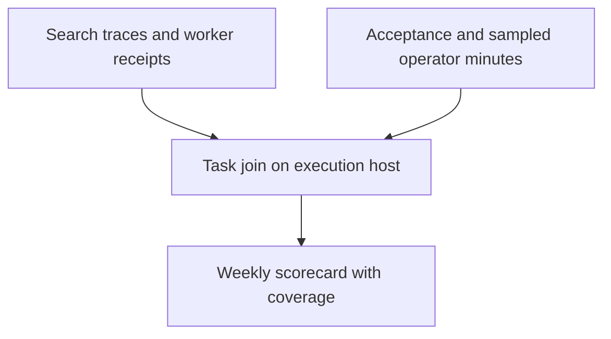

# Proposal: measure operator leverage in Morpheus

**Draft for discussion.** Start with a two-week, opt-in measurement pilot on two projects already using Morpheus. Reuse traces, task records, review evidence and Factory receipts. Add a small amount of metadata where those sources do not meet. The first result should be a scorecard that distinguishes a fast lookup, a fast delivery, and work that saves an operator time. It should also show which comparisons are still impossible.

Morpheus exists to help an operator and collaborators achieve their goals through agents with durable records and enough visibility to steer. A release that buys hours today by creating repeat work next month fails that objective. The unit is a **comparable accepted outcome**, whether software, a hardware validation milestone, or an operational decision with specified evidence. The design keeps Markdown in Git as the source of truth for intent, decisions and acceptance ([architecture §7.3](../architecture.md#73-the-work-loop), [§7.5](../architecture.md#75-agent-records)). Measurement is derived from that record and lives beside it.

## A starter scorecard

| KPI | Definition | First usable source and current limit |
|---|---|---|
| **Operator leverage** | Accepted outcome units ÷ operator active hours on the same intake cohort, including operator time spent on work that aborts or misses the window. Start with one unit per predeclared comparable task within a work class; publish the mix and denominator. | Sampled minutes for briefing, steering, reviewing, and accepting, pooled across operators; today count clarifications and corrective turns as proxies, never convert idle time or a turn count to minutes without calibration. Report ratio of sums, measurement coverage and uncertainty. |
| **Accepted lead time** | p50/p90 wall clock from actionable intake to first proof the agreed acceptance criteria are met. Decompose queue, agent/review work, CI/release and waiting on a person where identifiable. | Intake and acceptance markers are often missing. Report claim → PR/delivery as a separate surrogate today. Cohort by intake, report open/blocked/no-result rates and time at risk; completion-only quantiles cannot support a claim of acceleration. |
| **Throughput and trend** | Comparable outcomes accepted per week by project, task class and fixed size band. Show weekly counts and four-week rolling rate; compare like-for-like with the previous four weeks once available. | Roadmap/PR reconciliation gives merged items today, not customer acceptance. Assign size as small/medium/large at intake, freeze the original band, and audit split/duplicate tasks. Avoid PR count, code lines, or team rankings as productivity measures. |
| **Quality and durability** | First-attempt acceptance and 30-day material rework per accepted cohort; mark cause: wrong intent, missing source, regression, or other. Include operations/maintenance load and cost per accepted outcome as guardrails. | Review findings, reverts, reopened items, linked follow-ups and release probes are partial signals. Add an acceptance verdict and link attributable rework; show matured denominator, agent/gateway usage coverage and any unobserved cost. |

A workable week-one scorecard can expose adoption and timing by provider/role, claim-to-merge, and observation coverage. Mark real leverage, accepted lead time and improvement trends as unavailable if their denominators are missing. Do not create a weighted score to hide trade-offs. Keep throughput and operator leverage alongside quality, agent resource use and future upkeep. In each stratum, compare the same tasks or matching work classes; a shift from product features to short infrastructure fixes can make the aggregate improve without any real gain.

**Diagnostic ladder for the Context MCP:** launch and availability → first attempted lookup → first result visible to the model → first sufficient evidence (judged on a sample) → first correct decision → acceptance. Record server, client, first-evidence and end-to-end timings separately. Retrieval success is finding and reading the applicable source, not producing a nonempty result. For codebase-memory, grade graph scope and citation safety, and whether it avoided a shell search or prevented a stale structural conclusion. The two MCPs serve different kinds of questions.

## Data contract: collect less and join locally

Make a versioned allowlist, with no search text, excerpts, prompts, commands, transcript bodies, file paths, raw session IDs, or credentials on the export path. Reuse the existing file cap and 30-day retention for event detail. The operator can delete a pilot export or stop collection without changing work eligibility. Keep raw profiling behind the existing local permission boundary. For a multi-host pilot, export only approved aggregates or task-cohort rollups to an authorized private project; default is local analysis, no uploads. An empty report must state its coverage, including host-hours missing, rather than implying zero usage. Do not require another database, telemetry vendor, inbox action or merge gate.

| Grain / event | Existing source | Small addition / join |
|---|---|---|
| Session attempt / capability check | Startup hook and overview, installed CLI receipt, transcript metadata | At launch record the **executing** build revision (not worktree HEAD), host class, client+version, provider/role when proven, worktree match, and whether each intended MCP was callable/healthy. Separate launched, attempted, eligible and observed. Host class denotes desktop, CLI, or Fleet, not hostname. (90–95% join is a pilot target, not a baseline.) |
| Read/search and fallback | [Context trace v1](../src/context-search/rollout.ts); [profile spans](../src/profile/types.ts); graph tools via client spans | Preserve operation, transport, server duration, optional client duration, returned-token estimate, warm/cold/cache/partial and bounded reason codes. Give a per-attempt lookup ID to server/client/visible events where the wrapper can propagate it safely. Record allowed reasons: absent, scope mismatch, coverage, result-budget/limit, stale/partial, timeout, other; unknown stays unknown. Capture one explicit fallback reason when observable; do not reclassify all grep or reads as failure. |
| Task lifecycle and assignment | Roadmap/claim, PR/Actions/QA evidence and Factory receipts | Stable local task key: repository identity + canonical work item ID; use preassigned IDs only for enrolled intake, leave older unclaimed tasks unknown. Keep attempt identity and lineage separately (Factory run/attempt → native session link; native subagent → parent). Link (task, role, version, mode) at attempt start. When supplied, read merged/deployed/verified evidence timestamps; otherwise mark missing. |
| Acceptance and cost | Acceptance note/QA verification, review record, provider usage | Record `accepted_at`, coarse verdict, evidence reference (local only), and intended scope band. Controller-side estimated tokens/cost only when observed; maintain cached and reasoning token distinctions. Preserve accepted, incomplete, blocked, rejected and abandoned in each denominator. An accepted research memo is valid with its own acceptance evidence; a draft opening alone is not acceptance. |
| Sampled operator time | None authoritative; chat turns and review/QA actions already timestamped | Per sampled task one brief confirmation, with optional minute bands (<2, 2–5, 6–15, 16–30, >30 measured if practical) for briefing, steering, acceptance/review. Include failed work, time away stays out, overlaps count once per person. Track whether touch was necessary steering, clarification or rework. Human waiting is a separate wall-clock component. |

Generate stable, domain-separated keyed pseudonyms when publishing private cross-host rollups (same per pilot across authorized hosts; secret held by exporter, a different key for a new pilot). Keep raw identifiers at source. The existing context hash can be recomputed in-process to join historical rows as a diagnostic; do not use it as a new external identifier. Reject ambiguous or cross-project joins; aggregate same-run retries separately from task outcomes. Cross-check with actual receipt identity, not directory shape. Record versioned windows in UTC, with monotonic durations per event, nonnegative subintervals, attributable sample counts and provenance. Use at-least-once collection with deterministic event IDs and deduplicate by source/id. Report gaps and clock skew. Never guess task acceptance from text.

**Worked example (synthetic):** A scoped infrastructure outcome enters at 09:00 and is accepted at 11:00. The worker uses 500 ms to return results, unlocks the correct governing decision 23 seconds after the first prompt, and spends the rest on implementation/review. Operator actions total six minutes (2 brief, 1 steer, 3 verify). It contributes one unit, 120 elapsed minutes, and six operator minutes to the workload cohort. If a related task aborts after eight operator minutes, the cohort has one unit per 14 minutes (4.3 units/operator hour), not ten. If a burst of 20 searches improves by 0.2 seconds each, the direct saving is four seconds of tool time at most; avoiding one eight-minute correction is material. For proposal ranking use this kind of sensitivity calculation, not a claimed lift.

## Two weeks of evidence, with a decision attached

1. **Before day one:** choose two willing pilot projects, one desk/worker route with known context capability and one contrast (e.g. native vs Fleet, Claude vs Codex) without treating that contrast as a randomized causal comparison. Agree the acceptance marker, eligible tasks (do not count a greeting or a project switch as a lookup opportunity), three size bands and simple human time input. Freeze field definitions, baselines, versions and thresholds in a private manifest. Generate current diagnostic aggregates, document gaps and verify logging works on one Claude and one Codex root plus one nested attempt and one Factory worker. Test an absent tool, wrong worktree and both cache states; unknown must survive.
2. **Days 1–7:** shadow report; add no user-facing default beyond the pilot. Reconcile a random sample of 10 joins against claim/receipt/evidence, plus purposively sampled failures. Check coverage and exact reason codes. Compare passive touch counts with actual minute bands, by task class, and publish calibration error; don't fill unknown time statistically in the first scorecard. Target at least 90% matched eligible attempts, >=80% acceptance endpoint coverage and >=70% operator-time response before estimating a cohort ratio. If lower, fix the collection first or report bounds. Do not treat these thresholds as release gates.
3. **Days 8–14:** repeat report by runtime/build and strata. Start a paired replay of frozen, accepted historical searches and small tasklets whose expected decisions are independently judged. Tune on development data only; use a fresh held-out source split to confirm. Compare ordinary existing file/graph tools vs the same tools plus Context MCP at equivalent startup policy; test compact startup as a separate factor, and graph availability separately on structural questions. Counterbalance order, freeze model/effort/project snapshot, cache states and allowed time; blind acceptance scoring, use independent tasks as the unit and report paired intervals. Preserve the same governing-source and acceptance requirements in both arms. A live matched rollout is descriptive until opportunity and confounders are demonstrated.
4. **Readout:** show p50/p95 and n of server/client latencies, time to sufficient evidence, quality, cost, the five largest sources of lost time, and actionable missingness. Day 14 can decide whether adoption/visibility instrumentation works. It cannot yet decide 30-day rework or sustained velocity. Revisit those at day 45 and once four comparable weeks exist. Count canceled attempts and failures, do not remove them as slow outliers. Use an initially small dev set (about 12 cases) to measure repeat noise and variance. Size the locked comparison from that variance, and leave an underpowered result inconclusive. Reuse the [retrieval evaluation protocol](../qa/evals/context-retrieval/README.md) and [historical decision eval](../qa/evals/agent-stack/README.md) rather than creating another ingestion system.
5. **Commit / revise / stop:** prefer a change only if a coverage-aware paired result shows a practically meaningful improvement (starter threshold: 20% lower median time to sufficient evidence or one fewer retrieval turn, with no severe grounded decision regression), and quality/cost are at least stable. For operator leverage, report an interval and the raw sample; choose a materiality threshold after calibrating sample noise but before comparing pilot arms. Expand only if the workflow saves more human time than the collection and maintenance cost. Turn off timing collection if the instrumentation itself adds noticeable lookup time (budget p95 ≤10 ms added per tracked call on the pilot host) or an exporter exceeds its privacy boundary. Upgrade public recommendations only with measured transfer.

**Urgency:** better attribution and one human-time sample can begin before collecting a second month of incomparable records. A dashboard, extra search engine, generalized data platform and cross-project deployment stay behind the pilot evidence. No runtime instrumentation, collection or scheduled job is enabled by this draft.
