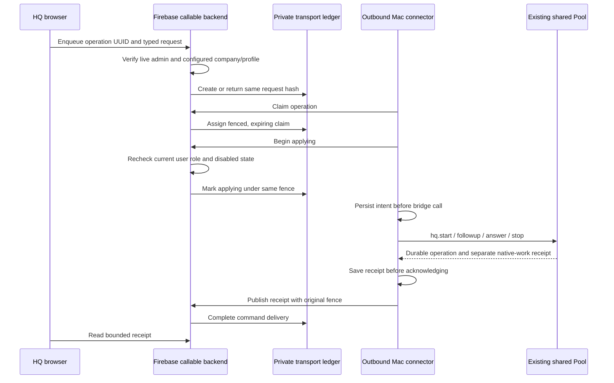

# Firebase to the private Paperclip controller

**Work in progress.** This opt-in prototype connects one configured HQ company to the
MacBook Pro controller. It is tested locally; it is not deployed or enrolled in a company HQ.
The [overview](paperclip-overview.md) records the accepted target. The
[worker admission facade](paperclip-hq-actor.md) and
[closeout exporter](paperclip-closeout.md) are separate parts of that target.

The browser calls a Firebase callable function using its normal Firebase ID token. The function
checks the current Auth user, existing admin/employee role, and installed company mapping. It
writes a command to private Firestore storage. The Mac makes outbound authenticated callable
requests to claim the command and applies it through the existing local bridge. There is no
public listener on the Mac, Firestore Admin credential on the connector, second Pool, or second
work scheduler. Paperclip retains the execution conversation; the transport stores temporary
instructions and receipts.



## Authority and identity

One deployed Firebase project maps to one explicit Paperclip company and controller. The function
uses Admin Auth `getUser`, not a browser-supplied role or merely an older ID-token claim. Admins
may enqueue; admins/employees may read receipts. The dedicated connector UID is excluded from
human operations and may only list, inspect, claim, begin and complete transport commands.
The server derives `actor: {uid, role: "admin", kind: "user"}`. It rechecks that user immediately
before applying queued work. No automatic agent or token-refresh identity is enrolled by this code.

The Mac's separately installed `hq.json` pins the company, controller, configured profiles and Git
repository. Each local action is authorized again there, including reads and stops. The existing
native subscription quota, permission, account reservation and host checks still run. HQ cannot
choose an arbitrary model, account, machine, workspace or permission override. For this first
callable, structured answers are a bounded dictionary of strings; tool permissions use `allow`.

Firestore commands live at `paperclipTransport/<company>/commands/<operation>`, **outside
`/hq/**`**. Direct clients, including admins, are denied. A nested deny inside an existing broad
allow cannot override that allow. Consumer rules must retain this isolation; Admin SDK access
bypasses rules and therefore stays inside the authorized backend.

[Callable authentication](https://firebase.google.com/docs/functions/callable),
[overlapping rules](https://firebase.google.com/docs/firestore/security/rules-structure#overlapping_match_statements),
[transaction behavior](https://firebase.google.com/docs/firestore/manage-data/transactions).

## Delivery, crashes and reconnect

An operation UUID binds the normalized payload and actual user. Repeating it returns the same
intent; changed content or another actor refuses. Claims have fences and expiry. An expired pre-application claim cannot begin; a replaced fence cannot publish a receipt.
A saved receipt may publish under the original applying fence after its lease expires. Once applying, a command is never automatically made pending
again. A missing receipt becomes `unknown`; it requires observation of the original bridge
operation rather than reposting a request. Firestore transaction callbacks contain no native or
Paperclip effects, because Firebase may retry those callbacks.

The private Mac journal records prepared intent, applying intent and receipt. Filenames hash
the exact operation ID so accepted uppercase IDs remain recoverable and case-only spellings
cannot alias on a Mac; the stored operation ID itself is preserved. A reconnect can
publish a saved receipt without invoking the bridge again. A prepared intent can proceed only
through a fresh backend authorization/fence; an interrupted applying intent is reported unknown.
The bridge also persists its operation-to-conversation/turn binding before the upstream effect.

`completed` means **command delivery has a receipt**. Native success, termination and Git
acceptance remain separate. A stop request may have a completed receipt while its work is still
stopping. Receipts carry an observation time and the local bridge's explicit work fields; they
are not a continuously refreshed conversation/log projection. The full inbox, live UI streaming,
shared occupancy projection and attachment reading still need integration.

One connector journal directory has an exclusive local lock. Normal passes release it; a process
crash preserves it. Do not delete it on elapsed time or PID alone: inspect its exact process and
bridge operation first. Retain its journal; an interrupted applying operation must remain unknown.
Automatic stale-lock ownership recovery is not qualified by this prototype.

## Local verification

The optional deployment dependencies stay under `scripts/paperclip-hq/`, outside the kit's runtime.
The core uses existing Zod and Node facilities. No paid services or real credentials are needed:

```sh
pnpm install --frozen-lockfile
pnpm exec vitest run tests/paperclip-hq.test.ts
pnpm --dir scripts/paperclip-hq install --ignore-workspace --frozen-lockfile --ignore-scripts
pnpm --dir scripts/paperclip-hq run build
# Node 22, Java 21+, firebase-tools 15.30.1 on PATH
node scripts/paperclip-hq/run-emulators.mjs
```

The harness refuses an existing `.env.local`, creates only its own temporary mapping, runs the
fixed `demo-morpheus-hq` Auth/Functions/Firestore emulators, and removes its env file afterwards.
The test refuses other emulator/project endpoints. It verifies actual callable authentication,
role refresh, direct Firestore-write denial, duplicate enqueue, company mismatch and one fake
bridge invocation. It launches no native provider. The path-scoped workflow runs this on Node22.
Local testing on this Mac also ran on Node26; that does not prove Node22 compatibility by itself.

## Operator entry points and remaining rollout

`entry.ts` exports seven narrow Cloud Functions. `MORPHEUS_HQ_SETTINGS_JSON` must contain the
explicit company/controller, connector UID, allowed profile names and optional `allowedOrigins`
for the company's browser. Without allowed origins, browser CORS is disabled. No deployment
command is supplied before an actual consumer project and its identity are qualified.

`connect.mjs` runs one bounded outbound pass using a private absolute-path configuration file:

```sh
node scripts/paperclip-hq/connect.mjs /absolute/private/connector.json
```

The strict configuration fields are `companyId`, `controllerId`, `connectorId`, `baseUrl`
(the callable region prefix), `directory` (private journal), `bridgeClientModule` (the existing
native bridge client), and `tokenFile` (owner-only current Firebase ID token). Tokens are read
fresh per request and never logged or stored in journals. Token renewal/enrollment must be
provided by the consumer's existing authentication; a short-lived token file alone is not an
around-the-clock deployment. This command neither installs nor hot-replaces the personal plugin.

Before rollout: choose/enroll a real connector identity without widening user access; qualify
token renewal, consumer CORS/rules/IAM and private artifact retention; install a restart policy;
verify the actual Mac bridge end to end with a native worker; build the company-styled inbox and
bounded live projections; then qualify two companies against one global capacity owner. Current
Pool configuration has one company, so multi-company routing is explicitly unfinished. Existing
Markdown inboxes remain authoritative until migration validation and closeout review pass.
