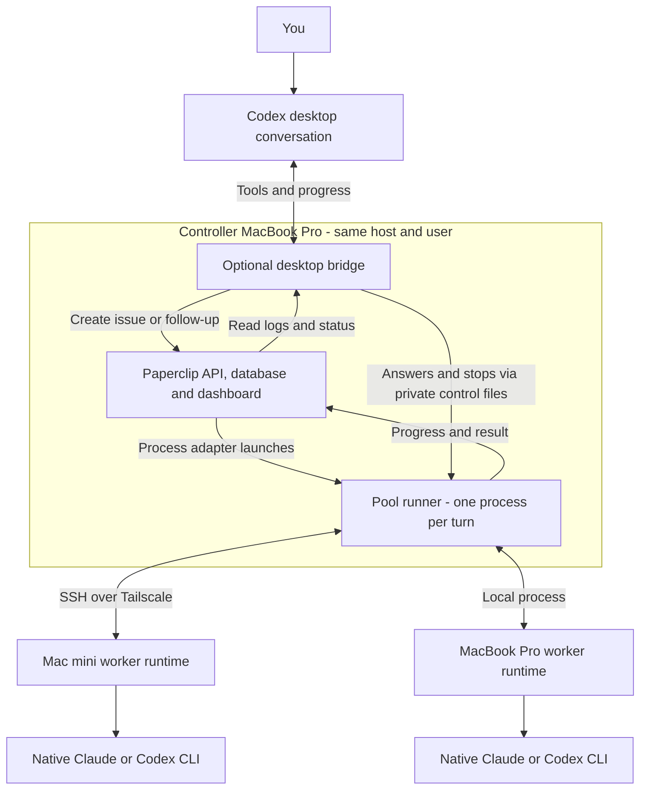
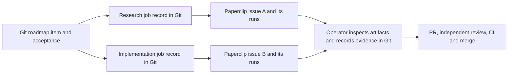
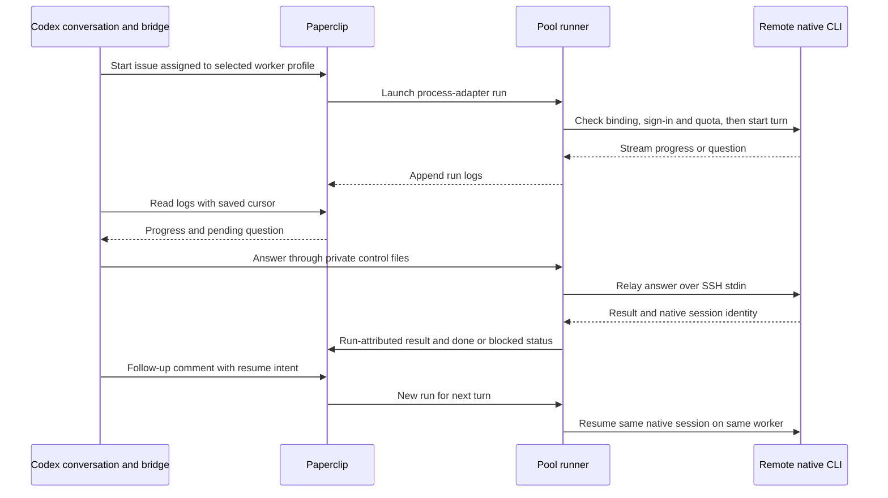

# How Morpheus and Paperclip fit together

> **Work in progress.** The Paperclip integration is an opt-in, tested prototype.
> This describes the October 24, 2026 implementation; broader project rollout is still pending.

**Morpheus defines the work and what counts as delivered. Paperclip runs and tracks delegated
work. The desktop bridge lets you supervise that work from your existing Codex conversation.**

## Who owns what

| Component | Responsibility |
|---|---|
| Morpheus in each project's Git repo | Roadmap, acceptance criteria, decisions, worklogs, claims, PRs, independent review and CI. |
| Skills, such as agentic CTO | How the coordinating agent plans, delegates and evaluates work within an agreed budget. |
| Paperclip | Agent registrations, assigned issues, execution runs, logs, operational status and dashboard. |
| Optional Codex/Claude bridge | Turns desktop requests into Paperclip work; relays progress, questions, answers, follow-ups and stops; remembers conversation identities. |
| Worker runtime on each Mac | Runs the host's installed Claude or Codex CLI, checks native sign-in and quota, and protects its workspace and process lifetime. |

Paperclip uses Morpheus's adapters and task instructions; it does not need to understand the
whole Morpheus PM schema. Morpheus uses Paperclip's execution machinery and dashboard. A
Paperclip issue marked `done` means that execution turn finished; repository delivery still
requires inspected evidence and the normal PR/review/CI/merge path.

## 1. Where the pieces run

Paperclip's **process adapter** launches our pool runner. That runner owns the SSH connection
and worker lease; the desktop bridge observes it and sends controls. Restarting the desktop
bridge can therefore reconnect to a still-running turn. Losing the runner or SSH is a different
failure: the host stops the turn, and uncertain cleanup holds its reservation until reconciled.

The controller API is loopback-only and authenticated. The Air's dashboard access uses a
forwarded port over the private connection. That browser view does not execute workers or keep
them alive. Controller and coordinator bridge must share a host and user in this version.

## 2. Git tasks and Paperclip jobs

The explicit task-linkage tool supports **one Morpheus roadmap item to many Paperclip issues**:

`scripts/paperclip-bridge/` prepares and submits immutable jobs, then reads back their exact
issue identities. Records live at `.agent/paperclip/<roadmap-ID>/<job>.json`, with repository,
branch, source SHA, acceptance reference and evidence hashes. Reconciliation records an

operator-verified result; it never marks the roadmap item shipped automatically.

There are **two complementary integration surfaces today**:

- **Git linkage:** `scripts/paperclip-bridge/` connects committed repository tasks and evidence
  to Paperclip issues.
- **Interactive delegation:** `plugins/codex-claude/` connects a Codex conversation to a worker
  profile, Paperclip issue/runs and native CLI session. Its live state is private local data.

They are not automatically joined end to end yet: starting an interactive pool conversation
does not itself create the committed Git job record or synchronize roadmap/worklog status.
The coordinator/operator supplies that linkage and promotes verified evidence through Git.

## 3. An interactive remote conversation

One interactive conversation has **one Paperclip issue, one native session, and a separate
Paperclip run for each provider turn**. Claude supports a live question/answer exchange; Codex
reports `needs_input` at a turn boundary. Follow-ups begin after the previous turn ends.
Routine reversible questions may be answered by the coordinator with a recorded reason;
new authority and tool-permission approvals still require the user's actual authorization.

The bridge saves IDs and log cursors for reattachment. Each turn has one atomic launch claim
so duplicate Paperclip wakes do not launch another provider call. After interruption,
`reconcile` establishes host termination; `recover` can release the supported exact-run hold
and continue the saved follow-up. Unknown effects remain visible instead of being called success.

## Machines, subscriptions and rollout status

A worker profile binds **provider + Paperclip agent + account identity + host + workspace +
model/effort + permissions**. The coordinator selects a configured profile. The runtime checks
fresh native quota and reserves capacity by account; profiles using the same subscription must
share its account identity. Each host uses its own native login. The remote worker receives no
Paperclip token or copied provider credential. Requested model/effort and observed provider
metadata are recorded separately; unreported values stay unknown.

At qualification closeout, remote Claude and Codex on the mini had passed streaming,
questions, remembered follow-ups, coordinator reconnect, stop/reconciliation and recovery;
all test agents were paused. Claude's stop test ended a worker waiting for a permission,
while Codex's test stopped an actual foreground command. Claude shell-command stopping and
logout/reboot readiness remain untested. Mini Claude currently relies on its logged-in GUI
session for native Keychain access.

The qualified runtime is privately staged; the installed personal desktop plugin was not
hot-replaced during the active session. Automatic best-worker/model routing, cross-account
session migration, general consumer-repo delivery and simulator load balancing remain rollout
work. Paperclip supplies the execution foundation; adding machines, logins and project skills
still requires our enrollment and qualification layer. The earlier pilot enrollment scripts
are not a universal one-command installer for the interactive stack.

## Where to go deeper

- [Interactive bridge design and live evidence](paperclip-interactive-bridge.md)
- [Git task linkage and authentication contract](paperclip-integration.md)
- [Bridge setup and pool commands](../plugins/codex-claude/README.md#remote-pool-workers-through-paperclip)
- [Earlier infrastructure pilot](paperclip-pilot-design.md) and [results](paperclip-pilot-results.md)
- [Workflow comparison](paperclip-workflow-comparison.md) — evaluation results and their limits
