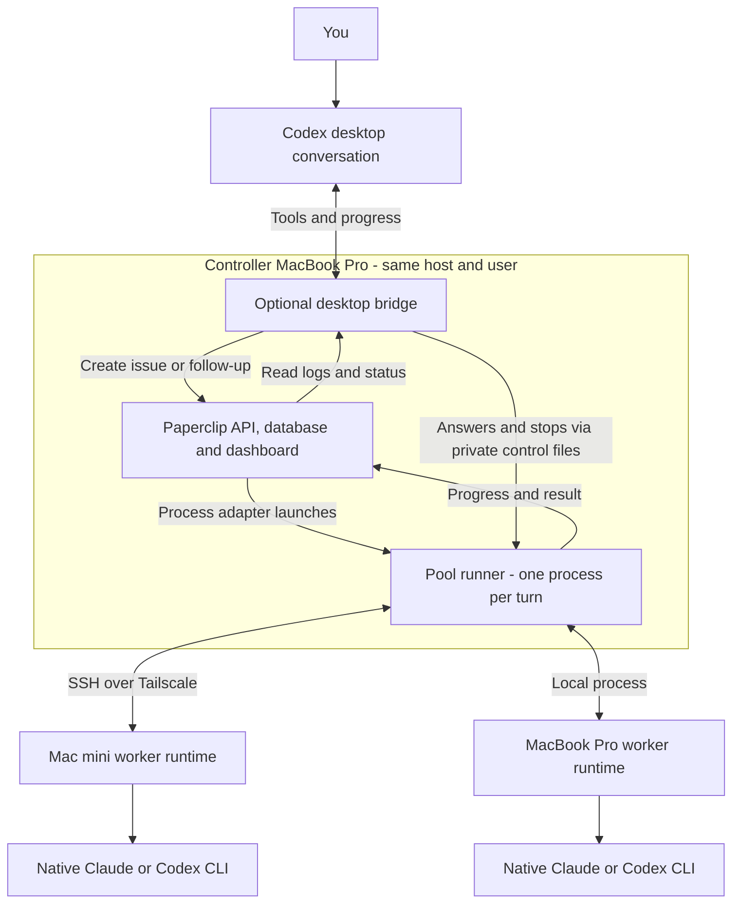
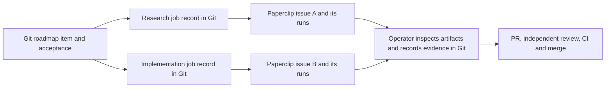
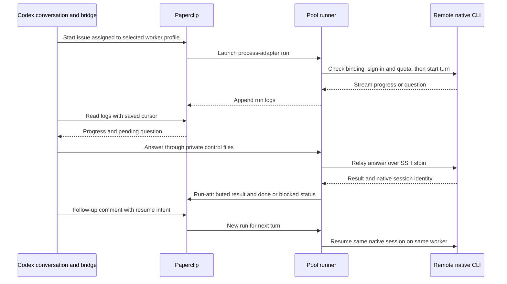
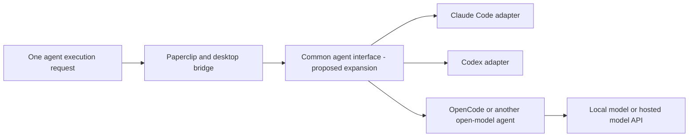
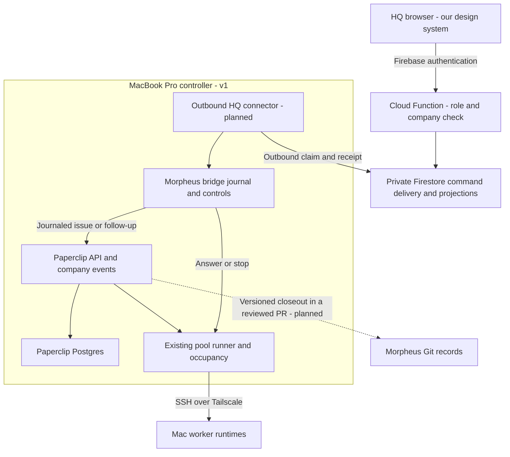

# How Morpheus and Paperclip fit together

> **Work in progress.** The Paperclip integration is an opt-in, tested prototype.
> This describes the October 24 implementation and October 25 design decisions;
> broader project rollout is still pending.

October25 implementation status: the [scoped HQ actor facade](paperclip-hq-actor.md)
and [outbound Firebase transport](paperclip-hq-transport.md) have landed. A
[controlled qualification](paperclip-hq-qualification.md) joined real demo Auth,
Functions and Firestore to the existing private Pool and remote Codex, including a
saved-receipt reconnect, same-session follow-up and independently read nonce files.
Its frozen Git closeout records those exact bytes. The private test runtime was
adopted for one paused Codex test agent; production HQ authentication, full browser
UI, multiple companies and Markdown-inbox migration remain unimplemented. Claude's
new transport run is not qualified because fresh native usage access requires its
account owner's sign-in; the earlier desktop bridge's Claude evidence is separate.
Questions and answers on the new Firebase route are qualified only with fixtures;
live HQ streaming, projections and the browser UI have not been deployed.

**Morpheus defines the work and what counts as delivered. Paperclip runs and tracks delegated
work. The desktop bridge lets you supervise that work from your existing Codex conversation.**

## Who owns what

| Component | Responsibility |
|---|---|
| Morpheus in each project's Git repo | Roadmap, acceptance criteria, decisions, worklogs, claims, PRs, independent review and CI. |
| Skills, such as agentic CTO | How the coordinating agent plans, delegates and evaluates work within an agreed budget. |
| Paperclip | Agent registrations, assigned issues, execution runs, logs, operational status and dashboard. |
| Optional Codex/Claude bridge | Turns desktop requests into Paperclip work; relays progress, questions, answers, follow-ups and stops; remembers conversation identities. |
| Worker runtime on each Mac | Runs the host's installed Claude or Codex CLI, checks native sign-in and quota, and protects its workspace and process lifetime. |

Paperclip uses Morpheus's adapters and task instructions; it does not need to understand the
whole Morpheus PM schema. Morpheus uses Paperclip's execution machinery and dashboard. A
Paperclip issue marked `done` means that execution turn finished; repository delivery still
requires inspected evidence and the normal PR/review/CI/merge path.

## 1. Where the pieces run

Paperclip's **process adapter** launches our pool runner. That runner owns the SSH connection
and worker lease; the desktop bridge observes it and sends controls. Restarting the desktop
bridge can therefore reconnect to a still-running turn. Losing the runner or SSH is a different
failure: the host stops the turn, and uncertain cleanup holds its reservation until reconciled.

The controller API is loopback-only and authenticated. The Air's dashboard access uses a
forwarded port over the private connection. That browser view does not execute workers or keep
them alive. Controller and coordinator bridge must share a host and user in this version.

## 2. Git tasks and Paperclip jobs

The explicit task-linkage tool supports **one Morpheus roadmap item to many Paperclip issues**:

`scripts/paperclip-bridge/` prepares and submits immutable jobs, then reads back their exact
issue identities. Records live at `.agent/paperclip/<roadmap-ID>/<job>.json`, with repository,
branch, source SHA, acceptance reference and evidence hashes. Reconciliation records an
operator-verified result; it never marks the roadmap item shipped automatically.

There are **two complementary integration surfaces today**:

- **Git linkage:** `scripts/paperclip-bridge/` connects committed repository tasks and evidence
  to Paperclip issues.
- **Interactive delegation:** `plugins/factory/` connects a Codex conversation to a worker
  profile, Paperclip issue/runs and native CLI session. Its live state is private local data.

They are not automatically joined end to end yet: starting an interactive pool conversation
does not itself create the committed Git job record or synchronize roadmap/worklog status.
The coordinator/operator supplies that linkage and promotes verified evidence through Git.

## 3. An interactive remote conversation

One interactive conversation has **one Paperclip issue, one native session, and a separate
Paperclip run for each provider turn**. Claude supports a live question/answer exchange; Codex
reports `needs_input` at a turn boundary. Follow-ups begin after the previous turn ends.
Routine reversible questions may be answered by the coordinator with a recorded reason;
new authority and tool-permission approvals still require the user's actual authorization.

The bridge saves IDs and log cursors for reattachment. Each turn has one atomic launch claim
so duplicate Paperclip wakes do not launch another provider call. After interruption,
`reconcile` establishes host termination; `recover` can release the supported exact-run hold
and continue the saved follow-up. Unknown effects remain visible instead of being called success.

## A common interface for agent compute

**Yes: Paperclip already supplies an agent-adapter interface.** Its installed 2026.1012.0
contract standardizes execution, environment checks and session serialization, with model
discovery hooks. It includes Claude, Codex and OpenCode adapters. Our qualified remote pool
currently uses its `process` adapter plus our bridge; that pool accepts only Claude and Codex.
Paperclip's wider adapter catalog is not automatically available through it.
[Pinned adapter contract](https://github.com/paperclipai/paperclip/blob/v2026.1012.0/packages/adapter-utils/src/types.ts).

**Recommended next step:** keep one coordinator-facing contract and extend the runtime adapters
underneath it. Reuse Paperclip's adapter system and evaluate **Agent Client Protocol (ACP)**
for interactive sessions before adding another framework. ACP standardizes prompts, streamed
updates, tool permissions, cancellation and session configuration; its ecosystem includes Claude
and Codex adapters. Native sign-in, quotas and remote recovery still need qualification for each
chosen adapter. This is a proposed extension; it does not replace the tested native-CLI path.
[ACP introduction](https://agentclientprotocol.com/get-started/introduction),
[agent integrations](https://agentclientprotocol.com/get-started/agents).

The common interface should expose start, progress/events, answer, follow-up, stop, reattach
and recovery, while advertising which capabilities each adapter supports. Every run should retain:

| Record | Required distinction |
|---|---|
| Agent and runtime | Logical worker/role, harness and adapter versions, provider, host, account and workspace. |
| Model and effort | Requested model/version and effort; separately reported effective values and provenance. Unsupported or unreported values stay explicit. |
| Execution and resources | Task/run/session IDs, permissions, timestamps, outcome, token usage, quota/reservation observations and termination evidence. |

An effort label is not a universal unit of compute: adapters must declare supported settings
and any mapping. ACP exposes model and reasoning-level configuration categories, but their
presence does not prove which model or effort actually served a turn.
[ACP configuration](https://agentclientprotocol.com/protocol/v1/session-config-options).

**OpenRouter and LiteLLM fit below the agent harness.** OpenRouter provides hosted access to
many models; LiteLLM offers an open-source, self-hostable model gateway. Neither model gateway
alone replaces native Claude/Codex sessions, machine allocation or our interactive worker contract.
OpenRouter's SDK availability should not be mistaken for a self-hostable agent dispatcher.
For open models, first qualify a harness such as OpenCode, which Paperclip already supports,
then choose direct/local inference or a gateway when needed. No new gateway is adopted here.
[OpenRouter](https://openrouter.ai/docs/quickstart), [LiteLLM](https://docs.litellm.ai/docs/),
[Paperclip's OpenCode adapter](https://docs.paperclip.ing/reference/adapters/opencode/).

## Paperclip inside our HQ, and Firestore instead of Postgres

**Research and proposal only. Today no HQ page talks to Paperclip.** The dashboard is reached
through the controller's loopback port or the Air's forwarded port, as described above.

**How installed Paperclip 2026.1012.0 is coupled:**

| Layer | What the installed source shows | Consequence |
|---|---|---|
| Dashboard | A React board app served by the same Express server; its data comes from `/api`. | Coupled to Paperclip's API, not to its database. HQ can reuse the API. |
| Auth and authorization | Board users sign in through Better Auth on Paperclip's own tables. Board/agent API keys and run tokens are checked by Paperclip's server code. | Paperclip does not know Firebase identities or Firestore rules. |
| Database | Drizzle ORM on Postgres, embedded by default: roughly 240 tables and 304 SQL migrations. Drizzle is imported by about 320 server modules, with ~470 `SELECT … FOR UPDATE` call sites, some `NOWAIT`/`SKIP LOCKED`, plus Postgres advisory locks and upserts. | Launch claims, idempotent issue creation and wake deduplication, which our bridge relies on, are built on Postgres locking. |
| File storage | Attachments already pass through a pluggable `StorageProvider` with local-disk and S3 providers. | This extension point handles files; database access has no equivalent provider interface. |

Sources: [schema](https://github.com/paperclipai/paperclip/tree/v2026.1012.0/packages/db/src/schema),
[DB client](https://github.com/paperclipai/paperclip/blob/v2026.1012.0/packages/db/src/client.ts),
[Better Auth setup](https://github.com/paperclipai/paperclip/blob/v2026.1012.0/server/src/auth/better-auth.ts),
[authorization](https://github.com/paperclipai/paperclip/blob/v2026.1012.0/server/src/services/authorization.ts),
[storage interface](https://github.com/paperclipai/paperclip/blob/v2026.1012.0/server/src/storage/types.ts).
Counts are approximate observations during October 25 QA of the installed build's compiled
`server` and `db` packages, not compatibility guarantees.

| Option | What it means | Cost and risk |
|---|---|---|
| 1. Links and deep links | HQ lists linked jobs from `.agent/paperclip/` and links to their Paperclip issue/run pages. | Small. Opening a link still needs private network access and a Paperclip sign-in. |
| 2. Native HQ controls through a server-side API boundary | An HQ server route verifies the Firebase session, then calls Paperclip's REST API with a server-held key and renders status, logs, start, answer and stop. | Medium. The deployed HQ must reach the loopback-only controller, which needs a network and deployment decision. |
| 3. Replace Postgres with Firestore | Rewrite Paperclip's data layer and auth adapter for Firestore. | Very large, and in practice a permanent fork: every upstream release and migration must be ported, and the locking semantics redesigned and requalified. |

**A server-side Firestore port would still need application authorization.** Firestore server
client libraries bypass security rules and use IAM. A Paperclip server using those libraries
would therefore enforce user permissions in its own code. Rules protect requests made with
the mobile/web client libraries, including direct browser reads; those reads would not pass
through Paperclip's authorization checks. Firestore transactions do not offer a drop-in
replacement for Postgres's row/advisory locks, queue queries or SQL migrations.
[Rules and server libraries](https://firebase.google.com/docs/firestore/security/get-started?authuser=cpheinrich@gmail.com),
[Firestore transactions](https://firebase.google.com/docs/firestore/manage-data/transactions?authuser=cpheinrich@gmail.com).

**How the two authorization systems would relate in option 2:** Firebase stays the HQ identity.
A user's `role` custom claim drives the `/hq` route gate (`decideHqAccess` verifies the session
cookie, then `canAccessHq`) and the generated Firestore role rules
([`src/hq/roles.ts`](../src/hq/roles.ts), [`src/hq/gate.ts`](../src/hq/gate.ts)). Morpheus ships
those gate, role and rules primitives; the dashboard pages are built in the project hosting HQ.
The proposed HQ server would use server-held Paperclip credentials, with company and action
scope verified against the exact endpoints before rollout. Paperclip would see that credential
as the actor, so HQ must also enforce per-user permissions, require `admin` (the proposed write
role) for controls, and record the Firebase user in its own audit trail.
The key never reaches the browser or a worker.

### Chris's direction, October 25 QA

These preferences now guide the proposal; they describe the target, not the current runtime:

1. **Our own design system.** HQ should render Paperclip's functionality in HQ's look, not
   Paperclip's board.
2. **One shared instance.** One Paperclip instance and one shared compute pool for all
   companies. Paperclip's company scoping maps each company's work to its own HQ. Every HQ can
   see what the shared runners are doing, so a backlog is visible.
3. **MacBook Pro controller for v1.** Keep Paperclip, Postgres and the bridge on the current
   MacBook Pro. Revisit a cloud controller if laptop availability causes problems; a VM is
   no longer a prerequisite.
4. **Go straight to option 2,** with Firebase role checks kept as simple as possible.
5. **An interactive inbox and ticket conversation.** Paperclip owns messages, screenshots,
   discrete inputs and assignments. Export versioned Markdown closeout snapshots to Git when
   the ticket wraps up. Chris accepted this contract in the final QA batch. Existing Markdown
   inboxes remain in service until the replacement passes migration checks.
6. **Firebase backend.** Use Cloud Functions and Firebase primitives for HQ, connected to the
   private Mac controller. Prefer simple existing roles and shared runner visibility.

### Recommendation, by direction

**1. Design system.** Build HQ's views in our design system over Paperclip's API. Do not embed or
restyle the board: its React app is Paperclip's own, and plugin UI slots render inside it, not in
HQ. Its [MIT license](https://github.com/paperclipai/paperclip/blob/v2026.1012.0/LICENSE)
allows reuse, and `@paperclipai/shared` supplies shared types and request validators. HQ can
relay company events or poll through its server; the browser never holds the Paperclip key.
Keep the board as the operator console for anything HQ does not cover yet.

**2. One instance, company-scoped HQs.** This fits Paperclip's model. Companies, agents, issues,
runs, comments and interactions have company ownership. Bind each HQ to its company in trusted
server configuration, and verify that the server credential and every issue/attachment request
respect that boundary. An arbitrary company ID from the browser cannot select another company.
Paperclip agents remain company-scoped; separate logical agent profiles can use the same physical
worker, with capacity reserved globally by host/account in our runtime.
[Company API](https://docs.paperclip.ing/reference/api/companies/).
**Shared-runner visibility is the gap.** Capacity and
reservations live in our pool runtime, not in Paperclip, and Paperclip's run lists are per
company. The pool should publish occupancy per host and provider (running, queued, reserved, free),
including company and job titles. Chris explicitly accepted this shared visibility. Company
threads, attachment contents and controls still resolve through their configured HQ company;
shared titles do not authorize arbitrary controller commands.

**3. Controller stays on the MacBook Pro for v1.** This preserves the qualified same-host
relationship between Paperclip's process adapter, pool runner and bridge control files. Remote
workers still use SSH over Tailscale. A cloud controller remains a later availability option,
with database persistence and a backup/restore test required before moving it.

**4. Firebase HQ backend, with simple role checks.** Option 2 remains the target. Use a Firebase
callable function for authenticated HQ operations, checking the existing role and a server-owned
HQ-to-Paperclip-company mapping. `canAccessHq` admits existing admins/employees to read; controls
require admin. Paperclip credentials stay on the controller.

A Cloud Function cannot assume a private route to the Mac's loopback API. The first implementation
will test an **outbound controller connector**: HQ submits a typed operation to a private
Firestore transport collection; the Mac claims it, invokes the existing bridge/Paperclip owner,
and publishes a receipt and bounded read projection. Firestore delivers requests and observations;
Paperclip still schedules work and owns its conversation. This is a proposed connection path,
not a deployed endpoint. The connector must preserve operation IDs and refuse blind replay after
an uncertain external effect. Disconnects should show an offline/waiting state in HQ.

**5. Interactive conversation: keep it in Paperclip, mint the record into Git.** Paperclip
already stores, per company-scoped issue:

- comments by users or agents;
- image and file attachments, linked to comments through the `StorageProvider`;
- structured interactions addressed to a user or an agent: `ask_user_questions`,
  `request_confirmation`, `request_checkbox_confirmation`, `request_item_verdicts`,
  `suggest_tasks`. They have `human_only` and other resolver policies, and can wake the
  assignee on an answer;
- human assignment (`assignee_user_id`, `responsible_user_id`), read states and inbox
  dismissals;
- revisioned issue documents.

These features exist in the pinned shared issue types as well as the current
[issues API](https://docs.paperclip.ing/reference/api/issues/); our HQ integration has not yet
qualified them end to end.

Duplicating that thread in Firestore would create two authorities for the same messages.
Recommended: an HQ inbox item is a Paperclip issue, or an interaction addressed to that person,
in their company. HQ reads and writes it through the server route. When the ticket wraps up, the
coordinator exports a versioned Markdown closeout record into Git with the PR: task and issue IDs,
the frozen conversation revision/cursor, decisions and accepted answers, validation evidence,
and attachment references with content hashes. Keep large images in durable private artifact
storage rather than committing every screenshot binary. Git preserves old committed snapshots;
making closeout files append-only needs an explicit validation rule. Reopening a ticket creates
a new snapshot instead of overwriting the previous one. One Morpheus item can aggregate several
Paperclip issues, and a completed execution turn alone does not trigger repository acceptance.

This contract is accepted for implementation. Today the inbox is `hq/team/<handle>.md` with the
[inbox cycle](runbooks/inbox-cycle.md). Replacing it still requires a qualified migration for
validation, archiving and promotion to `decisions.md`.

The [frozen-input closeout exporter](paperclip-closeout.md) is now available as an operator
prototype. It validates explicit normalized JSON and writes content-addressed snapshots; it
does not fetch a live Paperclip thread, establish acceptance or replace the existing inbox.
Live acquisition and migration remain separate qualification work.

| Kind of state | Single authority | Everyone else |
|---|---|---|
| Roadmap item, acceptance, decisions, completion record | Morpheus Git | HQ renders; Paperclip receives task instructions |
| Execution conversation: messages, screenshots, questions, assignments, runs and logs | Paperclip | HQ reads and writes through the server route |
| Shared compute capacity and reservations | Pool runtime | Every HQ reads occupancy and shared job titles |
| HQ identity and role | Firebase Auth custom claim | Paperclip sees the server credential |
| Existing HQ data; command delivery and bounded projections | Firestore, under role rules | Projections identify their source and observation time |

**How an HQ answer reaches a worker needs qualifying.** Paperclip delivers an interaction
response either by steering it into a live run or by waking the assignee for a new run
(`steered` and `wake_fallback` in its delivery records). Our qualified pool does not use that
path. A live Claude answer goes through the bridge's control files to SSH stdin. Codex asks at
a turn boundary, and the answer arrives as a follow-up. Until the runner consumes Paperclip
interaction responses, an HQ answer should be a follow-up that wakes the next turn. Live HQ
answers are a proposed extension. That follow-up must go through the bridge's turn journal:
posting a comment or interaction response alone does not create an authorized pool turn, and
an unrecognized wake can be a no-op. The new HQ backend needs a qualified remote route into
the bridge for starts, answers and stops, with an acknowledgment tied to the exact session.
The bridge also points a blocked issue's `unblockDescriptor`
at the controlling Codex conversation; HQ would become a second unblock route, which needs its
own rule for who answers first.

**Implementation direction:** keep Paperclip on Postgres and build option 2 directly. Use Firebase
for HQ authentication, backend and private delivery; use the existing pool to execute work. Start
with the existing private Paperclip artifact storage and record content hashes in closeouts;
qualify retention and restoration before calling those references durable. No new storage vendor
is required for the first slice. Do not copy the conversation into a second Firestore chat store.

**Final QA answers received, October 25:** controller stays on the MacBook Pro; Firebase hosts the
HQ backend; shared runner titles are allowed; the Paperclip inbox/Git snapshot contract is
accepted. Chris then authorized unsupervised implementation and testing. This authorizes code,
normal review/CI/merge and local qualification; cloud deployment and new paid resources remain
separate from that work.

**Validation before rollout:** connect two configured HQ companies to one controller; render each
company's own task, conversation and screenshot, with shared runner titles in both; answer a
structured question and verify the exact native session receipt; reject a mismatched company;
show offline/stale state during a controller outage and resume without duplicate turns; export a
completed thread twice without duplicate snapshots, then reopen it and preserve the old record;
verify attachment hashes. The controller is unavailable when the MacBook Pro is offline in v1.
Local/emulator tests and live native-worker qualification must be reported separately. These are
acceptance checks, not claims that the prototype already passes them.

## Machines, subscriptions and rollout status

A worker profile binds **provider + Paperclip agent + account identity + host + workspace +
model/effort + permissions**. The coordinator selects a configured profile. The runtime checks
fresh native quota and reserves capacity by account; profiles using the same subscription must
share its account identity. Each host uses its own native login. The remote worker receives no
Paperclip token or copied provider credential. Requested model/effort and observed provider
metadata are recorded separately; unreported values stay unknown.

At qualification closeout, remote Claude and Codex on the mini had passed streaming,
questions, remembered follow-ups, coordinator reconnect, stop/reconciliation and recovery;
all test agents were paused. Claude's stop test ended a worker waiting for a permission,
while Codex's test stopped an actual foreground command. Claude shell-command stopping and
logout/reboot readiness remain untested. Mini Claude currently relies on its logged-in GUI
session for native Keychain access.

The qualified runtime is privately staged; the installed personal desktop plugin was not
hot-replaced during the active session. Automatic best-worker/model routing, cross-account
session migration, general consumer-repo delivery and simulator load balancing remain rollout
work. Paperclip supplies the execution foundation; adding machines, logins and project skills
still requires our enrollment and qualification layer. The earlier pilot enrollment scripts
are not a universal one-command installer for the interactive stack.

## Where to go deeper

- [Interactive bridge design and live evidence](paperclip-interactive-bridge.md)
- [Git task linkage and authentication contract](paperclip-integration.md)
- [Bridge setup and pool commands](../plugins/factory/README.md#remote-pool-workers-through-paperclip)
- [Earlier infrastructure pilot](paperclip-pilot-design.md) and [results](paperclip-pilot-results.md)
- [Workflow comparison](paperclip-workflow-comparison.md) — evaluation results and their limits
