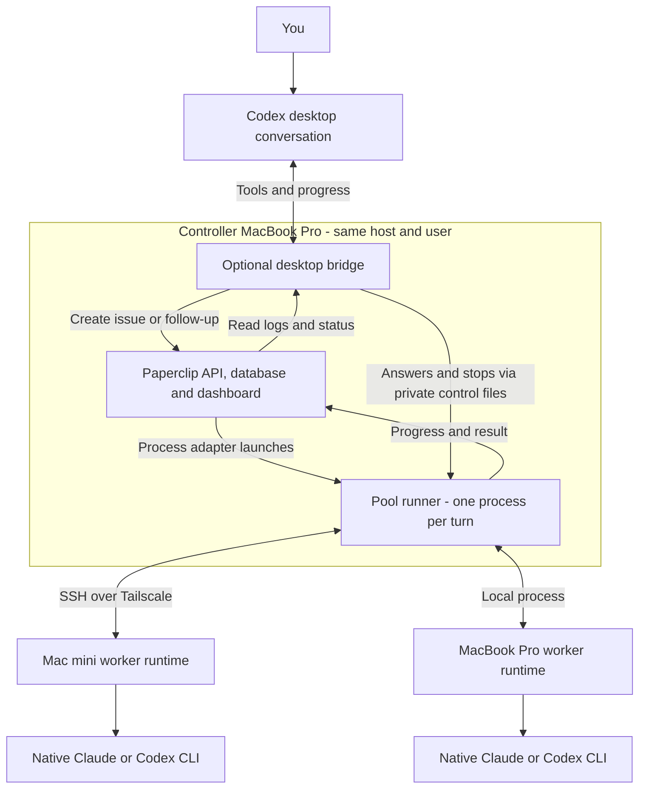
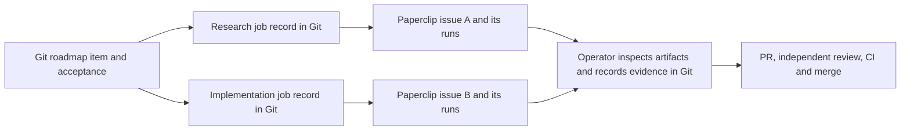
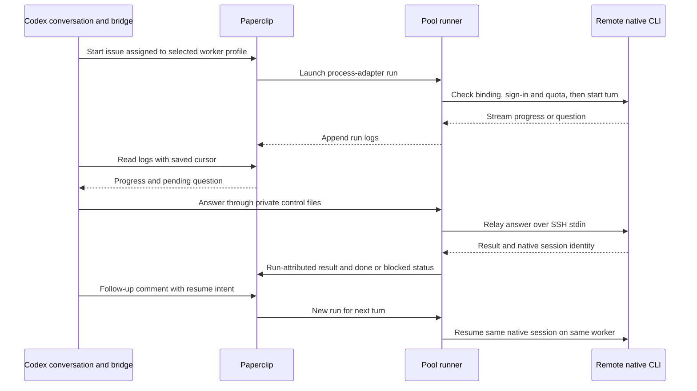
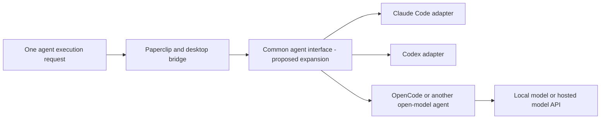
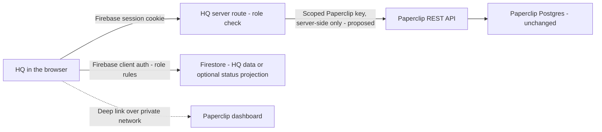

# How Morpheus and Paperclip fit together

> **Work in progress.** The Paperclip integration is an opt-in, tested prototype.
> This describes the October 24, 2026 implementation; broader project rollout is still pending.

**Morpheus defines the work and what counts as delivered. Paperclip runs and tracks delegated
work. The desktop bridge lets you supervise that work from your existing Codex conversation.**

## Who owns what

| Component | Responsibility |
|---|---|
| Morpheus in each project's Git repo | Roadmap, acceptance criteria, decisions, worklogs, claims, PRs, independent review and CI. |
| Skills, such as agentic CTO | How the coordinating agent plans, delegates and evaluates work within an agreed budget. |
| Paperclip | Agent registrations, assigned issues, execution runs, logs, operational status and dashboard. |
| Optional Codex/Claude bridge | Turns desktop requests into Paperclip work; relays progress, questions, answers, follow-ups and stops; remembers conversation identities. |
| Worker runtime on each Mac | Runs the host's installed Claude or Codex CLI, checks native sign-in and quota, and protects its workspace and process lifetime. |

Paperclip uses Morpheus's adapters and task instructions; it does not need to understand the
whole Morpheus PM schema. Morpheus uses Paperclip's execution machinery and dashboard. A
Paperclip issue marked `done` means that execution turn finished; repository delivery still
requires inspected evidence and the normal PR/review/CI/merge path.

## 1. Where the pieces run

Paperclip's **process adapter** launches our pool runner. That runner owns the SSH connection
and worker lease; the desktop bridge observes it and sends controls. Restarting the desktop
bridge can therefore reconnect to a still-running turn. Losing the runner or SSH is a different
failure: the host stops the turn, and uncertain cleanup holds its reservation until reconciled.

The controller API is loopback-only and authenticated. The Air's dashboard access uses a
forwarded port over the private connection. That browser view does not execute workers or keep
them alive. Controller and coordinator bridge must share a host and user in this version.

## 2. Git tasks and Paperclip jobs

The explicit task-linkage tool supports **one Morpheus roadmap item to many Paperclip issues**:

`scripts/paperclip-bridge/` prepares and submits immutable jobs, then reads back their exact
issue identities. Records live at `.agent/paperclip/<roadmap-ID>/<job>.json`, with repository,
branch, source SHA, acceptance reference and evidence hashes. Reconciliation records an
operator-verified result; it never marks the roadmap item shipped automatically.

There are **two complementary integration surfaces today**:

- **Git linkage:** `scripts/paperclip-bridge/` connects committed repository tasks and evidence
  to Paperclip issues.
- **Interactive delegation:** `plugins/codex-claude/` connects a Codex conversation to a worker
  profile, Paperclip issue/runs and native CLI session. Its live state is private local data.

They are not automatically joined end to end yet: starting an interactive pool conversation
does not itself create the committed Git job record or synchronize roadmap/worklog status.
The coordinator/operator supplies that linkage and promotes verified evidence through Git.

## 3. An interactive remote conversation

One interactive conversation has **one Paperclip issue, one native session, and a separate
Paperclip run for each provider turn**. Claude supports a live question/answer exchange; Codex
reports `needs_input` at a turn boundary. Follow-ups begin after the previous turn ends.
Routine reversible questions may be answered by the coordinator with a recorded reason;
new authority and tool-permission approvals still require the user's actual authorization.

The bridge saves IDs and log cursors for reattachment. Each turn has one atomic launch claim
so duplicate Paperclip wakes do not launch another provider call. After interruption,
`reconcile` establishes host termination; `recover` can release the supported exact-run hold
and continue the saved follow-up. Unknown effects remain visible instead of being called success.

## A common interface for agent compute

**Yes: Paperclip already supplies an agent-adapter interface.** Its installed 2026.1012.0
contract standardizes execution, environment checks and session serialization, with model
discovery hooks. It includes Claude, Codex and OpenCode adapters. Our qualified remote pool
currently uses its `process` adapter plus our bridge; that pool accepts only Claude and Codex.
Paperclip's wider adapter catalog is not automatically available through it.
[Pinned adapter contract](https://github.com/paperclipai/paperclip/blob/v2026.1012.0/packages/adapter-utils/src/types.ts).

**Recommended next step:** keep one coordinator-facing contract and extend the runtime adapters
underneath it. Reuse Paperclip's adapter system and evaluate **Agent Client Protocol (ACP)**
for interactive sessions before adding another framework. ACP standardizes prompts, streamed
updates, tool permissions, cancellation and session configuration; its ecosystem includes Claude
and Codex adapters. Native sign-in, quotas and remote recovery still need qualification for each
chosen adapter. This is a proposed extension; it does not replace the tested native-CLI path.
[ACP introduction](https://agentclientprotocol.com/get-started/introduction),
[agent integrations](https://agentclientprotocol.com/get-started/agents).

The common interface should expose start, progress/events, answer, follow-up, stop, reattach
and recovery, while advertising which capabilities each adapter supports. Every run should retain:

| Record | Required distinction |
|---|---|
| Agent and runtime | Logical worker/role, harness and adapter versions, provider, host, account and workspace. |
| Model and effort | Requested model/version and effort; separately reported effective values and provenance. Unsupported or unreported values stay explicit. |
| Execution and resources | Task/run/session IDs, permissions, timestamps, outcome, token usage, quota/reservation observations and termination evidence. |

An effort label is not a universal unit of compute: adapters must declare supported settings
and any mapping. ACP exposes model and reasoning-level configuration categories, but their
presence does not prove which model or effort actually served a turn.
[ACP configuration](https://agentclientprotocol.com/protocol/v1/session-config-options).

**OpenRouter and LiteLLM fit below the agent harness.** OpenRouter provides hosted access to
many models; LiteLLM offers an open-source, self-hostable model gateway. Neither model gateway
alone replaces native Claude/Codex sessions, machine allocation or our interactive worker contract.
OpenRouter's SDK availability should not be mistaken for a self-hostable agent dispatcher.
For open models, first qualify a harness such as OpenCode, which Paperclip already supports,
then choose direct/local inference or a gateway when needed. No new gateway is adopted here.
[OpenRouter](https://openrouter.ai/docs/quickstart), [LiteLLM](https://docs.litellm.ai/docs/),
[Paperclip's OpenCode adapter](https://docs.paperclip.ing/reference/adapters/opencode/).

## Paperclip inside our HQ, and Firestore instead of Postgres

**Research and proposal only. Today no HQ page talks to Paperclip.** The dashboard is reached
through the controller's loopback port or the Air's forwarded port, as described above.

**How installed Paperclip 2026.1012.0 is coupled:**

| Layer | What the installed source shows | Consequence |
|---|---|---|
| Dashboard | A React board app served by the same Express server; its data comes from `/api`. | Coupled to Paperclip's API, not to its database. HQ can reuse the API. |
| Auth and authorization | Board users sign in through Better Auth on Paperclip's own tables. Board/agent API keys and run tokens are checked by Paperclip's server code. | Paperclip does not know Firebase identities or Firestore rules. |
| Database | Drizzle ORM on Postgres, embedded by default: 240 tables and 304 SQL migrations. Drizzle is imported by 321 server modules, with ~470 `SELECT … FOR UPDATE` call sites, some `NOWAIT`/`SKIP LOCKED`, plus Postgres advisory locks and upserts. | Launch claims, idempotent issue creation and wake deduplication, which our bridge relies on, are built on Postgres locking. |
| File storage | Attachments already pass through a pluggable `StorageProvider` with local-disk and S3 providers. | This extension point handles files; database access has no equivalent provider interface. |

Sources: [schema](https://github.com/paperclipai/paperclip/tree/v2026.1012.0/packages/db/src/schema),
[DB client](https://github.com/paperclipai/paperclip/blob/v2026.1012.0/packages/db/src/client.ts),
[Better Auth setup](https://github.com/paperclipai/paperclip/blob/v2026.1012.0/server/src/auth/better-auth.ts),
[authorization](https://github.com/paperclipai/paperclip/blob/v2026.1012.0/server/src/services/authorization.ts),
[storage interface](https://github.com/paperclipai/paperclip/blob/v2026.1012.0/server/src/storage/types.ts).
Counts come from the installed build's compiled `server` and `db` packages.

| Option | What it means | Cost and risk |
|---|---|---|
| 1. Links and deep links | HQ lists linked jobs from `.agent/paperclip/` and links to their Paperclip issue/run pages. | Small. Opening a link still needs private network access and a Paperclip sign-in. |
| 2. Native HQ controls through a server-side API boundary | An HQ server route verifies the Firebase session, then calls Paperclip's REST API with a server-held key and renders status, logs, start, answer and stop. | Medium. The deployed HQ must reach the loopback-only controller, which needs a network and deployment decision. |
| 3. Replace Postgres with Firestore | Rewrite Paperclip's data layer and auth adapter for Firestore. | Very large, and in practice a permanent fork: every upstream release and migration must be ported, and the locking semantics redesigned and requalified. |

**A server-side Firestore port would still need application authorization.** Firestore server
client libraries bypass security rules and use IAM. A Paperclip server using those libraries
would therefore enforce user permissions in its own code. Rules protect requests made with
the mobile/web client libraries, including direct browser reads; those reads would not pass
through Paperclip's authorization checks. Firestore transactions do not offer a drop-in
replacement for Postgres's row/advisory locks, queue queries or SQL migrations.
[Rules and server libraries](https://firebase.google.com/docs/firestore/security/get-started),
[Firestore transactions](https://firebase.google.com/docs/firestore/manage-data/transactions).

**How the two authorization systems would relate in option 2:** Firebase stays the HQ identity.
A user's `role` custom claim drives the `/hq` route gate (`decideHqAccess` verifies the session
cookie, then `canAccessHq`) and the generated Firestore role rules
([`src/hq/roles.ts`](../src/hq/roles.ts), [`src/hq/gate.ts`](../src/hq/gate.ts)). Morpheus ships
those gate, role and rules primitives; the dashboard pages are built in the project hosting HQ.
The proposed HQ server would use server-held Paperclip credentials, with company and action
scope verified against the exact endpoints before rollout. Paperclip would see that credential
as the actor, so HQ must also enforce per-user permissions, require `admin` (the proposed write
role) for controls, and record the Firebase user in its own audit trail.
The key never reaches the browser or a worker.

**Recommendation:** keep Paperclip on Postgres. Start with option 1, then build option 2 as the
target. If HQ needs Firestore-native, rule-gated views, add a read-only status projection that a
server-side sync writes from Paperclip into Firestore. Paperclip remains the source of truth, and
controls still go through its API. Rather than port the database, use managed Postgres if the
operational burden is the concern. No migration, network exposure or frontend rollout is
authorized by this research.

**Open questions for Chris:**

- Which HQ hosts these views: one operator HQ, or each company's HQ? One Paperclip instance
  serves several companies.
- How should a deployed HQ reach the private controller: a tailnet-connected server, a relay, or
  local-only use?
- Which roles may view and which may control? The proposal is admin-only controls.
- Is Postgres for Paperclip acceptable, embedded on the controller or managed?

## Machines, subscriptions and rollout status

A worker profile binds **provider + Paperclip agent + account identity + host + workspace +
model/effort + permissions**. The coordinator selects a configured profile. The runtime checks
fresh native quota and reserves capacity by account; profiles using the same subscription must
share its account identity. Each host uses its own native login. The remote worker receives no
Paperclip token or copied provider credential. Requested model/effort and observed provider
metadata are recorded separately; unreported values stay unknown.

At qualification closeout, remote Claude and Codex on the mini had passed streaming,
questions, remembered follow-ups, coordinator reconnect, stop/reconciliation and recovery;
all test agents were paused. Claude's stop test ended a worker waiting for a permission,
while Codex's test stopped an actual foreground command. Claude shell-command stopping and
logout/reboot readiness remain untested. Mini Claude currently relies on its logged-in GUI
session for native Keychain access.

The qualified runtime is privately staged; the installed personal desktop plugin was not
hot-replaced during the active session. Automatic best-worker/model routing, cross-account
session migration, general consumer-repo delivery and simulator load balancing remain rollout
work. Paperclip supplies the execution foundation; adding machines, logins and project skills
still requires our enrollment and qualification layer. The earlier pilot enrollment scripts
are not a universal one-command installer for the interactive stack.

## Where to go deeper

- [Interactive bridge design and live evidence](paperclip-interactive-bridge.md)
- [Git task linkage and authentication contract](paperclip-integration.md)
- [Bridge setup and pool commands](../plugins/codex-claude/README.md#remote-pool-workers-through-paperclip)
- [Earlier infrastructure pilot](paperclip-pilot-design.md) and [results](paperclip-pilot-results.md)
- [Workflow comparison](paperclip-workflow-comparison.md) — evaluation results and their limits
