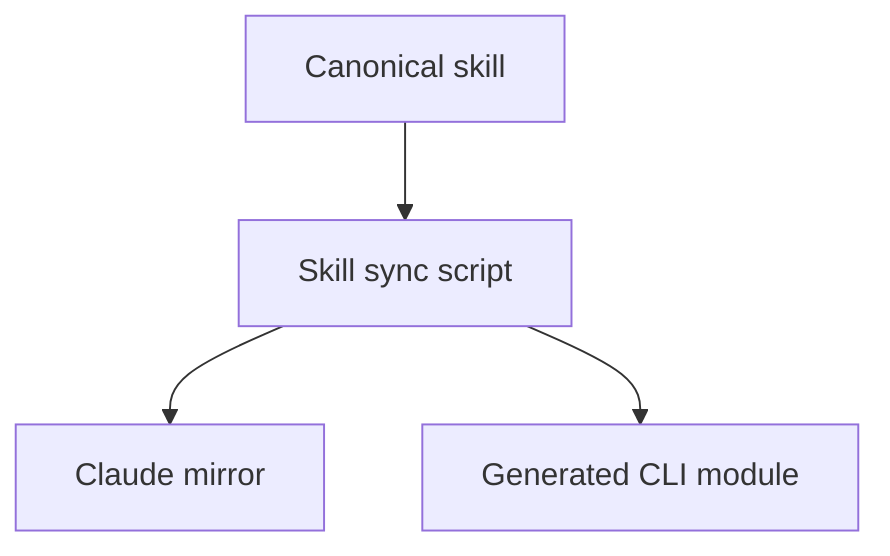

# Early visual planning

Before implementation, show a small diagram when relationships make a design clearer: architecture,
workflows/pipelines, async handoffs, state transitions, ownership or substantial alternatives.
Skip trivial self-contained edits. The maintained procedure is the `visual-design` skill, printed
by `morpheus skills guide visual-design`. This adds no approval pause or merge gate.

Start flowcharts top to bottom and inspect the render at the width people will actually read it.
Short labels, nearby branches and a clear main path help readers follow the relationships. Use a
compact row when the relationship calls for it, such as participants in a short sequence. If a
diagram needs zoom or sideways scrolling, simplify or split it into focused views.

## Distribution and refinement

Edit `.agents/skills/visual-design/SKILL.md`, then run
`node scripts/sync-visual-design-skill.mjs` to refresh the Claude mirror and the generated CLI
module. Distribution tests compare all three byte for byte. `src/project-skills.ts` remains the
only registry. Descriptions in scaffold pointers come from the canonical frontmatter.

The registry supplies pointers for new projects and for missing entrypoints in existing projects.
Scaffold instructions carry the early planning trigger, and Doctor flags older instructions that
lack it. Skill sync preserves existing instructions and skills. A CLI update refreshes the shared
guide for projects that use the pointers; instruction adoption remains a reviewed project change.

## Existing-project rollout

After this Morpheus change merges, update the standalone installed CLI with `morpheus self update`.
Verify `morpheus skills guide visual-design` prints the canonical guide and
`morpheus skills list --json` lists `visual-design` for both providers and all three project kinds.
No runtime `morpheus-kit` dependency bump is needed for agent guidance.

For each registered project, claim its own rollout item under its delivery rules, then:

1. Run `morpheus skills sync` in its claimed checkout, followed by `morpheus skills sync --check`.
   Inspect the two `visual-design/SKILL.md` entrypoints. Existing files are preserved: reconcile a
   project-owned version explicitly when necessary rather than replacing it automatically.
2. Carry the **Plan visually early** paragraph from Morpheus's `AGENTS.md` into the project's
   authored instructions, adapting context while retaining early timing, task triggers, the guide
   command, trivial-edit exception, current/proposed and assumptions, showing the diagram, retained
   diagram updates and fenced Mermaid for durable docs. Preserve its `CLAUDE.md` convention.
3. Run `morpheus doctor --offline` and check the `early visual planning` instruction warning is
   absent. Doctor is an advisory discovery aid, not a semantic evaluation or new gate.
4. Use the project's tests, independent review, CI and PR merge path. The installed review contract
   already carries the advisory question. If it keeps a legacy `.github/agent-review-prompt.md`,
   carry that question over too, without adding a required diagram artifact.

Use the private registry (`morpheus registry list`) for target paths. Keep the inventory and
project-specific rollout status out of public Morpheus records. A missing or stale registry entry
is a discovery gap, not proof that a project is absent or that the rollout is complete.
