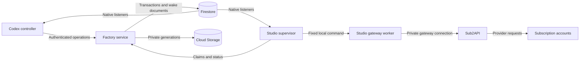

# Factory

General-purpose agent delegation: either Claude Code or Codex can coordinate, and it fans
out to workers — native Claude/Codex, or pooled subscriptions behind a sub2api gateway.
A persistent Codex task can coordinate Claude Code, and a Claude Code session can
coordinate Codex (see [Claude coordinating Codex](#claude-coordinating-codex)). This package is optional and **off
by default**. Cloning Morpheus, installing its CLI, and scaffolding projects do not install
or activate it.

Every worker runs **on the host where the bridge runs**, in checkouts on that host. A gateway
provides model access through a pooled subscription; it does not run the worker anywhere
else. Onboarding other machines as a worker fleet is out of scope. Direct delegation uses the six `factory_*` tools. Paperclip execution, internal pool/HQ
dispatch and their legacy modules are removed.

This README is the canonical reference; the `delegate` (Codex) and `delegate-to-codex`
(Claude Code) skills are short procedures that point here.

## Status: experimental, off unless this machine opts in

- **Repository-owned status.** `release` in `src/config.mjs` marks Factory `experimental`
  with default mode `off`. The plugin manifests say so, and `bridge.mjs doctor` reports
  `factory: { status, mode, enabled }` for this machine.
- **Personal installs only.** `node scripts/install.mjs` is the only installer. On the machine
  it runs on, it registers `factory@personal` in your own Codex personal marketplace and
  `factory@factory-local` at Claude Code user scope. Nothing distributes it: `morpheus init`,
  the device bootstrap, `self install`/`self update`/`self ensure`, session start and cloning
  a repository never install, register or enable it (Morpheus's
  `tests/factory-distribution.test.ts` holds this). An install on one machine does nothing
  for another machine or person.
- **Installing is not enabling.** The one switch is `mode` in this machine's private
  `~/.local/share/factory/config.json`. With no file it is `off`, and the hooks exit without
  output or starting the service. `bridge.mjs enable manual|automatic` opts in and `disable`
  opts out. A reinstall or update never writes that file, except to carry an old
  `codex-claude` install's settings to a machine that has none, so a saved choice, on or off,
  survives.
- **The coordinator stays the manager.** Codex in the usual setup, or Claude Code when it holds
  the conversation, decides when to call the provider-neutral `factory_*` tools, writes a
  self-contained brief, supervises the run and verifies the result. Hooks never dispatch user
  prompts. `manual` and the legacy `automatic` value both mean model-directed delegation; the
  latter remains accepted so an installed machine does not need a settings migration.

## Where things live

- **Source, instructions, tests:** `plugins/factory/` in Morpheus. Edit this package
  and submit a reviewed Morpheus PR to change its behavior.
- **Installed source copy:** `~/plugins/factory/`, registered in your
  personal marketplace. Codex and Claude Code additionally keep their own plugin caches. These
  are copies, not links to your working tree: editing the source or pulling Morpheus changes
  nothing that runs until you re-run the installer.
- **Personal settings and bridge records:** `~/.local/share/factory/` (0700 directory,
  0600 files). `FACTORY_HOME` relocates this for testing or a separate installation.
- **Claude conversations and memories:** Claude's native store, normally `~/.claude/`.
  The bridge records the session id per root task; it does not merge stores.
- **Task records and checkouts:** `task-<hash>.json` per root task, `runs/<runId>/` per run,
  `workspaces.json` (checkout ownership) and `worktrees/<task-hash>/<slot>/<repo>-<hash>/`
  (checkouts Factory created), all under the Factory home. See the
  [worked example](#worked-example).
- **Host and fleet tooling:** `src/host/`, a separate package with its own lockfile (worker
  setup, Xcode host updates, fleet pin coordinator, storage watchdog, sub2api install and
  the placement core). Installing the plugin copies it but never builds or runs it; see
  [Host package](#host-package).
- **Private host manifest:** `~/.local/share/factory/hosts.json` (owner-only), read only by
  the host package.
- Nothing about your subscription, selected executor, machine paths or conversation content
  belongs in the Morpheus repository.

## Install on each execution host

Prerequisites: macOS, Node 22+, Python 3, pnpm 11 and both CLIs on PATH. Include
`~/.local/bin` and `/opt/homebrew/bin` in the host's environment when needed. The coordinator
uses its own sign-in as usual. What a worker needs depends on its route:

| Worker route | Needs on this host |
|---|---|
| Native Claude (a Codex task with no eligible gateway, or one asking for Claude) | `claude auth login` with a `claude.ai` subscription; no API key or provider override |
| Native Codex (a Claude session with no eligible gateway, or one asking for Codex) | `codex login` with ChatGPT; `OPENAI_*`/`CODEX_API_KEY` are stripped |
| Either provider behind a gateway | A `gateways` entry and admin login references (see [Gateway mode](#gateway-mode)); no native sign-in for that worker |
| Claude behind a gateway | Additionally **no saved `claude.ai` login**: run `claude auth logout`, because a saved login was observed to override the gateway token, so this host cannot also use the native Claude route |

From this package directory, explicitly run:

```sh
node scripts/install.mjs
```

The installer copies the package, installs its locked dependencies, tests it, verifies the
installed MCP servers against their exact tool-name contracts and identical provider-neutral
Factory schemas, checks that neither hook manifest dispatches prompts, and uses Codex's
bundled plugin-creator helper to register it in the personal marketplace. A contract error
lists the missing, unexpected, and observed tool names. It
preserves other marketplace entries. The helper is looked for under
`~/.codex/.tmp/plugins/.agents/skills/plugin-creator/` and the older
`~/.codex/skills/.system/plugin-creator/`; if it is elsewhere, set `CODEX_PLUGIN_CREATOR`
to its `create_basic_plugin.py` path. Installation does not choose manual or automatic
mode.

**Updating.** Re-run the installer from an updated source; nothing else updates an install. It
keeps `config.json`, so the saved `mode`, gateways, `keyRef`s and admin references survive. Finish
delegated runs first: the next client replaces an idle older bridge service and refuses while it
still owns work. Start a new Codex task or Claude session afterwards; an open one keeps the tools
and skills it loaded.

**Migrating from `codex-claude`** (this package's name until 2026-10-31) is part of the same
run. When the installer finds the old install it carries the old settings into
`~/.local/share/factory/config.json` (mode, limits, model and effort maps, project modes;
not `threshold`, which reversed its meaning from percent remaining to percent used and
returns to its default), restores the Claude status line the old recorder had chained,
uninstalls the old Claude plugin and marketplace, removes the old Codex plugin and its
personal-marketplace entry, and deletes `~/plugins/codex-claude`. It prints each step. It
leaves `~/.local/share/codex-claude` (old run records, safe to delete once no session that
used the old plugin is open) and the inert `hooks.state` lines for the old plugin in
`~/.codex/config.toml`, which Codex owns while it runs.

Start a new Codex task to load the installed skill/tools. Review and trust the plugin hooks
through `/hooks`; installing a plugin does not itself trust hooks. On each execution host,
start the local Codex service if needed:

```sh
codex app-server daemon start
node ~/plugins/factory/scripts/bridge.mjs doctor
node ~/plugins/factory/scripts/bridge.mjs enable manual
```

`enable automatic` is a compatibility alias for the same model-directed behavior. `disable` is a master off switch and
stops active delegated runs, retaining conversations. Disabling/uninstalling the plugin
in Codex removes its tools/hooks; existing normal workers expire when their owner lease
stops. Explicit background workers must be stopped before uninstalling.

The mode is personal to this host, not to Morpheus projects or colleagues. A project's
mode can be set under `projects` using the canonical project key returned by `inspect`.
A project or task `off` takes precedence over executor overrides. Global `off` takes
precedence over everything. No daemon is started by an off-mode hook.

## Everyday use

Ask Codex naturally:

- “Use Claude for this task.”
- “Use Codex for this task.”
- “Use the Factory for this larger implementation.”
- “Keep this quick answer local.”
- “Stop Claude.”
- “Show Claude's live output.”

**Routing chooses once per root session.** The first `factory_delegate` of a root session
routes like this:

1. With no explicit provider, the gateway with the most headroom below the threshold
   (**90% used** by default). With no gateway configured, or none below it, the **other
   provider's native login** on this host. Work never silently stays with the coordinator.
2. With an explicit provider (“use Claude”, `provider`), that provider's roomiest eligible
   gateway; otherwise that provider's native login if it is the other provider. Asking for the
   coordinator's own provider with no eligible gateway is refused: the coordinator's own native
   login is never a worker, because that would be circular.

**A gateway of the coordinator's own provider counts:** it is a separate subscription reached
as an API, so a Claude session can hand work to the Claude behind a gateway and a Codex task to
the Codex behind one.

The first successful primary launch then **pins** that executor and gateway (or native login)
for the root session. Every later delegation, primary or `fresh:true`, uses the pinned route and
never re-routes: a pinned gateway that is missing, changed provider, unreadable or at the
threshold refuses until it is eligible again, and asking for the other provider needs a new root
session. A failed launch pins nothing. This is subscription usage, not a token count for a single chat.
The coordinator still consumes its own allowance while supervising. Missing/stale usage is
reported as unknown and never treated as headroom. Existing saved thresholds are preserved
when updating the plugin; change one with `bridge.mjs config`.
Routing hooks do not replace the desktop's model engine or forcibly preempt a running
generation.

## Model-directed delegation

Both root agents discover the same six tools: `factory_inspect`, `factory_delegate`,
`factory_status`, `factory_wait`, `factory_answer` and `factory_stop`. Root identity is injected
by the MCP host, so a model cannot invent another chat's identity. Codex's per-request
`_meta.threadId` takes precedence over the legacy `CODEX_THREAD_ID` environment fallback:
desktop MCP connections may be shared or outlive the chat that launched them. A missing or
malformed identity still refuses delegation. Every run-control operation
also verifies that the run belongs to that root session.

- **Judgment and user precedence.** An explicit request to use the Factory requires delegation;
  an explicit request to keep work local prohibits it. Otherwise the root uses its normal
  sub-agent judgment: quick interactive work stays local, while a bounded larger chunk may be
  delegated. There is no separate classifier.
- **Sticky primary worker.** The route is pinned as described above. The primary conversation
  keeps the working directory of its first launch (Claude resumes a session only from that
  directory) and spans every repository its task maps; see
  [Multi-repository workspaces](#multi-repository-workspaces).
- **Fresh work.** `fresh:true` (allowed only after the primary has launched once) starts a
  separate conversation on the pinned route with its own map, kept on its run record. It never
  replaces the primary saved session. A target the primary already maps becomes the source of a
  separate isolated worktree. This is not isolation between conversations of one root task, which
  share that task's ownership: an unowned linked worktree adopted by an idle fresh conversation
  can later be adopted by the primary or another fresh conversation too. Isolation is between
  root tasks; within one, one writer per checkout and `maxConcurrent` still serialize active runs.

- **Manager contract.** The root sends a self-contained brief, waits, handles only routine
  reversible clarification itself, sends authorization/spending/publishing/material decisions to
  the user, and independently verifies the result. Codex `needs_input` resumes through
  `factory_delegate` with the originating `runId`; a live Claude question uses `factory_answer`.
- **Edit guard and recursion.** While an owned worker is active, `PreToolUse` refuses the root's
  native edit tools in that checkout (Claude Code `Edit`, `Write`, `MultiEdit`, `NotebookEdit`;
  Codex `apply_patch`). Shell commands are not inspected, so this is an accidental-race guard,
  not a sandbox. Workers run with `FACTORY_DELEGATED=1`; hooks exit and MCP delegation refuses.

### Multi-repository workspaces

One task (root session) has one primary worker conversation, however many repositories it
touches. `factory_delegate` takes explicit targets: `cwd` (the working directory, fixed at the
first primary launch; defaults to the root's own directory) and `repos` (up to 16 more). The
root's starting repository does not limit the others, and nothing is inferred: a later
delegation without targets reuses the task's map, and a root that has moved to another
repository does not add it. Each target resolves to a checkout the task owns:

| Target | Resolves to |
|---|---|
| A repository the conversation already maps, its original, or a path inside its checkout | That checkout |
| A different linked worktree of an already mapped repository | Refused: use `fresh:true` |
| An unowned linked worktree (a claimed task checkout, e.g. from `morpheus pm claim`), including the root's own | Adopted and owned |
| Any original checkout, the root's own included, or a fresh target the primary already maps | A new detached worktree at its committed HEAD under `$FACTORY_HOME/worktrees/`, owned by the task |
| Another task's checkout (idle or not), a path inside one, a symlink to one, or a checkout containing one | Refused |
| A directory outside Git, the root's own included | Refused: name a repository with `cwd` or `repos` |

Two roots that start in the same original checkout therefore get separate worktrees and never
share or take over each other's, even while one is idle. Every mapped checkout is owned; no
task writes an original.

The map (`repository → { path, source, owned }`, keyed by the canonical common Git directory)
persists in the task record, so adding a repository resumes the same native conversation instead
of starting a worker per repository. `factory_inspect` reports it as `workspace`. Uncommitted
edits in an original are never copied, and the worker is told the original is reference only.
Ownership lives in one registry, `$FACTORY_HOME/workspaces.json`, written by the bridge alone;
ownership is recorded when the worker launches (a failed launch claims nothing) and released only
when the checkout directory is confirmed absent (`git worktree remove` or `morpheus pm cleanup`);
a permission or I/O error reading it keeps the owner. Factory never deletes a worktree it
created: the work stays there until you merge or remove it. A record from before workspaces
whose `primaryCwd` is a linked worktree migrates on its next delegation, keeping its saved
conversation. One bound to an original checkout or a directory outside Git cannot move (its
native session resumes only from that directory) and is refused with the remedy: start a new
root session, which gets task-owned worktrees.

Every checkout is guarded as one unit: no active run may share or nest a directory with another
run's checkouts, `PreToolUse` refuses the root's native edits in any of them, and global or
per-repository `off` for any target refuses the launch. A Claude worker receives the other
checkouts (and a linked worktree's common Git directory) with `--add-dir`; a Codex worker
receives them as `sandbox_workspace_write.writable_roots` only under `workspace-write`. Neither
permission mode changes, so a read-only sandbox stays read-only. Under full access this is an
ownership convention enforced at delegation, not an OS sandbox: the worker's shell can still
write anywhere its user can.

### Worked example

A Codex task `T1` starts in `/work/app`, an ordinary clone of repository A (an *original*
checkout). Repositories B and C are cloned at `/work/lib` and `/work/docs`. Paths below are
illustrative; real records hold absolute canonical paths, and a repository is keyed by its
canonical common Git directory.

**1. First delegation: A plus B.** The root calls `factory_delegate` with:

```json
{ "prompt": "Add the parser to lib and use it in app. …", "cwd": "/work/app", "repos": ["/work/lib"] }
```

Both targets are originals, so each becomes a detached worktree at its committed HEAD. The
route is chosen and pinned (here a Claude gateway named `claude-pool`), and one Claude
conversation starts with its working directory in A's new checkout and B's checkout passed with
`--add-dir`. The Factory home now holds:

```text
$FACTORY_HOME/
├── config.json
├── task-<hash(T1)>.json          root task record
├── workspaces.json               checkout ownership, one writer
├── runs/<runId>/run.json         one directory per run
└── worktrees/<hash(T1)>/
    └── primary/
        ├── app-<hash(A)>/        detached worktree of /work/app
        └── lib-<hash(B)>/        detached worktree of /work/lib
```

`<hash(T1)>` is 32 hex characters of the SHA-256 of the task id; `<hash(A)>` is 8 hex characters
of the SHA-256 of repository A's common Git directory. The task record (abridged):

```json
{
  "id": "T1",
  "workerBinding": { "executor": "claude", "gateway": "claude-pool" },
  "primaryCwd": "$FACTORY_HOME/worktrees/<hash(T1)>/primary/app-<hash(A)>",
  "workspace": {
    "/work/app/.git": { "path": "$FACTORY_HOME/worktrees/<hash(T1)>/primary/app-<hash(A)>", "source": "/work/app", "owned": true },
    "/work/lib/.git": { "path": "$FACTORY_HOME/worktrees/<hash(T1)>/primary/lib-<hash(B)>", "source": "/work/lib", "owned": true }
  },
  "sessions": { "primary:$FACTORY_HOME/worktrees/<hash(T1)>/primary/app-<hash(A)>": "<claude-session-id>" }
}
```

`sessions` maps the conversation's key to the provider's native Claude session id; a Codex worker
uses `codexSessions` the same way. `factory_inspect` reports the map as
`workspace: { "cwd": <primaryCwd>, "repositories": <the workspace map> }`. `workspaces.json`, written
after the worker launched:

```json
{
  "$FACTORY_HOME/worktrees/<hash(T1)>/primary/app-<hash(A)>": { "taskId": "T1", "project": "/work/app/.git", "source": "/work/app", "claimedAt": 1793850000000 },
  "$FACTORY_HOME/worktrees/<hash(T1)>/primary/lib-<hash(B)>": { "taskId": "T1", "project": "/work/lib/.git", "source": "/work/lib", "claimedAt": 1793850000000 }
}
```

**2. Later: add C.** `{ "prompt": "Document the parser in docs. …", "repos": ["/work/docs"] }`
adds `primary/docs-<hash(C)>/` to the map and **resumes the same native Claude session** from the
same working directory. No second worker or second root is started for the extra repository.

**3. Later again: no targets.** `{ "prompt": "Fix the review findings. …" }` reuses the saved map
(A, B and C) and the same session. If the Codex task has since moved to another repository, that
repository is not added; only a named target is.

**A separate root task.** Another Codex task `T2` that also starts in `/work/app` gets its own
`worktrees/<hash(T2)>/primary/app-<hash(A)>/`. Naming T1's checkout from T2 is refused, even while
T1 is idle.

**A fresh conversation.** In T1, `{ "prompt": "…", "fresh": true, "cwd": "/work/app" }` gets
`worktrees/<hash(T1)>/fresh-<first 8 characters of its runId>/app-<hash(A)>/`, on the pinned
route, recorded on its run rather than in the task's `workspace` and `sessions`.

**Already-claimed checkouts.** Had T1 started in a linked worktree from `morpheus pm claim`
instead, that worktree would be adopted in place (`"source": null`) rather than copied.

**Cleanup.** Merge or keep the work, then remove each checkout with `git worktree remove` (or
`morpheus pm cleanup` for a claimed one). The next delegation that reads `workspaces.json` drops
entries whose directory is confirmed absent.

## Permissions depend on the coordinator

These rules apply to every delegation, one repository or many; the multi-repository workspace
did not change them.

**Codex coordinating** (a Codex task calling `factory_*`). Delegation requires the task to run
with verified **full access** (sandbox `dangerFullAccess`). Anything narrower is refused; there
is no sandbox emulation. The task's approval policy then sets the worker's permissions:

| Codex approval policy | Claude worker | Codex worker behind a gateway |
|---|---|---|
| `never` | `bypassPermissions` | full access |
| `on-request` | `default` (asks; tool permissions go to the user) | `read-only` |
| anything else | refused | refused |

A loaded task's settings come from the app-server. For an unloaded desktop task the bridge reads
the latest turn from its rollout. That turn must be active and recorded within 24 hours, with
`permission_profile.type: "disabled"` and `sandbox_policy.type: "danger-full-access"`, or even
`factory_inspect` refuses. In practice: choose Full access for the Codex task, then send a
message so the active turn records it.

**Claude coordinating** (a Claude Code session calling `factory_*`). Full access is not
required. The session's mode, recorded by the plugin's hooks (send one message after trusting
them), is mapped and never widened:

| Claude permission mode | Codex worker | Claude worker behind a gateway |
|---|---|---|
| `plan`, `default` | `read-only` (Codex exec cannot ask) | the same mode |
| `acceptEdits`, `auto` | `workspace-write`, approvals off, no network | the same mode |
| `bypassPermissions` | full access | the same mode |
| anything else | refused | the same mode |

**Extra checkouts never widen a mode.** A Claude worker gets them through `--add-dir`; a Codex
worker gets them as writable roots under `workspace-write` only, so `read-only` stays read-only.
Full access is never permission to skip a business approval, repository review, spending or
sending rule.

The separate [unattended gateway worker](#explicit-unattended-codex-gateway-worker) takes its
sandbox from its own private job configuration, not from these tables.

## Gateway mode

To delegate to pooled subscriptions behind a sub2api gateway, add a `gateways` list to the
config. Each entry names a provider, the gateway origin, and a key reference — never a raw
key:

```json
{
  "gateways": [
    { "name": "claude", "provider": "claude", "baseUrl": "http://gateway:8080", "keyRef": "env:FACTORY_CLAUDE_KEY" },
    { "name": "codex", "provider": "codex", "baseUrl": "http://gateway:8080", "keyRef": "secret:factory/codex" }
  ]
}
```

`keyRef` is `env:NAME` (an environment variable), `secret:path` (a 0600 file) or
`exec:/path/to/command arg…` (a command run without a shell, split on whitespace, whose
trimmed stdout is the value), resolved at spawn time and never logged. The `exec:` form is
how a credentials manager stays the single source of truth, for example
`exec:/opt/homebrew/bin/darwin-env get FACTORY_CLAUDE_KEY`; give the command an absolute
path, since the bridge service inherits the PATH of whichever session started it.

`factory_delegate` defaults to `gpt-6.1-sol` on Codex and `claude-opus-5-5` on Claude,
independent of the controller's model. Standard speed applies to both workers. Specify
`model` or `speed: "fast"` only for a user-requested override; `selection` reports the
requested model, effort and speed. Legacy client model maps do not select models for
`factory_delegate`. Unattended services retain their explicitly configured model.
Codex selects a dedicated gateway provider with a required environment key and sets the
default service tier per launch. A missing gateway key fails before any request and cannot
fall back to the controller's Codex login. Claude workers disable Fast mode for the child
session. These controls apply to fresh and resumed worker turns.

Factory reads usage from the sub2api admin API. In Simple Mode each provider
uses one shared gateway route. Factory reads every page of the account list
and scores a pool by its roomiest active, schedulable OAuth account with known
usage. An account's score is its highest utilization across its active 5-hour
and 7-day windows. Accounts on cooldown and failed usage reads contribute no
headroom. The threshold applies to the pool score.

Factory picks the worker provider and honors explicit model requests. Standard
Claude model IDs and family aliases select Claude, and standard OpenAI model
IDs select Codex. Specify the provider for custom model IDs. Sub2api owns OAuth,
account selection, session stickiness and failover within the selected provider
pool. The account that supplied the pool score can differ from the account
that serves a request.

- **Claude.** Inspection, start and `doctor` ask sub2api for
  `GET /api/v1/admin/accounts/<id>/usage?source=active&force=true` for each
  eligible account. Sub2api may serve a short cached answer. `updatedAt` is the
  gateway's timestamp for the selected reading.
- **Codex.** Factory reads stored usage windows and `codex_usage_updated_at`
  for OAuth accounts with a known ChatGPT subscription plan. Forcing the usage endpoint would send a model
  request. Windows whose reset times have passed are skipped.

The admin references apply to one gateway origin. Use the provider's shared
Simple Mode route for the pool score to describe the accounts the gateway can
schedule.

Each request times out after 15 seconds. Configure the admin login as references too:

```json
{
  "admin": {
    "emailRef": "exec:/opt/homebrew/bin/darwin-env get FACTORY_ADMIN_EMAIL",
    "passwordRef": "exec:/opt/homebrew/bin/darwin-env get FACTORY_ADMIN_PASSWORD"
  }
}
```

Without `admin`, the service falls back to `FACTORY_ADMIN_EMAIL` and
`FACTORY_ADMIN_PASSWORD` in its own environment. That environment is the one of the
Claude or Codex session that first started the service, which is rarely the shell that
exported them (a desktop-app session exports nothing), so `env:` references and the env
fallback usually mean "quota unknown, routing native". `bridge.mjs doctor` shows each
gateway's `usedPercent` and its `updatedAt`, whether it is below the threshold, whether its `keyRef` resolves,
and where the admin login came from, so a misconfiguration is visible before a delegation
is attempted.

When a gateway is selected, the bridge sets the provider overrides instead of stripping
them and skips the native sign-in check. Native mode is unchanged: it still strips
overrides and requires a `claude.ai`/ChatGPT sign-in. **A saved `claude.ai` login defeats
the Claude gateway:** with both present, the Claude CLI was observed to keep using the
saved login and fail with `401 Invalid API key` against the gateway token (and to take
over two minutes doing it), although the documented precedence says the token wins. On a
host that delegates Claude work through a gateway, run `claude auth logout`; `doctor` notes
the combination.

Legacy controller-specific commands map model and effort independently at each Claude launch:

| Codex selection | Claude alias |
|---|---|
| GPT-6 Astra / GPT-5.6 Sol / GPT-5.5 | opus |
| GPT-5.6 Terra | sonnet |
| GPT-5.6 Luna | haiku |

Low/medium/high/xhigh map to their matching effort values; minimal/none map to low;
max/ultra map to max. These are configurable approximations, not claims of equivalence.
Explicit model/effort overrides take precedence, then `modelMap`.

A Codex model missing from `modelMap` — Codex ships new ones faster than this table changes;
`gpt-6.1-sol` once blocked every delegation until the user was asked to pick a Claude model —
uses `modelFallback`, default `opus`. That family alias follows whatever the installed Claude
CLI resolves it to, so no model choice is asked for. The run's `selection` (and
`claude_inspect`'s preview) records `source` (`override`, `mapped` or `fallback`), the Codex
`codexModel`, and for a fallback a `reason`, so the coordinator can report what ran. Set
`modelFallback` to another fixed model or family alias (`fable`, `sonnet`, a full id) to
change it, or to `null` to refuse unmapped models with a message naming the setting. It is
not a retry: authentication, rate-limit, permission and transport failures are reported as
they are, and an explicit model the CLI rejects still fails that run. Unsupported effort
values still fail visibly.

Any explicit model is passed through to `claude --model`: a family alias (`opus`, `sonnet`,
`haiku`, `fable`) or a full id such as `claude-fable-5-1`, from an override or from
`modelMap`. The Claude CLI is the authority on what the subscription can run: an id it does
not recognize fails that run at the first request with the CLI's own error, at no cost, and
the bridge reports it as a failed run rather than guessing a substitute. Moving aliases
(`best`, `latest`, `default`, `newest`, `auto`) are refused because they could select a
paid-credit-only model without anyone choosing it. There is no fixed allowlist: a model
released after this plugin needs no configuration change. A saved `subscriptionModels` list
from an earlier release still parses but no longer restricts anything; `doctor` says so.

Configuration is a validated JSON document. Read it with `bridge.mjs config`, edit a copy,
and apply it with `bridge.mjs config -` with `{"value": <complete configuration>}` on stdin.
Do not edit settings while a second writer is updating them. Unknown settings are rejected.

## Claude coordinating Codex

The installer also registers a Claude Code plugin (`claude-plugin/`, marketplace
`factory-local`) with a `delegate-to-codex` skill, the same `factory_*` contract (plus legacy
`codex_*` compatibility tools) and hooks, and sets a
recorder status line. Skip that half with `node scripts/install.mjs --codex-only`. The same
`mode`, `threshold` and `projects` settings govern both directions; `bridge.mjs disable` stops
both. Start a new Claude session after installing, and review its hooks.

- **Allowance.** Claude Code gives its five-hour and weekly subscription windows only to the
  status line command. `bridge.mjs statusline install` points the status line at
  `scripts/claude-statusline.mjs`, which records the windows to `claude-usage.json` and prints
  `5h N% · 7d N%`; an existing status line is kept and run through it instead
  (`statusline uninstall` restores it). A snapshot older than 20 minutes, or one with an
  expired window, is unknown and never triggers a handoff. Surfaces that do not run a status
  line (headless `-p`, possibly the desktop app) therefore stay unknown until an interactive
  terminal session records one; manual delegation still works.
- **Settings source.** Hooks record the session's working directory and permission mode from
  Claude's own hook input, its effort from `CLAUDE_EFFORT`, and its model from the latest
  assistant reply in the transcript. Until a hook has run, delegation refuses.
- **Legacy model and effort mapping.** `codexModelMap` maps the Claude family (fable/opus/sonnet/haiku) to an
  approved `codexModels` entry; `codexEffortMap` maps effort. Unmapped values use Codex's own
  configured default rather than a guess.
- **Permissions, never widened.** See the Claude table in
  [Permissions depend on the coordinator](#permissions-depend-on-the-coordinator). Full access is
  `--dangerously-bypass-approvals-and-sandbox`; `workspace-write` writes inside the checkout, the
  task's other checkouts and their linked worktrees' Git directories. Under `workspace-write`
  Codex may be unable to push or reach the network; Claude does those steps.
- **Execution.** Each handoff runs `codex exec --json` under the same guardian lease, output
  cap and run limit as Claude workers, with the prompt on stdin. The primary conversation's
  saved Codex session id is resumed with `codex exec resume`. Codex cannot ask mid-run, so a
  question arrives as a `needs_input` result and is answered with `factory_delegate` and
  that result's `runId`, `replySource` (`root` or `user`) and `replyReason`, within the
  same supervision budget.
  One Claude session may run multiple Codex delegations concurrently when their checkouts do
  not overlap. A second writer in an overlapping checkout is refused with the owning run id; the global `maxConcurrent` limit still applies. `factory_inspect` lists all
  active runs and the five most recent terminal runs. Pass `runId` to wait, status or stop.
- **Subscription only.** The bridge requires `codex login status` to report a ChatGPT
  sign-in and strips `OPENAI_*`/`CODEX_API_KEY` from the worker. Paid Codex credits cannot be
  detected from `exec` output; manage that in your ChatGPT account.
- **No loops.** Both workers run with `FACTORY_DELEGATED=1`; the hooks of either plugin
  then do nothing and both MCP servers refuse to start a further delegation.

### Same-provider workers behind a gateway

When routing picks the coordinator's own provider behind a gateway, `factory_delegate`
launches that worker; the run's
`executor` and `gateway` fields say what ran.

- **A Claude worker for a Claude session** runs `claude -p` with the gateway's base URL and
  token, the session's own model and effort, and the session's own permission mode, so it is
  never wider than the coordinator. It can ask live questions; the coordinator answers them
  with `factory_answer` (`source: root` for a routine clarification, `user` to attest a real
  answer).
- **A Codex worker for a Codex task** runs `codex exec` against the gateway with the task's own
  model and effort. Its sandbox follows the task's approval policy: never-approve full access
  maps to full access, on-request to read-only.
- **Sessions are kept per task on the pinned route.** A root session pins executor and
  gateway once; its primary provider conversation is keyed by its first working directory and
  spans the task's mapped checkouts. Because the route never changes, the conversation never
  resumes on another gateway or native login. A `needs_input` reply must use the route and run it
  came from.
- **Credentials stay out of the worker.** It gets only the provider's own variables; every
  variable a configured `keyRef`, `emailRef` or `passwordRef` names is removed from its
  environment, along with `FACTORY_ADMIN_*`.
- **No shared memory.** Memory sharing exports the other agent's store, so a same-provider
  worker receives none.

## Sessions, output and supervision

Factory exposes an additive `task` view on desktop delegation, status, wait and answer results.
Its ID identifies the delegated work, while the legacy run ID still addresses a concrete local
invocation. The first invocation's ID serves as the task ID. A follow-up to an open question keeps
that task ID even if the provider starts another invocation. A new brief after a settled result
gets a new task ID even when the provider reuses its conversation.

The view uses the adopted task state names from [A2A 1.0.1](https://a2a-protocol.org/v1.0.1/specification/).
In particular, a question is `TASK_STATE_INPUT_REQUIRED` even when the provider turn has exited.
Unverified cleanup or an unclassified interruption has `TASK_STATE_UNSPECIFIED`. This is a
local lifecycle projection with existing MCP tool inputs and run history. It does not expose an A2A
transport binding.

The cross-host pilot uses the [Factory task contract](src/host/docs/fleet-task-contract.md).

Each Codex task remains a normal saved Codex conversation. The plugin associates its
working directory with a saved Claude session id and resumes it on subsequent handoffs.
It does not create a native Claude model choice inside Codex or import Claude messages as
native assistant turns. Progress and results arrive as tools and Codex commentary; a
read-only loopback viewer can display streamed text in the Codex browser panel. Claude's
own transcript retention still applies: a session deleted by Claude cannot be resumed.

For an unloaded Codex desktop task, the bridge validates active turn metadata from its
rollout, including `.jsonl.zst` compression on Node 22.15+. Earlier Node 22 releases can
read plain rollouts and report a clear runtime requirement for compressed ones. Completed, stale or restricted
turns still refuse. An unavailable rollout reports a task-metadata error; reopen that task
and send a message rather than substituting another session. `bridge.mjs doctor` reads
gateway quota independently, so healthy quota does not prove a task can delegate.

The working directory defaults to the Codex turn's actual directory. Other repositories join
the same conversation as task-owned checkouts (see "Multi-repository workspaces"); a different
checkout of a repository already mapped needs `fresh:true`. Codex must wait for the worker to
stop before editing its checkouts. The bridge prevents overlapping runs, applies
`maxConcurrent`, and never replays a task automatically after a crash.

In the reverse direction, a Claude session can own multiple concurrent Codex runs in
non-overlapping checkouts. `needs_input` resumes and supervision counts remain per run's
working directory. The bridge never permits two active writers in overlapping checkouts, even
when both belong to that Claude session.

Claude questions return through its permission-control stream. Codex may answer routine,
reversible clarifications with a recorded reason; substantive product decisions, new
permissions, sending, publishing, spending, and destructive operations still need the user.
A tool permission is not interchangeable with a clarification. The `source: user` field
is the coordinating agent's attestation to an actual user answer, not an independent
approval UI. Structured/prose `needs_input` results resume the same conversation with its
`runId`, `replySource` and `replyReason`. Autonomous supervision is capped at eight replies by default. A genuine user answer
remains allowed at the limit and resets that autonomous budget; its audit record is retained.

Permission mapping is in [Permissions depend on the coordinator](#permissions-depend-on-the-coordinator).
Business/repository approval rules remain part of the handoff even under full access.

## Subscription billing

The bridge verifies Claude's local authentication is `claude.ai`/`firstParty`, removes
API/provider overrides from the child environment, and rejects provider overrides in known
Claude settings files. It does not read or copy authentication tokens. There is no API-key
fallback. A reported paid-overage event stops the run. **Disable Claude extra usage in your
account if you require a hard subscription-only spending boundary:** the CLI does not
expose an atomic per-run “no overage” switch, and detecting an event cannot undo usage
already incurred. The CLI's reported dollar cost is a list-price estimate, not proof that
an API charge occurred.

## Memory sharing

Native project instruction loading remains unchanged. To enable cross-agent reads, set
`memorySharing: true` and explicitly select relevant Markdown files in
`memorySources[canonicalProjectKey].codex` and `.claude`. No whole-store scan or automatic
cross-project synchronization occurs. Each read returns at most 12 files/16,000 characters
with provenance; symlinks escaping an owner's memory store are rejected.

Sharing requires Codex's native memories to be enabled globally and for the task. Unknown
controls suppress sharing. Claude's disable environment flag or a disabled setting also
suppresses sharing. Custom Claude memory roots must be declared in its settings and files
still explicitly selected. These are read-only exports: each agent writes its own memory
through its normal workflow. With full filesystem access, ownership instructions are not
an OS write barrier. The plugin never joins the stores or rewrites AGENTS.md/CLAUDE.md.

## Cleanup and recovery

Saved chats are disk records, not idle model processes. A run has one guardian and one
Claude process group. Polling `wait` renews the owner lease; status/viewer reads do not.
After 60 seconds without an owner by default, the guardian interrupts Claude, escalates to
terminate/kill if needed, and removes descendants remaining in its owned process group.
A hard two-hour run limit and 16 MiB combined output cap apply by default. Output parsing
and displayed progress are bounded. Completed runs leave the in-memory map; the shared
bridge exits after five idle minutes.

Normal interruption and SessionEnd hooks request a stop. A Codex crash or service crash
is covered by the guardian lease. On recovery the bridge checks saved process identities
before signaling an orphan; it never kills every `claude` process or trusts a PID alone.
Unrecognized ownership blocks a replacement run. Programs that intentionally detach into
new sessions are outside process-group ownership; don't ask workers to launch persistent
servers/daemons without a separately managed lifecycle.

Background mode is opt-in for each run and survives lost leases, but still has time/output
limits and an explicit stop operation. Machine shutdown ends live processes; saved native
Claude conversations survive. Bridge records/logs contain task content, remain local and
private, and can be removed once no run is active; deleting logs does not delete native
Claude chats. There is no cross-machine history synchronization.

## Remote and compatibility boundaries

Install and enable on the machine actually executing the Codex task. Its Claude login,
filesystem and memory stores are used. Authentication on your laptop does not authenticate
the Mac mini. The remote chat displays tool progress normally; the optional loopback viewer
requires a forwarded port to open locally. No inbound network port is opened; its control
socket is local and private.

Loaded tasks use the public app-server settings response. Detached desktop tasks use only
the active turn fields required by the bridge and validate that contract before delegating;
new Codex versions remain compatible while the contract is intact and fail closed when it
changes. Per-task memory control similarly checks the database schema before making a
read-only `state_5.sqlite` query because the public read response omits it. Run doctor after
updates. A reinstalled client replaces an idle earlier bridge service automatically and
refuses the upgrade while that service still owns Claude work.
Claude stream/question/resume protocol was tested with the installed Claude Code CLI.
Windows is unsupported. Linux exercises portable tests in CI but is not a desktop support
claim. A host missing authentication is reported; the plugin never copies another host's login.

## Host package

`src/host/` holds the tooling that used to live in the `morpheus-factory` repository:
TypeScript placement/admission/broker core, Python/shell worker setup, per-host Xcode
update controller and LaunchAgent installer, fleet pin coordinator, storage watchdog and
the sub2api gateway install. It keeps its own `package.json`, lockfile and workspace file,
so `pnpm install` there never joins Morpheus. Every command is explicit capability setup on
the Mac it changes; the plugin installer and Morpheus never build it, install software
(Xcode, runners, Docker, Colima, Tart, provider CLIs) or load its services.

Personal hosts, paths, runners and devices live only in `$FACTORY_HOME/hosts.json`, owner
only, validated by `src/host/worker/host_config.py`. The package's fixtures, examples and
docs are synthetic, and a test rejects personal metadata by shape. See
[`src/host/README.md`](src/host/README.md) for commands and for moving a host's services
from a source checkout to the installed copy, with rollback.

## Development

```sh
pnpm install --frozen-lockfile
pnpm check
pnpm test
(cd src/host && pnpm install --frozen-lockfile && pnpm check && pnpm typecheck && pnpm test && pnpm build)
```

Tests use fake subprocesses and local fixtures; they do not spend model allowance. Live
subscription smoke checks are explicit and recorded in the task worklog. Dependencies:
standard MCP SDK for transport/schema compatibility, `ws` for the local app-server socket,
and Zod for validated settings/tool inputs. No Morpheus runtime dependency.

Protocol references: [Codex hooks](https://learn.chatgpt.com/docs/hooks),
[Codex memories](https://learn.chatgpt.com/docs/customization/memories),
[Claude headless mode](https://code.claude.com/docs/en/headless), and
[Claude memory](https://code.claude.com/docs/en/memory).

### Explicit unattended Codex gateway worker

A trusted host service can invoke a bounded worker without a desktop conversation:

```sh
node plugins/factory/scripts/gateway-worker.mjs --config /private/service/job.json --admission-id CALLER_UUID < /private/service/prompt.txt
node plugins/factory/scripts/gateway-worker.mjs --status ADMISSION_ID
node plugins/factory/scripts/gateway-worker.mjs --config /private/service/job.json --admission-id NEW_CALLER_UUID --resume ADMISSION_ID < /private/service/continuation.txt
```

This separate opt-in entry point currently supports **Codex through one explicitly
configured gateway**. It does not inspect a desktop identity, native account or quota.
Desktop permission admission and routing remain separate. No installer,
launchd job or consumer policy is added. The operator must authorize the service job
and its permissions; possession of a private configuration is its local authority.

Create an owner-only (`0600`) JSON file **outside every checkout**, in a trusted
operator-controlled directory. All fields are required; unknown fields are refused:

```json
{
  "version": 1,
  "jobId": "repair-worker",
  "cwd": "/absolute/claimed-worktree",
  "gateway": {
    "name": "existing-pool",
    "provider": "codex",
    "baseUrl": "https://gateway.example.invalid",
    "keyRef": "env:SERVICE_GATEWAY_KEY"
  },
  "model": "gpt-6.1-sol",
  "effort": "medium",
  "sandbox": "workspace-write",
  "approvalPolicy": "never",
  "maxRunSeconds": 3600,
  "maxLogBytes": 1048576
}
```

`cwd` must name the already claimed isolated checkout. The runner canonicalizes it;
claim lifecycle and independent review are the consumer's responsibility. Independent
review jobs need a distinct `jobId`, isolated checkout and native session. Sandbox is
exactly `read-only`, `workspace-write` or explicitly authorized `danger-full-access`.
Only `never` approval is supported; other modes refuse rather than widen. Prompts arrive
on stdin (up to 1 MiB), and the existing noninteractive handoff preserves repository
requirements, review gates and the prohibition on recursive Factory delegation.

The key resolver supports the existing `env:`, `secret:` and `exec:` references. The
key is passed only in the provider environment, never argv or the job record. A minimal
child environment and per-binding isolated `CODEX_HOME` prevent inherited desktop
identity, native login or provider configuration from selecting another billing path.
Provider, URL, API-key environment source, model and effort are pinned on every turn;
credential or gateway failure produces evidence without native or paid-vendor fallback.
Known key values are redacted from guardian stdout/stderr across read boundaries before
writing logs. Operator-controlled credential commands and agent commands still run as
the authorized OS user; this is process ownership, not a security boundary against that
user or a full-access worker. Keep service config/state out of agent-editable paths.

State is under `$FACTORY_HOME/unattended` (default `~/.local/share/factory/unattended`),
which must be private and outside the checkout. All callers on the host must use the
same Factory home. Do not point desktop or other author processes at this
service-owned claimed checkout while it is in use: this lock serializes unattended
jobs, not independent tools or desktop processes. The result contains `admissionId`,
`binding.jobId`, canonical checkout/gateway/model/permission binding, native `sessionId`,
`resultPath`, `terminationVerified`, exit code and the provider's structured `result`.
The consumer must generate and durably save a fresh UUID for each intended invocation
**before calling the CLI**, passing it as `--admission-id`. If the consumer dies before
receiving stdout, that saved ID is sufficient for `--status` or a same-ID retry; no
filesystem discovery is needed. The runner exclusively reserves the admission directory
before credentials or worker launch. Repeating an ID returns its existing evidence for
the same binding and never spawns again; a different binding refuses. If a crash left
incomplete reservation evidence, replay refuses rather than reclaiming the ID. Do not
invent a replacement ID for an operation whose effect is unknown. Omitting the flag
keeps an autogenerated ID for interactive callers that can retain the returned report;
unattended consumers must provide their own durable ID. A continuation uses a **new**
caller UUID and `--resume` with the earlier admission ID.

A caught preparation failure before guardian spawn, or an OS `ENOENT` refusal of
the guardian executable before it starts, retains `prelaunchFailure` in admission
evidence: `phase` (`preparation` or `guardian-spawn`), `proof: "never-launched"` and
a fixed sanitized summary. The result is terminal `failed`, with `sessionId: null`,
`terminationVerified: true` and `exitCode: null` (no worker exited). Status and same-ID
replay return that retained failure, including after credentials or setup are repaired;
they never repurpose the failed UUID. After correcting setup, the consumer saves a
**fresh UUID without `--resume`**, because this invocation created no native session.
Missing proof or a possibly started guardian remains unverified; an error or absent
PID alone is insufficient evidence. Old unknown admissions are not retroactively cleared.

Verified terminal results with a native session also expose optional `timing`:
`source: "runner"`, UTC `startedAt`/`endedAt`, positive integer `durationMs`, and
`evidence` naming this admission's guardian `process.json`. The guardian measures with
a monotonic clock from just before provider spawn through provider/tool waits and owned
cleanup; credential preparation is outside that interval. The existing deadline and lease
clocks are unchanged. Status and same-ID replay recover the identical measurement even
if the caller lost stdout or `result.json`. For independent-review records, copy source,
duration and evidence and compute `elapsedMinutes = durationMs / 60000`; UTC timestamps
locate the turn and do not measure its duration. Legacy/incomplete timing, unknown
termination, rejected admission and null-session results omit `timing`; never substitute
zero, filesystem times or an estimate for an unmeasured reviewer turn.

Admission evidence is persisted before worker spawn. The guardian holds a kernel lock
for that canonical checkout, and a durable pointer names the exact admitted run. Two
jobs cannot write there together. Rejected admission returns `needs_input` without
launching a provider.

The CLI process is the service owner and renews its guardian lease. There is no desktop
owner lease. If the actual service process dies, the guardian expires that lease, kills
its owned descendants and retains events/process evidence. Deadline and output limits
also stop owned descendants and retain the native session. `--status` reconstructs a checkpoint
from those files after restart without a provider call. Continue only with the previous
admission ID, a verified terminated session and an identical binding, including job,
checkout, gateway credential reference, model and permissions. A changed workspace or
route never resumes that session. No automatic retry or continuation is performed.

For unattended runs, each provider receives a unique inherited run marker. The guardian
combines a full same-user process census with parent/start-identity tracking, so ordinary
`start_new_session`/`setsid` tools remain owned after their launcher exits. Cleanup signals
individual descendants after rechecking their start identities and requires an empty
verified census before releasing admission. An unreadable census or ambiguous identity
keeps admission held. Process environments are inspected in memory and never logged by
this census. Like the existing full-access contract, this cannot contain a user or tool
that deliberately discards ownership metadata and evades observation; use OS-enforced
isolation for untrusted processes. Merely detaching a tool does not discard its marker.

A dead guardian or missing/corrupt process evidence leaves the workspace held with
`needs_input`, even when its PID is gone. An operator must independently reconcile that
exact worker group and descendants before repairing the retained evidence; deleting a
lock or retrying under another Factory home is not recovery. The runner intentionally
does not guess termination or kill a possibly unrelated reused PID. Normal verified
cleanup admits the next invocation. Logs, prompt and native session/checkpoint files
remain private for consumer investigation; apply the service's retention policy there.

An exited admission whose guardian could not verify cleanup at exit (`cleanupVerified: false`, for
example after a census error or a tool that outlived the window) can be re-proven explicitly:

```sh
node plugins/factory/scripts/gateway-worker.mjs --reconcile ADMISSION_ID
```

It runs one fresh, read-only census with the same tracker and standard as the guardian and sends
no signals. The census covers:
- the run marker;
- the owned identities the guardian recorded, and their descendants;
- the guardian's own recorded identity.

Only when that census finds nothing does it write `reconciliation.json`, which is bound by SHA-256
to that admission's `process.json` and `admission.json`. `process.json`, with its original timing
and provenance, is never changed.

It refuses and writes nothing when any of the following holds:
- a recorded process or the guardian is still alive;
- the census is unreadable or an identity is missing or malformed;
- the record is for another run, or is running, rejected or never launched;
- cleanup was already verified.

Process start times are compared the way the guardian recorded them: the reconcile drops `TZ` and
uses `LC_ALL=C` before any `ps`, and it refuses recorded identities that are not in that format.

`--status` and the guardian's admission gate accept a valid proof through one shared check, so
`--resume` then continues normally. A later change to either bound file invalidates the proof.
Repeating `--reconcile` is idempotent, and exits 0 only when termination is verified.

JSON is the CLI's only non-help output. A worker failure exits 1; completed and
`needs_input` reports exit 0, so consumers **must inspect the result**, not the exit code
alone. Pre-admission errors use `{ outcome, summary, evidence, question }`; admitted
runs wrap that report in `result` with the correlation fields above. A completed worker
turn is never proof of delivery or consumer acceptance. Authenticated gateway smoke,
installed runtime verification and actual delivery receipts remain separate rollout
requirements; fake-provider lifecycle tests establish none of them.

## Authenticated Studio pilot

The Codex-only `factory_remote` tool uses the current desktop root for ownership.
Its explicit operations are `submit`, `get`, `wait`, `answer`, `cancel`, and
`download`. Keep a stable message ID for each brief and each answer. `wait`
returns the latest snapshot within 25 seconds. Download writes a new private
file under the controller's Factory home and returns its path. The existing
local Factory tools remain available for local delegation.



### Provision the service

1. Create a dedicated Native Firestore database, a private uniform-access
   Storage bucket with public access prevention, an Artifact Registry repository,
   and a Cloud Run runtime service account. Enable Cloud Run and Artifact Registry.
   Give the runtime Firestore User scoped to that database, Firebase Auth Viewer
   for token revocation checks, and Storage Object Creator and Object Viewer on
   the bucket. Give the deployer Cloud Run Developer, Service Usage Consumer,
   Artifact Registry Writer on the repository, and Service Account User on that
   runtime identity.
2. Apply [firestore.fleet.rules](firestore.fleet.rules) to the named database.
   The client can read only its own signal document. Firebase Auth must have the
   email/password provider enabled and two separate operator-provisioned users
   for the Pro and Studio supervisor. Record their UIDs in enrollment and place
   their distinct passwords in owner-only files on the corresponding machines.
3. Build `docker build --platform linux/amd64 -f Dockerfile.fleet -t "$IMAGE" .`
   from this directory and push the pinned image. Set `FACTORY_ENROLLMENT` as a
   Cloud Run environment variable using a private local env file. It contains
   IDs and allowed projects, with this shape:

   ```json
   {
     "projectId": "pilot-project",
     "databaseId": "factory-pilot",
     "bucket": "pilot-private-factory-artifacts",
     "users": {
       "controllerUID": { "role": "controller", "projects": ["fixture"] },
       "studioUID": { "role": "worker", "hostId": "studio", "slotId": "studio" }
     },
     "projects": {
       "fixture": {
         "revision": "0123456789abcdef0123456789abcdef01234567",
         "workspaceKey": "studio-fixture",
         "eligibleSlots": ["studio"],
         "selection": { "provider": "codex", "gateway": "studio-codex", "model": "enrolled-model" }
       }
     }
   }
   ```

4. Deploy `factory-pilot` with the runtime service account, an explicit region
   and a pinned image digest. Have an admin disable the Cloud Run Invoker IAM
   check for this service so the Pro and Studio can send Firebase ID tokens.
   The application checks each token and enrollment before reading the request
   body or touching task data. Before enrollment, verify that a POST to
   `/v1` without a token returns the application's JSON 401.

### Enroll the Macs

- On the Pro, place `fleet-controller.json` in the owner-only Factory home.
  It contains `endpoint` (Cloud Run HTTPS URL), `databaseId`, `firebase`
  (the Firebase web app's public SDK configuration), and the separate
  controller `email` and `password`. Set `projects` to a map of enrolled
  project IDs to absolute local repository paths. Use mode `0600`. Install
  and enable the updated plugin for `factory_remote`. Submissions and answers
  require a currently authorized root and an enabled target repository.
- On Studio, use separate unprivileged supervisor and execution accounts.
  Install Node, this plugin with `pnpm install --frozen-lockfile`, and all
  executable files on the supervisor-to-worker command path in a location
  neither account can modify. Enroll a detached pilot checkout on the execution
  account at the exact approved SHA. Add `.factory-artifacts-*/` to that
  checkout's local Git exclude list. The executor refuses a dirty initial
  checkout and requires `workspace-write`. Configure Codex and Python 3 on
  its system path. Use the existing gateway worker config format and a
  Studio-only Codex gateway credential reference in the execution account.
- The Studio supervisor config uses the same connection fields as the Pro,
  with Studio credentials, and a `quota` object with the enrolled gateway
  `name`, `baseUrl`, Factory `threshold`, and a private `keyRef` to a
  Sub2API key scoped to `accounts.read`, `accounts.identity.read`, and `openai.quota.read` for the
  enrolled Codex OAuth group. The supervisor checks fresh quota before each
  invocation. The execution account receives only the separate inference
  key. Also set an absolute `journalPath` in the supervisor's
  mode `0700` directory and an `execution` object. The latter provides
  `account` (execution username), `node`, `script` (absolute
  `scripts/fleet-executor.mjs` path), `workerConfig` (absolute owner-only
  gateway config path), and `project` (the enrolled project ID).
  Grant the supervisor passwordless sudo as the execution account for
  exactly `NODE SCRIPT WORKER_CONFIG PROJECT`, with environment setting
  disabled. Preserve the execution account's HOME and ensure sudo's PATH can
  find Codex and Python. Run one launchd job under the supervisor account with
  `NODE scripts/fleet-studio.mjs STUDIO_CONFIG`. Give neither worker account
  the Pro credentials or Cloud Storage IAM.
- Before starting launchd, check the gateway's `/health` from the Studio
  itself. For a smoke test, ask the worker to request a color, then generate
  a small text or PDF artifact from the answer. Confirm the controller
  downloads and opens the file, the exact Studio attempt is recorded, and
  the slot is released after verified cleanup.

If a supervisor restarts after recording a launch and before seeing cleanup,
the attempt remains held. Reconcile the exact admission with the gateway
worker's `--status` or `--reconcile`. The runner will observe the verified
proof for that same admission, fail the interrupted task, and release its slot
without replaying the model.
The pilot uses an enrolled Codex model and a single Studio slot. Firestore
coordinates placement, and Sub2API retains account routing behind its gateway.
