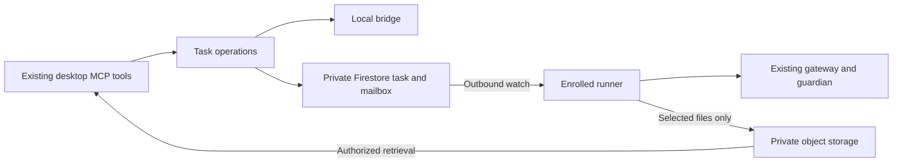

# Factory task contract

The [A2A 1.0.1 specification](https://a2a-protocol.org/v1.0.1/specification/) and
[normative proto at its release commit](https://github.com/a2aproject/A2A/blob/3303592588e388e62e0f69f701af531d2f4e3991/specification/a2a.proto)
pin the vocabulary. The contract covers task and context identity, message roles, input-required
continuation, terminal state, and distinct artifacts. Adopted semantics are exercised by the
normal Factory Node tests. A change to the adopted behavior updates the rule and its fixture
together. The Firestore documents are Factory's persistence format.

| Rule | Reference | Factory behavior |
| --- | --- | --- |
| Task versus context | A2A §3.4.2–3.4.3 | A reply retains its task ID. A fresh brief has a new task ID. A provider session ID is separate. |
| Task state and messages | A2A §4.1 | Map known lifecycle states to the pinned task enum and use the standard user and agent roles. |
| Idempotency | A2A §3.3.1 | Repeated cancellation has one effect. Factory additionally requires replay-safe submission and answer IDs. |
| Outputs | A2A §3.7 and §4.1 | The final summary is text. File artifacts carry independent metadata and an exact object reference. |

Claims, capacity, attempt identity, checkout ownership, approval policy, and the provider
session live in Factory. Firestore listeners wake runners and clients, and a transaction owns
the task, slot and writable workspace. An expired lease does not release ownership. An uncertain
attempt uses the indeterminate state and needs evidence of cleanup. The default pilot route
keeps each continuation on its claimed host. Commands address the exact attempt and question.

The local task projection, mailbox transactions, claims, and artifact staging have source
coverage. Remote activation also needs enrolled runner and controller identities, scoped
watches, authenticated mutation endpoints, and an end-to-end runner. The observer's dashboard
credentials do not grant those capabilities. Use the loopback emulator for source checks.

The cutover lets active local runs finish, retains the previous installed build, and checks a
local delegation before enabling one remote slot. Final acceptance requires a real controller
submission, a remote question and answer, and a returned artifact opened on the controller.
The standard A2A transport bindings, external discovery, and push notifications are outside
this contract.
