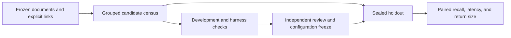

# Context retrieval evaluation

This study tests whether search returns useful evidence within a small startup
context allowance and whether the gain transfers to multi-round agent work.
The earlier Evo studies changed both the case source and the evidence rules.
Neither supplies an unopened holdout.

## Retrieval protocol



The unit is a repository-scoped information need with a known source and line
range. A task can yield a literal identifier lookup and a descriptive lookup.
Both stay in one group. Connect groups that share a direct source or target,
task ID, or repo-qualified PR. Report actual group counts before claiming
precision. Prefer a census to generating paraphrases to fill a quota. Target
2,400 independent development and 1,200 held-out groups if eligible. Keep about
one third of groups held out per repository and report lookup types separately.
Use a seeded hash of canonical group IDs. Do not reuse exposed benchmark
questions as new held-out evidence.

Use immutable file bytes from Evo, Lakina and Morpheus, with canonical authorized
meeting notes added from their own pinned manifest. All engines search the same
manifest within the same project scope. GitHub PR references are traversable
citations. PR contents and live external services are outside the corpus.
Track the source kinds covered by deterministic cases separately from the
documents indexed. A document without an explicit relationship can be searchable
even if it cannot supply a deterministic answer key.

Prefer objective repository relationships. A work log's roadmap field maps
to a canonical task. Use a distinctive work-log body line as evidence when
available, with alternative work logs counted as alternatives rather than extra
independent cases. For descriptive lookup use an independent linked record's
title or nearby text, without the target path or literal identifier. Resolved
Markdown heading links can target a line inside a section. The referring
record stays in the corpus but is excluded as a return candidate for its own
descriptive case. This study measures known-source retrieval, so open-ended
factual usefulness is assessed separately.

Primary outcome is evidence-span recall on descriptive cases at 1,000
returned tokens. Report literal-ID file recall separately. Also report
2,500 tokens, actual token counts, and total query time through
serialized tool output. Use a common source-citation formatter and tokenizer.
Only complete evidence lines count. Pin engine versions, the allowed search
scope and all settings before opening holdout. Report build time separately
from first-query and warm latency. Persist original responses, measure in a
counterbalanced order, count errors as misses and use paired uncertainty with
groups as the resampling unit. Report per-project and per-kind denominators.

## Agent workflow

A genuine historical request is a case. Compare ordinary search and file reads
with the same tools plus MiniSearch and a bounded startup brief. A fresh agent
can follow up in either arm. Use matched GPT-6 Luna settings through the
authorized Factory gateway, the same frozen sources and permissions, and
counterbalanced arm order. Pilot the runner and measure included weekly usage
before committing to 150 independent held-out tasks. Record task success against
frozen source-backed evidence, all-round elapsed time and context consumption.
Review ambiguous factual answers blind to arm. Keep the agent pilot separate
from the deterministic benchmark and report its actual denominator.

## Run order

1. Verify hashes and census the frozen inputs.
2. Run synthetic harness tests and a real development-only smoke.
3. Have a fresh reviewer inspect the protocol, code and tests. Resolve findings.
4. Freeze configuration, fixture hashes and development selection.
5. Run the sealed holdout once, independently recompute scores and publish
   aggregate results. Keep private fixture text and raw outputs outside Git.

## Engine and output contract

| Method | Retrieval and passage selection |
|---|---|
| `ripgrep` | Exact roadmap ID when present, otherwise an OR of distinct query terms. Rank matching lines by number of distinct terms, with path and line tie breaks. Select the nearest shared window containing the matched line. |
| `mini-body` | MiniSearch 7.2.0 over 16-line windows with 4-line overlap. Index body text. |
| `mini-context` | Same windows with indexed title, heading and path. Fixed boosts of 2.5, 2, 1.5 and 1 for title, heading, path and body. |
| `qmd-bm25` | QMD 2.8.3 lexical document rank. Choose a window around the strongest lexical line in each document. |
| `qmd-hybrid` | Optional QMD lexical plus local vector without expansion or reranking. Use a window around the matched QMD chunk when anchored, with the BM25 window rule as fallback. |

All adapters draw from the same 16-line windows with 4-line overlap.
Line-ranked adapters select the nearest window containing the match.
The bounded ripgrep adapter is a one-query baseline. The full ordinary
agent workflow has its own baseline. QMD operates on a private projection that
keeps file basenames, maps hits back to canonical paths and checks inventory size.
The shortlist limit is 40 results per adapter. The shared formatter returns
at most two non-overlapping spans per file. An entry that would exceed the cap
is skipped intact. Measure retrieval once per case and method and add the
separately timed packing and serialization at each budget. Report the first
query per method and project after setup and the distribution of later queries.
Raw measurements are in `responses.jsonl`; do not sum two budget columns as
if both were separate invocations. Optional hybrid results require pinning
the local embedding model and recording setup time.

Input JSON contains `seed`, `exposedPaths` keyed by project name, and a
`projects` array of `{name, repository, sources: [{root, manifest}]}`. Source paths are
absolute. The repository is the canonical owner/name used for PR grouping.
A manifest lists a Git revision and canonical Markdown paths with
SHA-256 digests. It may be the existing context snapshot or meeting manifest.
Keep input, output and snapshots in a private directory. From the repository
root, with dependencies installed and private paths supplied:

```sh
node --test qa/evals/context-retrieval/*.test.mjs
export TOKENIZER_MODULE=/private/runtime/node_modules/js-tiktoken/dist/index.js
export QMD_MODULE=/private/qmd/node_modules/@tobilu/qmd/dist/index.js
node qa/evals/context-retrieval/run.mjs frame "$input" "$frame"
node qa/evals/context-retrieval/run.mjs run "$input" "$frame" "$pilot" pilot
python3 qa/evals/context-retrieval/report.py "$frame" "$pilot"
node qa/evals/context-retrieval/run.mjs run "$input" "$frame" "$dev" dev
python3 qa/evals/context-retrieval/report.py "$frame" "$dev"
VERIFIED_DEVELOPMENT_RUN="$dev" node qa/evals/context-retrieval/run.mjs \
  run "$input" "$frame" "$holdout" holdout
python3 qa/evals/context-retrieval/report.py "$frame" "$holdout"
```

Use js-tiktoken 1.0.21 and Python tiktoken 0.14.0 with `o200k_base`. The last
argument to the runner can explicitly list methods. Keep ripgrep in the list
for reporting. The frame command only emits counts and digests on stdout.
The held-out runner refuses missing development verification or method,
version, code, corpus or frame drift. This is a procedural lock; a human
or agent with filesystem access could open the sealed file. Do not inspect it
for tuning. The independent verifier checks the complete result matrix,
rerenders citations from source, recounts tokens with Python, rescores evidence
and reports equal-group-weighted paired bootstrap intervals. Thin slices
describe the sample and have wide uncertainty.
